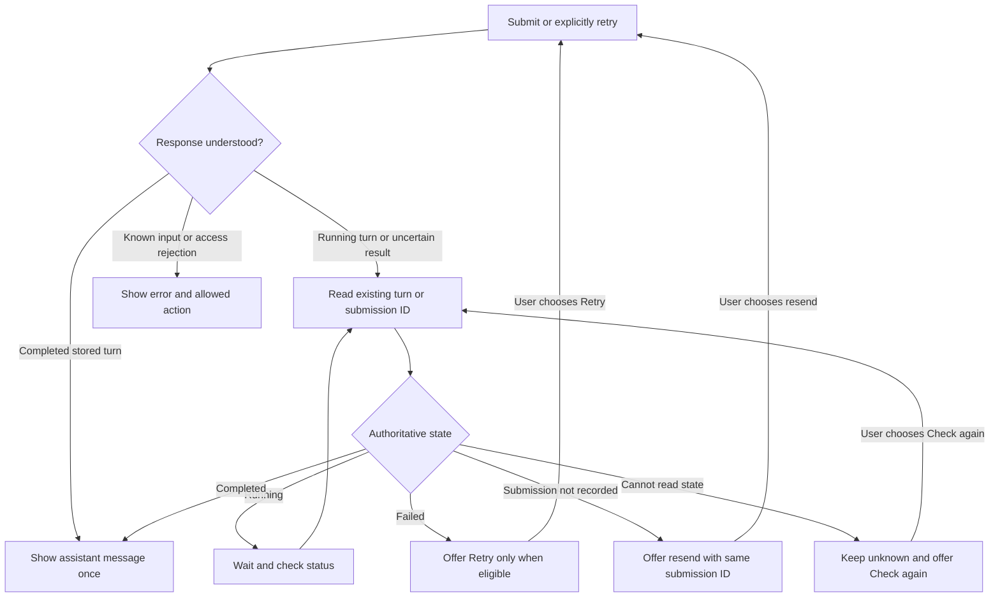

# Gusto NutriBite: API Contract

Status: v1 API implemented for the Phase 1 local scripted foundation, 11 October 2026. Real-provider and release verification remain outstanding.

Last updated: 11 October 2026.

## 1. Purpose and scope

This document defines the HTTP contract between chat and backend: paths, payloads, validation, ownership, completion, errors, and recovery. It carries forward the adopted [architecture](architecture.md), [product requirements](product-spec.md), and [UX](ux-flow.md). The [implementation plan](phase-wise-implementation-plan.md) adopts these as the M1 baseline; actual provider compatibility and executable schema checks remain required.

Use this document as the home for public field names and wire behavior. Database tables are defined in the draft [data model](data-model.md); policy and privacy rules belong in `safety-and-security.md`; prompts belong in `prompt-spec.md`. Once code exists, link the runtime schemas here and check that they match this contract.

Executable owners: [strict public schemas](../src/contracts/api.ts), [bounded raw JSON reader](../src/server/validation/json.ts), [HTTP adapter](../src/server/http.ts), and [Next.js route](../src/app/api/v1/[[...path]]/route.ts). Phase 1 preserves the public citation union and enforces null sources at acceptance/storage. Phase 2 adds strict classifier/reviewer schemas and code policy gates; scripted outcomes remain software fixtures, not model evaluation. The local network quota subject is one loopback group; forwarded headers are ignored. Public network identity and secure-cookie deployment must be implemented/verified before production is enabled.

Milestone 1 answers without retrieval. Milestone 2 uses the same API version, endpoints, interface, and response shapes; it fills the citation fields defined here. There is no public provider, prompt-editing, evaluation, or retrieval endpoint.

## 2. HTTP conventions

| Item | Contract |
| --- | --- |
| Base path | `/api/v1` on the same origin as the web app. No public deployment URL exists yet. |
| Transport | HTTPS in production. Local HTTP is allowed only for local development. |
| Request encoding | UTF-8 JSON for POST requests, with `Content-Type: application/json`. An optional `charset=utf-8` parameter is allowed. |
| Response encoding | `application/json; charset=utf-8`. No HTML error pages from application handlers. |
| Request size | Initial maximum 16,384 bytes, enforced while reading the body, before parsing. Compressed request bodies are not supported. |
| Field names | `snake_case`. Fields declared in a response type are required; use explicit `null` where declared nullable. |
| Unknown fields | Reject unknown request fields and query parameters. Validate server output against strict schemas. |
| IDs | Canonical lowercase UUID strings. Client operation IDs use random UUIDv4; server resource IDs are opaque UUIDs. IDs are not credentials. |
| Time | UTC RFC 3339 strings with milliseconds, such as `2026-10-11T06:00:00.000Z`. Clients display local time separately. |
| Counts | Finite JSON integers within JavaScript's safe integer range; counters are nonnegative unless a positive minimum is specified. |
| Caching | All endpoints return `Cache-Control: no-store`. Personalized responses also use `private`; do not put them in framework or shared caches. |
| Credentials | Session cookie only. Do not accept session tokens, API keys, roles, or ownership claims in request bodies or URLs. |
| Correlation | Every application response has `X-Request-ID`, matching `meta.request_id`. Generate a new server request ID for each HTTP request, including a replay. |
| Unsupported methods | `405 METHOD_NOT_ALLOWED` with an `Allow` header. Unknown API paths return `404 ENDPOINT_NOT_FOUND`. |

GET requests have no body. No endpoint accepts query parameters in this version. Reject malformed JSON, duplicate JSON object keys, invalid UTF-8, unpaired Unicode surrogates, and U+0000 (NUL) in strings. NUL cannot be stored in PostgreSQL text/JSONB; reject it as `400 INVALID_REQUEST` before acceptance rather than removing it. The same character in generated content fails output validation. Do not coerce strings into numbers or accept `null` for a required object/string.

An intermediary may still return a non-JSON error or drop a connection. The client treats an unreadable response to a mutation as an uncertain outcome and follows Section 9; it must not infer that the mutation failed.

### Session and CSRF rules

Use the anonymous cookie session described in [the architecture](architecture.md#4-conversation-and-session-design). The production cookie name is `__Host-nutrition_session`, with `HttpOnly`, `Secure`, `SameSite=Lax`, `Path=/`, and no `Domain`. A separately named local-development cookie may omit `Secure`; it must never be used in production.

All conversation, turn, submission-status, and retry endpoints require a live session and a server-side ownership check. Missing, invalid, expired, and revoked sessions receive the same `401 SESSION_UNAVAILABLE`. Do not create a replacement session as a side effect of these requests.

Mutating requests require an exact allowed `Origin`. All POST endpoints except session establishment also require `X-CSRF-Token`, obtained from the session response and bound to that session. Missing or mismatched tokens receive `403 REQUEST_FORBIDDEN`. Keep the CSRF token in memory, not a URL. It is distinct from the session credential; knowing it alone grants no access. The adopted construction is defined in [safety and security](safety-and-security.md#csrf-construction-and-rotation).

Session establishment is the bootstrap exception: require the allowed Origin and JSON content type, but no existing CSRF token. Do not enable cross-origin credentialed CORS. Browser same-origin protections and the server checks must also hold for local evaluation clients, which should follow the same session/CSRF flow.

### Shared envelopes

```typescript
type UUID = string;
type Timestamp = string;

type Meta = {
  request_id: UUID;
  server_time: Timestamp;
};

type Success<T> = {
  data: T;
  meta: Meta;
};

type Failure = {
  error: ApiError;
  meta: Meta;
};
```

A response contains either `data` or `error`, never both. Section 8 defines `ApiError`. Successful reads may return a turn whose stored status is `failed`; HTTP success means the read worked, not that an answer completed.

## 3. Endpoint index

All paths below are relative to `/api/v1`.

| Method and path | Purpose | Normal response |
| --- | --- | --- |
| `POST /session` | Establish or reuse an anonymous session | `201` created; `200` reused |
| `GET /session` | Check the existing session and read safe client settings | `200` |
| `POST /conversations` | Create an owned conversation, safely replayable | `201` created; `200` replayed |
| `GET /conversations/{conversation_id}` | Restore ordered turns and current status | `200` |
| `POST /conversations/{conversation_id}/turns` | Accept and execute one user question | `201` completed; errors as in Section 8 |
| `GET /conversations/{conversation_id}/turns/{turn_id}` | Read one owned turn without generating | `200` |
| `GET /conversations/{conversation_id}/submissions/{client_submission_id}` | Recover when the client does not know the turn ID | `200` recorded or not recorded |
| `POST /conversations/{conversation_id}/turns/{turn_id}/attempts` | Explicitly retry the latest failed turn | `201` completed; errors as in Section 8 |
| `GET /health/live` | Check application process health | `200` |
| `GET /health/ready` | Check configuration, database, and schema readiness | `200` ready; `503` not ready |

Replaying an accepted submit/retry returns `200` with the existing operation receipt and current turn, which may be running, completed, or failed. A replay never starts generation. This is distinct from making a new attempt.

The first submit/retry handler awaits execution as specified in [the request lifecycle](architecture.md#5-request-lifecycle-and-recovery). It does not return `202` and launch background work. A running turn is observable through concurrent reads or a replay while its original handler runs. Interrupted attempts are resolved by their stored deadlines.

## 4. Public resource schemas

### Session settings

```typescript
type ClientLimits = {
  question_max_code_points: number;
  request_body_max_bytes: number;
  conversation_max_turns: number;
  attempts_max_per_turn: number;
  attempt_timeout_seconds: number;
};

type SessionView = {
  latest_conversation_id: UUID | null;
  expires_at: Timestamp;
  csrf_token: string;
  limits: ClientLimits;
  provider_mode: "scripted" | "groq";
  generation_enabled: boolean;
  diagnostics_enabled: boolean;
};
```

All limits are positive integers. Initial default values are `2000`, `16384`, `20`, `3`, and `60`, respectively, from [the architecture configuration](architecture.md#initial-configuration-defaults). The server returns effective values; clients must not hardcode these examples. Session expiry remains seven days absolute under the adopted architecture default; reading or reusing the session does not extend it.

`latest_conversation_id` is the most recently updated conversation with at least one accepted turn belonging to this live anonymous session, or `null` when none exists. It is derived from owned stored conversations, not supplied by the client. Empty conversations are skipped; ties use creation time and ID. It lets startup recover saved messages when tab storage is missing/unavailable. An existing valid tab reference takes precedence, including an explicitly created empty chat. The client reads the selected conversation through the ordinary authorized endpoint; lookup never submits or retries a turn. It is not a cross-session lookup or a history-list endpoint.

The CSRF token is an opaque base64url string of 43–128 characters. No raw session token, session database ID, provider setting, token budget, or secret appears in this response. Internal context and model limits stay on the server.

### Answer content and citation schema

This content object is the structured model-output boundary. The surrounding message and request metadata are added by server code.

```typescript
type Source = {
  id: string;
  title: string;
  url: string | null;
  locator: string | null;
};

type Claim = {
  text: string;
  source: Source | null;
};

type AnswerContent = {
  answer: string;
  claims: Claim[];
};
```

| Field | Validation |
| --- | --- |
| `answer` | String, 1–6,000 Unicode code points, with at least one non-whitespace character. |
| `claims` | Array, 0–20 entries. Required even when empty. |
| `claims[].text` | String, 1–600 code points, with at least one non-whitespace character. |
| `claims[].source` | Required. Either `null` or a complete `Source` object. Milestone 1 adds the stricter rule below. |
| `source.id` | Server-assigned citation identifier matching `^[A-Za-z0-9_-]{1,128}$`; not an arbitrary model-created identifier. |
| `source.title` | Non-whitespace string, 1–300 code points. Plain text. |
| `source.url` | `null`, or an absolute HTTPS URL of at most 2,048 code points. No credentials, control characters, or executable schemes. No relative, `file:`, `data:`, or `javascript:` URLs. |
| `source.locator` | `null`, or a non-whitespace string of 1–300 code points identifying a page, section, or passage. |

Every nested object is strict: reject unexpected keys, omitted required keys, and wrong types. These sizes are adopted protocol validation limits consistent with the architecture; they are not target answer lengths. Prompt style belongs in `prompt-spec.md`.

Milestone rules:

1. **Milestone 1:** Every `source` must be exactly `null`. A non-null source fails validation even if it has a valid citation shape. Do not remove it to make the answer pass.
2. **Milestone 2:** The same union accepts citations. Each non-null source must exactly match a server evidence record retrieved for that turn. A repeated source ID must resolve to the same metadata. Resolve whether a claim is supported by the evidence during validation/evaluation; an HTTPS link alone is not proof.
3. An authority named in answer prose never becomes a source automatically. The sources panel derives entries only from accepted non-null source objects and deduplicates by `source.id`.
4. An empty claims array is allowed when a response makes no factual statements, including a non-factual refusal or clarification. Do not invent claims to fill it. Factual statements must be represented in the claims list; evaluate missing or contradictory claims because schema checks cannot establish truth or complete coverage.

Require native structured output and a complete provider response. Reject prose-only, cut-off, malformed, or invalid output. Do not extract JSON from prose, repair it, silently truncate strings/arrays, or automatically regenerate after validation failure. Code-authored templates pass the same content schema and milestone checks.

### Messages, attempts, and turns

```typescript
type ResponseKind = "answer" | "refusal" | "clarification";
type TurnStatus = "running" | "completed" | "failed";

type UserMessage = {
  id: UUID;
  role: "user";
  text: string;
  created_at: Timestamp;
};

type AssistantMessage = {
  id: UUID;
  role: "assistant";
  kind: ResponseKind;
  content: AnswerContent;
  created_at: Timestamp;
};

type AttemptView = {
  id: UUID;
  number: number;
  client_attempt_id: UUID | null;
  started_at: Timestamp;
  deadline_at: Timestamp;
  finished_at: Timestamp | null;
};

type AttemptFailure = {
  code: AttemptFailureCode;
  message: string;
  retry_at: Timestamp | null;
};

type RetryEligibility = {
  allowed: boolean;
  reason: "turn_running" | "turn_completed" | "not_latest_turn"
    | "attempt_limit_reached" | null;
  attempts_remaining: number;
};

type TurnView = {
  id: UUID;
  conversation_id: UUID;
  conversation_revision: number;
  client_submission_id: UUID;
  sequence: number;
  status: TurnStatus;
  user_message: UserMessage;
  assistant_message: AssistantMessage | null;
  current_attempt: AttemptView;
  failure: AttemptFailure | null;
  retry: RetryEligibility;
};

type ConversationView = {
  id: UUID;
  created_at: Timestamp;
  revision: number;
  turn_count: number;
  active_turn_id: UUID | null;
  turns: TurnView[];
};

type TurnRead = { turn: TurnView };

type OperationResult = {
  turn: TurnView;
  operation: {
    attempt_id: UUID;
    replayed: boolean;
  };
};

type SubmissionLookup = {
  recorded: boolean;
  turn: TurnView | null;
};
```

`AttemptFailureCode` is defined in Section 8. Its safe message is 1–300 code points. Attempt numbers and turn sequences start at `1`. The first attempt has `client_attempt_id: null`; retries carry the supplied client attempt ID. A turn keeps its user-message ID and sequence across retries.

`SessionView.diagnostics_enabled` reports the local operator's temporary capture switch for the privacy notice. No public endpoint enables, reads or deletes diagnostic content. Normal conversation/turn responses remain unchanged and never include a rejected candidate.

Messages are nested in ordered turns to avoid returning two competing copies of the transcript. Render each turn's user message, then its assistant message if present. Failed/running turns have one visible question and a status, not an invented assistant message.

The original submitted user text is preserved. Its trimmed form must satisfy the question limit in Section 7; the raw string is also bounded by the request-body limit. The server determines roles, response kind, sequence, times, ownership, and status. Clients cannot provide these fields.

### State and ordering invariants

| Turn status | Assistant message | Failure | Attempt finish time | Retry |
| --- | --- | --- | --- | --- |
| `running` | `null` | `null` | `null` | Not allowed; reason `turn_running`. |
| `completed` | Required; validated and committed | `null` | Required | Not allowed; reason `turn_completed`. |
| `failed` | `null` | Required | Required | Allowed only for the latest accepted turn with attempts remaining. |

For a failed turn, use `not_latest_turn` before `attempt_limit_reached` if both apply. An eligible failed turn has `allowed: true` and `reason: null`. `attempts_remaining` is `max(0, configured maximum - current_attempt.number)`; it does not by itself grant permission to retry. Transient limits or service outages may still reject an eligible attempt.

A completed refusal or clarification follows exactly the completed state. Neither gets a Retry action. Unsafe or invalid candidates never appear in `assistant_message`, `failure.message`, or HTTP error details.

`ConversationView.turns` contains all accepted turns in ascending, contiguous sequence order. `turn_count` equals its length, including refusals and failed questions; retries do not increase it. With the adopted 20-turn bound, there is no pagination or silent omission. An empty conversation has `revision: 0`, `turn_count: 0`, `active_turn_id: null`, and `turns: []`.

Maintain a monotonically increasing conversation revision. Increment it atomically whenever a turn starts, completes, fails, or begins another attempt. A conversation response is a consistent snapshot: every nested `conversation_revision` equals the top-level `revision`. At most one turn is running, and `active_turn_id` identifies it; otherwise it is `null`.

Single-turn reads and operation results carry that same snapshot revision. Ignore delayed snapshots older than the latest revision already observed for the conversation. Merge by IDs, not array position or timestamps. Replayed operations can refer to an earlier `operation.attempt_id` while `turn.current_attempt` describes a later attempt; render the current turn and never treat replay as permission to run the old operation again.

## 5. Session and conversation endpoints

### Establish or read a session

`POST /session` accepts exactly `{}`. With no live cookie, it creates a session and returns `201 Success<SessionView>` plus `Set-Cookie`. With a live cookie, it returns `200 Success<SessionView>` without rotating identity or extending expiry. An invalid or expired cookie may be replaced only through this explicit endpoint.

`GET /session` returns `200 Success<SessionView>` for a live session and `401 SESSION_UNAVAILABLE` otherwise. It never creates or extends a session. Neither operation creates a conversation or calls a model.

On first use with no saved chat, establish a session. On refresh with a saved chat, read the existing session first. If it is unavailable, show the unavailable-conversation flow; establish a replacement only when the user chooses to start a new chat. Never silently attach an old conversation ID to a new session.

Serialize session bootstrap within a tab. Bootstrap is idempotent only when the browser presents the live cookie; if the cookie response is lost, repeating it may leave an unused empty session. Confirm a successful session read before creating a conversation. Do not use a browser-readable operation ID as an alternative session credential. Unused-session cleanup belongs in the data/privacy design.

### Create a conversation

`POST /conversations`

```json
{
  "client_conversation_id": "10000000-0000-4000-8000-000000000001"
}
```

Persist this client ID before the request and retain it until the result is confirmed. A new accepted operation returns `201 Success<ConversationView>` containing an empty conversation, with `Location: /api/v1/conversations/{id}`.

The pair `(session, client_conversation_id)` is unique. Repeating it returns `200` and the same conversation's **current** snapshot, even if that conversation has since gained turns. It never creates a second conversation or clears existing messages. On an uncertain creation response, repeat this POST with the same ID; it has no generation side effect.

Only update the browser's active conversation after success. Creation does not delete, cancel, or reassign another conversation. The UI follows the unsent-draft and pending-request rules in [UX-06](ux-flow.md#ux-06-start-a-new-chat). Separate tabs may own separate conversations under the same session.

### Read a conversation

`GET /conversations/{conversation_id}` returns `200 Success<ConversationView>`. Check the live session and ownership before reading. Reconcile an expired running attempt before constructing a snapshot, following architecture's completion fence. This housekeeping cannot invoke a model.

An absent, deleted, or unowned conversation returns the identical `404 CONVERSATION_UNAVAILABLE` response. A storage failure returns `503 STORAGE_UNAVAILABLE`, never an empty conversation. Keep visible messages while loading fails, as required by [UX-07](ux-flow.md#ux-07-refresh-or-return).

## 6. Submission, status, and retry endpoints

### Submit a question

`POST /conversations/{conversation_id}/turns`

```json
{
  "client_submission_id": "20000000-0000-4000-8000-000000000001",
  "question": "How does steaming change the texture of vegetables?"
}
```

The client creates and saves the submission ID before sending. A newly completed answer, refusal, or clarification returns `201 Success<OperationResult>`, with `operation.replayed: false` and `Location` pointing to the turn read endpoint. `operation.attempt_id` identifies the first attempt. Return only after validated assistant content and completion state commit together.

If execution fails after acceptance, return the corresponding non-2xx `Failure` from Section 8. Include owned recovery IDs and direct the client to check status. Do not include the rejected candidate. If storage cannot confirm the outcome, report `operation_state: "unknown"`; do not claim a stored failure.

An existing `(conversation_id, client_submission_id)` with the same normalized question returns `200 Success<OperationResult>` with `replayed: true`. Return its current turn snapshot, even if running or failed. Do not make another provider call, consume another generation attempt, or append another user message. The original request's first attempt ID remains the operation receipt.

The same submission ID with a different normalized question returns `409 IDEMPOTENCY_CONFLICT`. A genuinely edited question needs a new submission ID, and can be accepted only after the previous running turn resolves.

### Read a known turn

`GET /conversations/{conversation_id}/turns/{turn_id}` returns `200 Success<TurnRead>` for any stored state. A failed turn is a successful status read with `status: "failed"`; render its safe failure message and follow `retry.allowed`.

Check conversation ownership first. A turn missing from that owned conversation, including an ID belonging to another conversation, returns `404 TURN_UNAVAILABLE`. Do not reveal where it belongs. Reconcile deadlines before returning status. Polling never invokes generation or extends an attempt deadline.

### Recover by submission ID

`GET /conversations/{conversation_id}/submissions/{client_submission_id}` returns `200 Success<SubmissionLookup>` after checking the conversation owner.

- Recorded: `recorded: true`, with the current `TurnView` in `turn`.
- Not recorded: `recorded: false`, `turn: null`.

Not recorded means no matching turn was visible in that authoritative database read. An earlier HTTP request might still arrive and accept it. Therefore, any resubmission must reuse the same submission ID and normalized question. Do not generate a new ID on this evidence.

Read from the authoritative database, not a lagging replica or cache. A database outage is `503`, not `recorded: false`. Do not return the unrecorded result for a missing or unowned conversation; return `404 CONVERSATION_UNAVAILABLE` instead.

### Explicitly retry a failed turn

`POST /conversations/{conversation_id}/turns/{turn_id}/attempts`

```json
{
  "client_attempt_id": "30000000-0000-4000-8000-000000000002",
  "failed_attempt_id": "40000000-0000-4000-8000-000000000001"
}
```

`failed_attempt_id` must match the current failed attempt observed by the client. `client_attempt_id` identifies this deliberate retry and is persisted before sending. This request contains no question; the server reuses the stored question and conversation. A changed question belongs on the submit endpoint.

Under the same lock/transaction, confirm that the turn is failed, is still the latest accepted turn, has attempts remaining, and still references `failed_attempt_id`. Acquire one new attempt, keep the existing user message and sequence, and run normal validation and safety. Never bypass those checks on retry.

A newly completed attempt returns `201 Success<OperationResult>` with `replayed: false`. `Location` points to the turn read endpoint. Execution failures follow the same error rules as initial submission.

The pair `(turn_id, client_attempt_id)` is unique. Check for an existing retry receipt **before** checking whether `failed_attempt_id` is still current. The same ID and failed-attempt reference returns `200 Success<OperationResult>` with `replayed: true`, the matched attempt ID, and the current turn snapshot. It cannot create an additional attempt even if that earlier retry failed.

Reusing the client attempt ID with a different failed-attempt reference returns `409 IDEMPOTENCY_CONFLICT`. A new retry ID targeting an outdated attempt returns `409 STALE_ATTEMPT`. If another attempt is running, return `409 TURN_ACTIVE`; if the turn completed, is no longer latest, or exhausted its attempts, return `409 RETRY_NOT_ALLOWED`. The client rechecks status rather than treating any of these conflicts as a failed new attempt.

Retries are always explicit user actions. Replaying a lost retry request keeps both IDs unchanged; choosing Retry after that attempt is confirmed failed uses a fresh client attempt ID and the newly observed failed attempt ID.

## 7. Input validation and idempotency rules

### Question normalization

Decode valid Unicode, convert CRLF and standalone CR line endings to LF, then apply ECMAScript string trimming to the start and end. This normalized string is used for emptiness, code-point length, context sizing, generation input, and the idempotency hash. Preserve the first accepted raw question separately for display/evaluation.

Do not lowercase, collapse internal spaces, remove punctuation, or apply Unicode compatibility normalization for idempotency. Safety may inspect a separate normalized copy without changing the saved request identity. Replaying with different leading/trailing whitespace or equivalent line endings returns the first accepted message; other changed content conflicts.

Reject an empty normalized question or one over the effective code-point limit with `422 VALIDATION_FAILED`. Accept input exactly at the limit when the conversation budget also permits it. Count code points, not UTF-16 code units or grapheme clusters. The outer 16 KiB body limit is independent, including for whitespace-heavy or heavily escaped JSON.

Reject fields such as `messages`, `history`, `role`, `system_prompt`, `model`, `claims`, and `source`. Conversation history comes only from owned stored records. Do not accept attachments, tool calls, or client-supplied safety verdicts.

### Acceptance order and conflicts

Apply these checks without widening access:

1. Enforce transport/body rules, parse the strict request, and verify allowed Origin, live session, CSRF, and ownership as applicable.
2. Look up an existing operation ID and compare its normalized payload. Return the stored receipt/current snapshot on a match. A generation shutdown or exhausted conversation limit must not turn a valid replay into new work.
3. For a new operation, check active-turn conflicts, retry preconditions, conversation capacity, service availability, and generation limits. Recheck race-sensitive conditions in the acceptance transaction.
4. Atomically reserve capacity and save the question/attempt before any provider call. A rejected operation consumes no accepted-turn sequence or attempt number. General abuse/read limits may still count the HTTP request.
5. Commit completion or a known failure with the architecture's current-attempt fence. Replays and status reads report stored state; they do not resume abandoned computation.

For initial submission, `409 CONVERSATION_BUSY` means another turn is running; include only its owned turn ID for status recovery. `409 CONVERSATION_LIMIT_REACHED` means a new question exceeds the turn or full-context budget; preserve history and offer a new chat. Do not trim older context to accept it.

Retain operation receipts for as long as their owning conversation is accessible. Do not evict them on a short response-cache timer. M1 purges conversations only after owner expiry/revocation; old sessions and operation IDs cannot recreate them. Do not delete individual conversations under a live session or add a tombstone/deletion-receipt protocol for the deferred manual control.

Exactly one accepted turn and at most one assistant response per turn are application guarantees. Exactly one paid provider request is not guaranteed after network failures. Measure known attempts and usage as required by [the efficiency guide](token-optimization-and-efficiency.md); unavailable usage is unknown, not zero.

## 8. Errors and recovery instructions

### Error schema

```typescript
type ApiError = {
  code: ApiErrorCode;
  message: string;
  operation_state: "not_accepted" | "accepted" | "unknown" | "not_applicable";
  field_errors: Array<{ field: string; message: string }>;
  recovery: {
    action: "edit_request" | "check_status" | "repeat_request"
      | "reload_conversation" | "refresh_session" | "start_new_chat" | "none";
    conversation_id: UUID | null;
    client_submission_id: UUID | null;
    turn_id: UUID | null;
    client_attempt_id: UUID | null;
    retry_after_seconds: number | null;
  };
};
```

`ApiErrorCode` is the closed set of codes in the two tables below. `message` is safe plain text of 1–300 code points. `field_errors` contains at most 10 entries, each with a field name of 1–100 code points and a safe message of 1–300 code points; use `[]` outside field-validation errors. Do not echo submitted text, invalid model content, stack traces, database errors, safety classifier rationale, or provider payloads.

`operation_state` refers to the mutation attempt requested by this HTTP call:

- `not_accepted`: the server established that this call did not accept a new operation. A concurrent request with the same ID may still exist; conflicts direct the client to status.
- `accepted`: acceptance is known, and a stored outcome can be checked. This does not mean the turn completed successfully.
- `unknown`: acceptance or final commit cannot be established. Check the existing ID before offering another attempt.
- `not_applicable`: a read, session operation, or request without an identifiable generation/conversation mutation.

Recovery IDs are nullable. Return references only after verifying their ownership; never expose another visitor's IDs. The client retains its own recovery marker even if an error cannot safely return references. A status action uses the turn endpoint when its ID is known and the submission lookup otherwise.

`repeat_request` means retry the same operation or read with the same payload and operation IDs, after an explicit user action. It does not mean generate a new attempt. `check_status` is also read-only with respect to generation. `reload_conversation` means read the owned conversation again; `refresh_session` means GET session metadata, not create a replacement session. A status result with an eligible failed turn is what enables the separate Retry action.

When a wait duration is known, return a positive integer `retry_after_seconds` and a matching integer-seconds `Retry-After` header. Otherwise use `null` and omit the header. A wait does not authorize automatic regeneration. A rate-limited status read should be repeated as a read after the wait.

### Request, access, and availability errors

| HTTP | Code | Meaning and client action |
| --- | --- | --- |
| `400` | `INVALID_REQUEST` | Invalid JSON/encoding, duplicate keys, malformed path ID, unsupported query, or unexpected GET body. Fix the request. |
| `401` | `SESSION_UNAVAILABLE` | Missing, expired, invalid, or revoked session. Show unavailable history; establish a replacement only through the new-chat flow. |
| `403` | `REQUEST_FORBIDDEN` | Origin or CSRF check failed. Do not resend generation automatically; refresh session metadata if the cookie is still valid. |
| `404` | `CONVERSATION_UNAVAILABLE` | Conversation absent, deleted, or unowned. Same message and shape for all three. Offer a new chat. |
| `404` | `TURN_UNAVAILABLE` | Turn absent from the owned conversation. Reload its history; do not guess another conversation. |
| `404` | `ENDPOINT_NOT_FOUND` | Unknown API path. No recovery mutation. |
| `405` | `METHOD_NOT_ALLOWED` | Unsupported method. Correct the client; include `Allow`. |
| `409` | `IDEMPOTENCY_CONFLICT` | An operation ID was reused with a different normalized payload. Check the saved operation and correct the client action. |
| `409` | `CONVERSATION_BUSY` | A different turn is active. Check its status; the rejected new submission was not accepted. |
| `409` | `CONVERSATION_LIMIT_REACHED` | Turn/context limit reached. Start a new chat; preserve history. |
| `409` | `TURN_ACTIVE` | Retry target is currently running. Check status. |
| `409` | `STALE_ATTEMPT` | A new retry targeted an outdated failed attempt. Check status before another deliberate retry. |
| `409` | `RETRY_NOT_ALLOWED` | Completed turn, older turn, or exhausted attempts. Read current eligibility. |
| `413` | `BODY_TOO_LARGE` | Encoded request exceeds the body limit. Shorten it before resubmission. |
| `415` | `UNSUPPORTED_MEDIA_TYPE` | Request content type or content encoding is unsupported. Fix the request. |
| `422` | `VALIDATION_FAILED` | Body fields are missing/extra, wrong type, or out of bounds. Show field errors and keep the question editable. |
| `429` | `RATE_LIMITED` | Request or new-attempt quota exceeded. Respect a supplied wait; repeat the same operation only on user action. |
| `429` | `PROVIDER_RATE_LIMITED` | Known local account quota or provider cooldown blocks acceptance. No new turn/attempt is created; keep the draft and repeat the same operation after `Retry-After`, only on user action. |
| `503` | `PROVIDER_CAPACITY_EXCEEDED` | The request cannot fit the configured token ceiling even after waiting. Shorten the question, start a new chat, or ask the operator to review configuration. |
| `503` | `GENERATION_UNAVAILABLE` | Generation disabled or shared capacity unavailable before accepting new work. History/status remain readable. |
| `503` | `STORAGE_UNAVAILABLE` | Database read/write or commit status unavailable. Preserve visible content and follow the outcome rules below. |
| `503` | `SERVICE_NOT_READY` | Readiness check failed. Return only a safe message. |
| `500` | `INTERNAL_ERROR` | Unexpected application failure without a more specific safe code. Never expose internals. |

Choose the recovery action by condition: validation uses `edit_request`; owned turn conflicts use `check_status`; unavailable session/conversation or full history uses `start_new_chat`; missing turns use `reload_conversation`; a stale CSRF token uses `refresh_session`; safe replayable availability failures use `repeat_request`; forbidden origins or unsupported client behavior use `none`. For `STORAGE_UNAVAILABLE` or `INTERNAL_ERROR`, select state and action from the server's evidence, not from HTTP status alone.

If a conversation-creation commit is uncertain, use `unknown` and `repeat_request` with the same `client_conversation_id` retained by the client. If a submit/retry commit is uncertain, use `unknown` and `check_status`. If a read fails, use `not_applicable` and `repeat_request`. Only use `not_accepted` when non-acceptance is established.

### Accepted-attempt failures

`AttemptFailureCode` is the closed set below. These codes may appear both in a stored `TurnView.failure` and in the failed execution handler's HTTP error.

| HTTP from submit/retry | Code | Stored failure condition |
| --- | --- | --- |
| `429` | `PROVIDER_RATE_LIMITED` | A phase hits a local reservation limit or Groq HTTP 429 after acceptance. Store a retry time, hide any candidate and return matching `Retry-After`. |
| `503` | `PROVIDER_CAPACITY_EXCEEDED` | A later phase cannot fit the configured token ceiling; waiting alone cannot fix it. |
| `502` | `MODEL_SERVICE_FAILED` | Provider error or provider refusal outside the reviewed app response mapping. |
| `502` | `OUTPUT_INVALID` | Missing, malformed, truncated, oversized, wrong-type, or non-null-source Milestone 1 content. |
| `502` | `OUTPUT_REJECTED` | Candidate failed the app's output safety checks. Candidate stays hidden. |
| `502` | `SAFETY_CHECK_FAILED` | Required contextual classifier/output review could not return a usable verdict. Fail closed. |
| `504` | `ATTEMPT_TIMEOUT` | Shared attempt deadline expired; includes orphaned work reconciled after restart. |
| `503` | `STORAGE_FAILED` | Required exchange persistence failed and the server subsequently confirmed a terminal failed attempt. |
| `500` | `ATTEMPT_FAILED` | Other execution failure with a confirmed stored failed attempt. |

Use these execution errors with `operation_state: "accepted"` and `recovery.action: "check_status"` only after a failed state is confirmed. If the provider finished but the completion commit is uncertain, use `STORAGE_UNAVAILABLE` with `unknown` instead. Never declare failure and permit retry while a completion might already be committed.

If a handler loses its completion fence to a newer attempt or discovers a completed turn during reconciliation, return the authoritative current turn snapshot rather than overwriting its outcome with an old failure. This recovery response uses `200 Success<OperationResult>`; the operation receipt still identifies the attempt handled by that request.

Failure messages follow [UX-08](ux-flow.md#ux-08-recover-from-an-error) and the safe mappings in [errors.ts](../src/server/errors.ts). Distinguish quota, provider failure, unusable safety check and rejected output. Existing historical failure codes are preserved; reads use the current safe message for that code. The client shows Retry only when `retry.allowed` is true and disables generation while a known cooldown remains.

`failure.retry_at` is non-null exactly for `PROVIDER_RATE_LIMITED`. It is a stored UTC timestamp, so a history read/refresh retains the wait. Structural retry eligibility is unchanged by time; the backend rechecks cooldown and account usage before accepting a retry, without consuming an attempt when blocked. Known usage checks before acceptance cover the first model phase; each later phase still reserves separately. Another request or a larger candidate may exhaust capacity after acceptance. Retry times describe observed capacity, not a guaranteed reservation. No request is automatically queued or regenerated.

## 9. Client recovery sequence



1. Before a POST, persist the active conversation ID and relevant client operation IDs in `sessionStorage`. On retry, retain the failed attempt ID as well. Keep one visible question. The server remains authoritative if browser storage is unavailable.
2. On refresh, validate the existing session, then load the conversation and check the saved operation marker. If no usable tab marker exists, establish/reuse the anonymous session and read `latest_conversation_id`; restore that conversation before considering creation of a new empty chat. Preserve a valid tab reference even when it points to an explicitly created empty chat. Never send a generation POST automatically on page load.
3. If the turn ID is unknown, use the submission lookup. If recorded, adopt its server turn ID and merge the snapshot by revision. If unrecorded, an explicit resend uses the same ID and retained question. If the text was not saved and is no longer available after reload, explain that it cannot be recovered; do not invent or automatically resubmit it.
4. Poll running state every two seconds initially, backing off to five seconds after ten seconds. Stop automatic polling after 70 seconds from the start of that recovery window and offer Check again. These timings implement the architecture's polling defaults. Respect a larger `Retry-After` if provided.
5. A client timer never marks the stored attempt failed. Only the server can reconcile its database deadline. Check again can run after automatic polling stops without starting generation.
6. A failed turn allows a new attempt only through the explicit retry endpoint and current eligibility. An edited/new question uses a new submission ID after the previous turn resolves.
7. Clear the pending marker after authoritative resolution. Keep the active conversation ID for refresh recovery. Ignore stale responses from a previous active conversation or lower revision.

For a lost retry response, read the known turn. If the current attempt's `client_attempt_id` matches the pending marker, it was accepted. If it does not, replay the retry POST with the original client attempt ID and failed attempt ID only on explicit recovery action; deduplication/preconditions prevent a second attempt. Never replace the pending ID merely because the response was lost.

The API exposes no cancellation endpoint. Closing the page does not promise cancellation; an already running handler may commit before its deadline. New chat does not delete or cancel a saved exchange.

## 10. Worked wire examples

These are synthetic payload examples, not real model responses, nutrition guidance, evaluation results, or evidence that the endpoints exist. All IDs and timestamps are illustrative. CSRF and cookie values are intentionally omitted.

### Completed answer

For a newly accepted question, return HTTP `201`. The body is a complete `Success<OperationResult>`:

```json
{
  "data": {
    "turn": {
      "id": "50000000-0000-4000-8000-000000000001",
      "conversation_id": "60000000-0000-4000-8000-000000000001",
      "conversation_revision": 2,
      "client_submission_id": "20000000-0000-4000-8000-000000000001",
      "sequence": 1,
      "status": "completed",
      "user_message": {
        "id": "70000000-0000-4000-8000-000000000001",
        "role": "user",
        "text": "How does steaming change the texture of vegetables?",
        "created_at": "2026-10-11T06:00:00.000Z"
      },
      "assistant_message": {
        "id": "80000000-0000-4000-8000-000000000001",
        "role": "assistant",
        "kind": "answer",
        "content": {
          "answer": "Steaming generally softens vegetables. The final texture depends on the vegetable and cooking time.",
          "claims": [
            { "text": "Steaming generally softens vegetables.", "source": null },
            { "text": "The final texture depends on the vegetable and cooking time.", "source": null }
          ]
        },
        "created_at": "2026-10-11T06:00:08.000Z"
      },
      "current_attempt": {
        "id": "40000000-0000-4000-8000-000000000001",
        "number": 1,
        "client_attempt_id": null,
        "started_at": "2026-10-11T06:00:00.000Z",
        "deadline_at": "2026-10-11T06:01:00.000Z",
        "finished_at": "2026-10-11T06:00:08.000Z"
      },
      "failure": null,
      "retry": { "allowed": false, "reason": "turn_completed", "attempts_remaining": 2 }
    },
    "operation": {
      "attempt_id": "40000000-0000-4000-8000-000000000001",
      "replayed": false
    }
  },
  "meta": {
    "request_id": "90000000-0000-4000-8000-000000000001",
    "server_time": "2026-10-11T06:00:08.100Z"
  }
}
```

### Refusal message

This is only the `assistant_message` fragment for a separate completed turn. The surrounding turn follows the same completed-state invariants. Exact refusal wording remains owned by the prompt/safety documents.

```json
{
  "id": "80000000-0000-4000-8000-000000000002",
  "role": "assistant",
  "kind": "refusal",
  "content": {
    "answer": "I can't provide a personal calorie target. Please consult a qualified dietitian or healthcare professional.",
    "claims": []
  },
  "created_at": "2026-10-11T06:02:00.000Z"
}
```

### Submission not recorded

HTTP `200` from the owned submission lookup:

```json
{
  "data": { "recorded": false, "turn": null },
  "meta": {
    "request_id": "90000000-0000-4000-8000-000000000003",
    "server_time": "2026-10-11T06:03:00.000Z"
  }
}
```

### Unknown completion after storage trouble

HTTP `503`; the client checks the existing turn and shows no unsaved assistant answer:

```json
{
  "error": {
    "code": "STORAGE_UNAVAILABLE",
    "message": "We couldn't confirm whether your answer completed. Check its status before trying again.",
    "operation_state": "unknown",
    "field_errors": [],
    "recovery": {
      "action": "check_status",
      "conversation_id": "60000000-0000-4000-8000-000000000001",
      "client_submission_id": "20000000-0000-4000-8000-000000000001",
      "turn_id": "50000000-0000-4000-8000-000000000001",
      "client_attempt_id": null,
      "retry_after_seconds": null
    }
  },
  "meta": {
    "request_id": "90000000-0000-4000-8000-000000000004",
    "server_time": "2026-10-11T06:00:09.000Z"
  }
}
```

### State fixtures derived from the completed example

Use the complete example as a baseline fixture and apply all changes in a row together. This specifies running/failed variants without repeating the entire transcript.

| Fixture | Required changes |
| --- | --- |
| Running first attempt | Set `conversation_revision` to `1`, `status` to `running`, `assistant_message` to `null`, and `current_attempt.finished_at` to `null`; keep `failure: null`; set retry to `allowed: false`, reason `turn_running`, attempts remaining `2`. Use a server time before the attempt deadline. |
| Failed first attempt | Keep revision `2`; set status `failed`, assistant message `null`, and failure to code `OUTPUT_INVALID` with a safe message. Retain a non-null finish time. Set retry to `allowed: true`, reason `null`, attempts remaining `2`, provided this remains the latest turn. |
| Running second attempt | Keep the turn, sequence, question, and message ID; use revision `3`, a new current attempt ID, number `2`, the supplied client attempt ID, new start/deadline, and null finish time. Set status `running`, assistant message and failure to null, and retry reason `turn_running` with `1` attempt remaining. |

For replay fixtures, set `operation.replayed: true` and use HTTP `200`. For turn-status reads, the data object contains only `turn`, not `operation`. An unknown browser outcome has no successful TurnView fixture; it is an inability to establish state.

## 11. Health endpoints

`GET /health/live` is unauthenticated and returns `200 Success<{ status: "ok" }>`. It confirms that the process can serve the request and makes no database or model call.

`GET /health/ready` is unauthenticated and returns `200 Success<{ status: "ready" }>` only after checking required configuration, database connectivity, and compatible schema. Otherwise return `503 Failure` with `SERVICE_NOT_READY`, `operation_state: "not_applicable"`, empty field errors, null recovery references, and `recovery.action: "repeat_request"`.

Expose no connection strings, environment values, migration details, model credentials, or raw exceptions. Neither health endpoint makes a paid model call. Provider availability is checked through a controlled smoke test, not readiness polling. A disabled generation kill switch does not make history/status unreadable or automatically make the application unready.

## 12. Compatibility, privacy, and handoff

### Contract stability

Keep this API unchanged when enabling Milestone 2. The public `Source | null` union already supports citations. Milestone policy and retrieval validation change behind it; no client field selects a milestone or bypasses source rules.

Materialize and verify the complete adopted v1 schemas, including citations, envelopes, and error enums, before freezing the executable contract for release. An incompatible change after release requires explicit versioning and migration. An internal provider schema can be narrower, but must map to and pass the public runtime schema. This document does not choose provider endpoint syntax or expose provider response objects.

Idempotent replay of a stored response is request recovery, not an answer cache. A fresh evaluation repetition uses a new submission ID and the conversation conditions specified by `evaluation.md`; repeating the same HTTP operation must not count as a new model sample.

### Privacy implementation boundary

New chat does not delete messages. M1 uses seven-day session access and bounded automatic cleanup after expiry/revocation under [safety and security](safety-and-security.md#7-privacy-retention-and-cleanup). Manual session-wide deletion is deferred as [FB-001](feature-backlog.md#backlog). There is no M1 deletion endpoint, receipt, confirmation UI, or post-revocation replay contract to implement.

Rate limits, retention, operator access, user notice, and CSRF are owned by safety/security; operational procedures belong in [deployment/operations](deployment-and-operations.md). Verify actual enforcement and provider/backup limits before public operation. Do not claim a deletion control exists or accept chat text as a data-control command.

### Contract checks to carry into testing

| Area | Required check | Requirement references |
| --- | --- | --- |
| Request parsing | Reject malformed/duplicate-key JSON, unsupported content type, unknown fields, invalid Unicode, and oversized bodies without a model call. Test exact input boundaries. | CHAT-06, SYS-04 |
| Content | Strict answer/claim schema; reject non-null sources in Milestone 1, truncation, extra fields, and repaired prose. Accept non-factual empty-claim templates. | ANS-01–ANS-04 |
| Ownership | A second session cannot read conversation history, poll by either ID, submit, or retry another visitor's turn. | SYS-02 |
| Idempotency | Same ID/payload replays once; changed payload conflicts; concurrent first submissions and stale retry requests cannot create duplicates. | CHAT-05, CHAT-07 |
| Commit/restart | Never return successful assistant content before commit. Resolve a lost completion response or expired attempt without automatic regeneration. | CHAT-03, CHAT-07 |
| State consistency | Enforce status/nullability, one active turn, revision ordering, and current retry eligibility. Test late responses after newer attempts. | CHAT-02, CHAT-05 |
| Refusal and errors | Refusals are completed responses without Retry; rejected output is hidden; errors contain no credentials or raw candidates. | SAFE-01–SAFE-04, ANS-03 |
| Browser recovery | Refresh does not resend; not-recorded lookup cannot bypass ownership; storage outage is unknown, not empty history. | CHAT-04, CHAT-07; UX-07–UX-08 |
| Milestone compatibility | Same paths and strict response schema accept null-source fixtures and valid future citation fixtures; Milestone 1 rejects the latter at its policy layer. | NEXT-01 |
| Evaluation | Fresh repetitions generate new samples; HTTP replays do not; keep earlier failed attempts and available usage for review. | EVAL-02, EVAL-05–EVAL-06 |

The [data model](data-model.md) defines storage and [safety/security](safety-and-security.md) defines policy/controls. Follow the approved [implementation plan](phase-wise-implementation-plan.md) with the existing [agent](../AGENTS.md)/[operations](deployment-and-operations.md) guidance. Use the existing design reference/preview during UI work; a manual-deletion amendment does not block M1.

## Phase 2 session capability fields

Both GET and POST session responses now include required `provider_mode: "scripted" | "groq"` and `generation_enabled: boolean` alongside the existing expiry, CSRF token and limits. These are server-selected display capabilities, not client-selectable settings. They keep the test-mode label/data notice truthful and expose generation shutdown without exposing model credentials, prompts or internal reasons. The [runtime schema](../src/contracts/api.ts) is authoritative. Status/history reads remain available when generation is paused.
