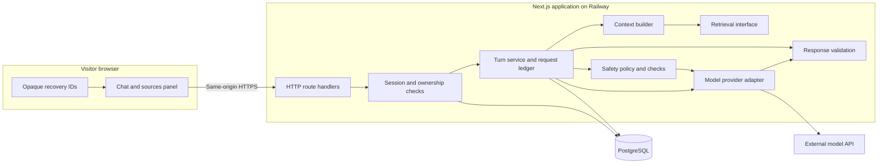
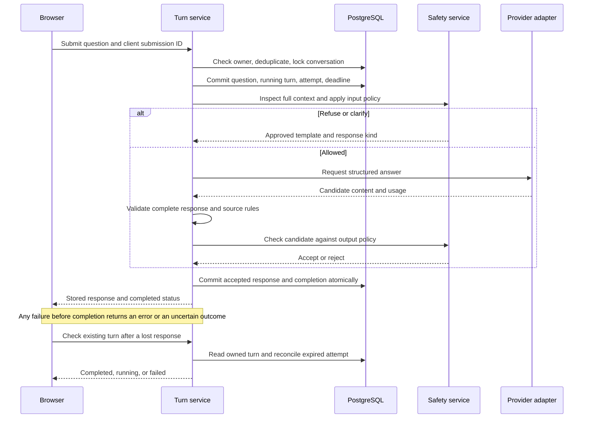

# Gusto NutriBite: Architecture

Status: Draft for review. This is a proposed build design, not an implementation record.

Last updated: 11 October 2026.

Project: `E:\ai-nutrition-asst` · Repository: [ai-nutrition-asst](https://github.com/priyank-agrawal-101/ai-nutrition-asst).

## 1. Purpose and source documents

This document explains how to build Milestone 1 and add retrieval in Milestone 2 without changing the public interface, endpoints, or response shape. It owns component boundaries, technology choices, request execution, and operational limits. Detailed contracts, database definitions, safety policy, prompts, and test procedures belong in the documents listed in the [README index](../README.md#document-index).

Read this design with:

| Source | Architectural input |
| --- | --- |
| [Original brief](problemStatement.txt) and [problem statement](problemStatement.md) | Structured answers, server-side model calls, stored conversations, safety enforcement, evaluation, and the retrieval extension. |
| [Product specification](product-spec.md) | Requirement IDs and acceptance checks. Brief and Derived requirements constrain this design; Proposed requirements remain subject to review. |
| [Product positioning](product-positioning.md) | Confirmed India-first audience and selected Gusto NutriBite identity, with proposed language and commercial strategy. Does not add features, change public contracts, or create launch dependencies. |
| [UX flows](ux-flow.md) | Submission, refusal, new chat, refresh recovery, and retry behavior. |
| [Efficiency guidance](token-optimization-and-efficiency.md) | Bounded context, calls, output, retries, and honest usage measurement. |

**Current evidence:** The folder and Git remote were checked. The repository contains documentation and no application implementation. The technologies and numbers below are recommendations. No model access, hosting account, performance, safety, or deployment has been verified.

## 2. Proposed stack and scope

Build one Next.js application with server modules separated by responsibility. Use a PostgreSQL database and a model-provider adapter. Deploy the application and database on Railway. This keeps the browser and API on one origin and avoids operating a separate frontend and backend for this prototype.

| Area | Proposed choice | Reason and tradeoff |
| --- | --- | --- |
| Language and runtime | TypeScript in strict mode; a supported Node.js LTS release | Shared types across the app, with runtime validation at trust boundaries. Pin compatible versions during scaffolding. |
| Web application | Next.js App Router, React, and Node-runtime route handlers | One project serves the chat and API. Use ordinary HTTP handlers for the stable API. |
| Styling | CSS Modules and a small set of shared CSS variables | Enough for the chat, input, states, and sources panel. Visual decisions belong in `design-guide.md`. |
| Runtime schemas | Zod, with a tested JSON Schema conversion for the provider | Validate incoming requests and outgoing content. TypeScript types alone cannot validate external data. |
| Database | PostgreSQL in local development, tests, and production | Transactions and constraints support ownership, ordering, and duplicate prevention. Use a dedicated local database; do not use another project's database. |
| Database access | Drizzle ORM and versioned SQL migrations | Keep normal queries typed while allowing explicit locking and database constraints. |
| Model integration | OpenAI API as the first provider candidate, behind a server-only adapter | A concrete starting point from the brief's options. Exact model and endpoint stay open until structured-output compatibility, access, privacy, quality, latency, and cost checks pass. |
| Hosting | Railway application service and PostgreSQL service | A long-running Node service fits the request lifecycle below. This proposes Railway alone; Vercel is not required by the interpreted brief. |
| Automated checks | Vitest for unit/integration tests; Playwright for browser tests; GitHub Actions for CI | Test behavior at schema, database, and browser boundaries. Live model evaluation remains a separate activity. |
| Package management | npm with a committed lockfile | Reproducible installation without adding another tool. |

Do not add registration, a history dashboard, a vector database, Redis, a job broker, agents, or microservices for Milestone 1. The product's other [proposed exclusions](product-spec.md#scope) remain proposed. Evaluation uses scripts and reviewed artifacts, not an admin UI.

### Alternatives considered

| Option | Why it is not the starting recommendation | Revisit when |
| --- | --- | --- |
| React with FastAPI | Valid under the brief, but creates two runtimes and a separate API deployment. | The team prefers Python or retrieval work needs a Python service. |
| Next.js on Vercel with hosted Postgres | Also valid, but execution deadlines and interrupted requests must be rechecked for that hosting model. | Hosting preference or measured cost favors it. Preserve the request ledger and recovery rules. |
| SQLite | Simple for a local demo, but requires a persistent file volume and constrains concurrent deployment choices. | A deliberate single-instance local-only build is chosen. |
| Supabase | Managed Postgres is suitable, but its browser data access and auth features are unnecessary here. | Managed database operations or user accounts become requirements. |

No hosting price or free-tier capacity is assumed. Confirm the budget and service limits before provisioning.

## 3. System boundaries



The retrieval interface returns an empty result in Milestone 1 and makes no network calls. Arrows show dependencies; the request sequence below defines execution order.

| Component | Owns | Must not own |
| --- | --- | --- |
| Chat client | Message display, local draft, waiting/error states, recovery polling, accessible controls | Provider credentials, safety decisions, authoritative completion status |
| Route handlers | HTTP parsing, request limits, session checks, calling services, public error mapping | Prompts, provider-specific response parsing, business rules spread across handlers |
| Session service | Anonymous identity, expiration, conversation ownership | Treating an opaque conversation ID as authorization |
| Turn service | One ordered exchange, attempt lifecycle, concurrency, persistence, completion | Trusting browser history or displaying uncommitted content |
| Context builder | Ordered stored messages, token budget, prompt and schema versions | Mixing conversations or silently dropping safety context |
| Safety service | Code rules, contextual classification, output checks, approved refusal/clarification templates | Claiming to verify nutrition facts merely because a response passed safety checks |
| Provider adapter | Structured generation, timeouts, normalized provider outcomes and usage | Writing messages directly to the database or controlling browser responses |
| Response validator | Shape, size, source policy, and acceptance checks | Repairing invalid prose or replacing forbidden source values |
| Repository layer | Scoped queries, transactions, locks, migrations | Returning data without an ownership scope |
| Evaluation runner | Calling normal application behavior and exporting controlled test records | Special-case answers, bypassed safety, or overwriting earlier results |

Only the server can access the database and provider. Browser text, stored messages, model output, and future retrieved text are untrusted data. Keep them separate from system instructions.

## 4. Conversation and session design

### Anonymous identity

Propose anonymous browser sessions, consistent with the current UX. Create a cryptographically random session token on the server. Send it in an `HttpOnly`, `Secure` production cookie with `SameSite=Lax`, `Path=/`, and no broad domain scope. Store only a token hash in the database. The session is a bearer credential; never put it in a URL or browser-readable storage.

Use a seven-day absolute session lifetime as an initial proposal. Enforce it in database queries as well as cookie expiry. This is access duration, not a promise about data retention. Clearing cookies or using another browser does not recover the old session.

Store the active conversation ID and in-flight submission/attempt IDs in `sessionStorage`, scoped to this application origin. This restores the same tab after refresh without keeping a second copy of messages. Cross-device history and unsent-draft recovery are outside this design. Session cookies may be shared by tabs; database constraints still prevent concurrent turns in the same conversation.

Every conversation, message, turn, and status query must join back to the live session owner. Return the same public unavailable response for nonexistent and unowned IDs. Checking ownership once in the page loader is insufficient.

### Frontend state

Use explicit states: `loading`, `ready`, `submitting`, `waiting`, `unknown`, `failed`, and `unavailable`. The server's stored state determines completion; a successful model call by itself does not.

- Create the client submission ID and persist its recovery marker before sending. If recovery storage is unavailable, explain that refresh recovery is limited; server duplicate protection still applies.
- Render one pending question keyed by that ID. Replace it with the server turn ID after acceptance; do not append a second copy.
- Restore history and unresolved turn state before enabling submission after refresh. A status request never starts generation.
- Disable Send, Retry, and New chat while a request is unresolved. Also enforce relevant concurrency rules on the server.
- Keep generated text hidden until the server confirms validation and database commit. Milestone 1 uses no token streaming to the UI.
- Render assistant content as plain text initially. A later Markdown renderer must disable raw HTML and sanitize links.
- Keep the sources panel visible and empty throughout Milestone 1, as [UX-05](ux-flow.md#ux-05-look-for-sources) requires.

New chat creates a separate conversation. It changes the active ID only after creation succeeds and the user resolves any unsent draft. It does not delete earlier conversations.

## 5. Request lifecycle and recovery

### Terms and states

A **turn** is one accepted user question and at most one completed assistant response. An **attempt** is one execution of that turn. A **provider call** is one external request, such as classification or answer generation. A retry creates a new attempt for the same turn.

Use turn states `running`, `completed`, and `failed`. Keep attempt records with the same terminal states plus a failure code. `unknown` is a browser observation when the server cannot be reached, not an extra database outcome. A completed refusal or clarification has state `completed`, with a separate response kind.



### Execution order

1. Validate content type, body size, question length, and allowed fields. Verify origin, live session, and conversation ownership. Reject client-supplied roles, prompts, source entries, and history.
2. Check for an existing submission ID within the owned conversation. If found, compare the normalized question hash and return its status/result; never call the model again for this replay. Reusing the ID with different content is a conflict.
3. Apply generation rate limits and confirm the question fits the conversation context budget. In a short transaction, lock the conversation and recheck ownership, deduplication, capacity, and active-turn status. Save the user message, turn, first attempt, context version, and absolute deadline. Commit before making any external call.
4. Build the request from that saved context snapshot. Run the input safety path in Section 7. A template response skips answer generation; allowed questions continue through the empty retrieval interface and structured generator.
5. Require a complete provider response. Apply schema, size, Milestone 1 source, and output safety checks. Cut-off content, provider refusal payloads outside the app contract, and unparseable output are failures handled by the adapter or validator.
6. In a second transaction, confirm the session is live and the attempt is still the current, unexpired owner of the running turn. Insert the assistant response and mark both attempt and turn completed atomically. Release active-turn ownership. Return only the committed result.
7. On failure, record a safe error code and end the active attempt where storage is available. Return a public error. If a commit outcome cannot be confirmed, query the existing turn; do not assume failure and start generation again.

Never hold a database transaction open during a model call. Keep transaction/query timeouts short enough to fit the end-to-end deadline.

### Duplicate prevention and explicit retry

Use database uniqueness and conditional updates, not only disabled buttons:

- A unique `(conversation_id, client_submission_id)` identifies the accepted question.
- A unique assistant response per turn prevents two successful answers for one question.
- A partial unique constraint or equivalent locked update allows one running turn per conversation.
- A unique `(turn_id, client_attempt_id)` deduplicates retry requests.
- A stored current-attempt ID acts as a fence: an older or expired attempt cannot complete after a new attempt starts.

Retry is allowed only after a confirmed failure, within the attempt limit, and while that turn remains the most recent accepted question. Once a later turn is accepted, disable retry on the older question to preserve context order. An edited question is a new turn with a new submission ID.

The retry transaction locks the conversation and turn, checks these conditions, creates one attempt, and marks the turn running. Network replay of the same retry ID returns the stored operation receipt and current turn snapshot, as defined in the [API contract](api-contract.md#explicitly-retry-a-failed-turn). Simultaneous retries cannot both acquire the turn.

If the server confirms that a submission was never recorded, resend the same submission ID and retained question. This is safe even if the original request arrives late: both must pass the same unique constraint. Do not generate a new ID merely because the first HTTP request timed out.

This guarantees at most one stored assistant response per turn. It cannot guarantee exactly one billable provider call: a provider may continue processing after a network timeout. Track this uncertainty and all known usage; never claim otherwise.

### Process failure and deadlines

Keep orchestration inside the awaited HTTP handler on the long-running server. Do not use an untracked background promise after returning an HTTP response. A durable background worker is not required for this prototype because interrupted work may end as a visible failure.

Each accepted attempt has a database deadline. Status reads and new submissions reconcile overdue running attempts to failed using an atomic conditional update. Run the same reconciliation during startup and periodic maintenance. Use database time for deadline comparisons. A late response loses its completion fence and must be discarded.

If a browser disconnects, the server may finish and commit within its deadline; this is not promised after process termination. On refresh, read the ledger. A restart must not regenerate abandoned requests automatically. Before the deadline, report running; after reconciliation, report failure and allow explicit retry.

If the database is unavailable, status remains unknown in the browser. Offer Check again. Do not bypass persistence, infer failure from a client timer, or show an unsaved model answer.

## 6. Structured response and API boundary

### Content contract

The [API contract](api-contract.md#answer-content-and-citation-schema) owns the proposed content schema, citation fields, string limits, identifier rules, and allowed URL schemes. Its [resource schemas](api-contract.md#messages-attempts-and-turns) keep conversation, turn, attempt, status, response kind, and error metadata separate from answer content. These schemas remain drafts for review.

The generator produces content; server code controls request status and response kind. Errors do not masquerade as successful assistant content. Do not generate citation placeholders in Milestone 1.

The stable schema must allow `Source | null` from the beginning. Add a milestone-specific runtime rule requiring **every source to equal `null`** in Milestone 1. Enforce that rule even if a provider-facing schema also narrows sources to `null`. Reject a non-null source; do not silently erase it. Keep the public shape when retrieval is added.

Require strict field/type checks, reject unexpected properties, and bound all arrays and strings. An empty claims list is valid for a refusal or clarification without factual statements. An ordinary answer must list its factual statements; claim coverage and contradictions also need evaluation because structural validation cannot prove completeness or truth.

Invalid prose must not be extracted, repaired, wrapped, or regenerated automatically into a valid-looking answer. Code-authored templates must pass the same content checks. Milestone 1 uses no answer cache, including for repeated evaluation questions.

### API capabilities

Paths, methods, payloads, and response codes are defined in the [API endpoint index](api-contract.md#3-endpoint-index). This table summarizes the component responsibilities.

| Capability | Required semantics |
| --- | --- |
| Establish session | Issue a session cookie without exposing its token to JavaScript. |
| Create conversation | Return an owned empty conversation; make creation replay-safe. |
| Read conversation | Return ordered messages and unresolved turn status; no cross-session access. |
| Submit question | Accept a client submission ID and question; return a completed outcome or recoverable status/error. |
| Read request status | Look up by turn ID or client submission ID, including when acceptance was not received. Never generate. |
| Retry failed turn | Accept a distinct attempt ID; enforce the rules in Section 5. |
| Health and readiness | Report process health separately from database/schema readiness. |
| Delete session data | Define this capability if required by the approved privacy/deletion policy before public release. |

Review and freeze the API contract before implementation. It defines unrecorded-submission lookup, retryable failures, active conflicts, unavailable conversations, and rate limits. Keep the same capabilities and response shapes in Milestone 2; do not add a retrieval-specific chat endpoint.

## 7. Safety enforcement

Follow [SAFE-01 through SAFE-05](product-spec.md#safety). The architecture provides enforcement points; the draft [safety and security policy](safety-and-security.md) owns the detailed rules, and `prompt-spec.md` will own model instructions and template wording.

### Input gate

1. Normalize a copy of the input for rule checks while retaining the original message for display and evaluation. Treat instructions embedded in messages as user content.
2. Run code rules over the current question and relevant full-conversation references. High-confidence prohibited requests select an approved refusal template with the required professional referral.
3. For remaining requests, run a separate structured contextual classifier. Its limited verdict is `allow`, `refuse`, or `clarify`, with an enumerated policy reason. Supply the full retained context so indirect references are visible. The server maps verdicts to allowed actions and templates.
4. Deterministic refusal rules take precedence over a classifier's allow verdict. Malformed, missing, or timed-out classification ends in a service failure. It must not default to allow.

The classifier adds cost and is itself fallible. It supplements code; it does not replace code checks or prove safety. Do not rely on a keyword list or on the answer model declaring its own output safe. General nutrient education must still receive useful answers; test false refusals alongside missed refusals.

### Output gate

After schema validation, apply code rules to both the answer and claims for prohibited advice and inconsistent response kind. Then use a separate structured safety review of the candidate and conversation. A rejected candidate is not stored as successful or shown to the user. Record a validation/safety failure and a reviewable reason. Do not silently replace the unsafe candidate with a success that hides the failure.

Approved input refusals and clarifications bypass generation and model output review; they still pass deterministic template and schema checks. If a provider refuses outside the expected schema, map that outcome to a documented safe error unless an explicitly reviewed provider-refusal mapping exists.

This proposal permits up to three model calls for an ordinary answer: contextual classification, generation, and output review. Clear code-handled refusals use zero. Count usage for each call. Removing or combining a safety step requires passing comparable safety and quality evaluation first.

The [safety policy](safety-and-security.md#3-safety-policy) proposes behavior for mixed requests, ambiguous medical context, emergencies, minors, eating-disorder content, unrelated topics, and unsupported languages. Review and test those proposals before public release. Do not infer that every request outside the brief exclusions is safe; this design does not authorize medical personalization.

Required safety failures block public release. Passing a finite test set is evidence about those cases, not a guarantee for every user message.

## 8. Context, model adapter, and limits

### Context construction

Build context from the current conversation's saved user messages, completed assistant content, and the current question exactly once. Include earlier refused and failed user questions when needed to interpret later references; include no invalid assistant candidates. Label failed turns clearly so the model does not invent a prior response.

Keep system instructions, schema, and safety rules stable and before changing conversation content where the provider permits. Never load repository documents or other conversations into chat context. Claim sources are metadata, not independent evidence.

For Milestone 1, send the complete retained conversational context within a fixed budget. Do not summarize or silently remove older turns. When the next question would exceed the budget, reject it before model calls, preserve the existing chat, and explain that a new chat is needed. This proposed user-facing limit needs acceptance in the product spec and UX document.

Calculate each phase's request budget using the selected model's tokenizer or a validated conservative bound. Reserve room for system instructions, safety-review candidate content, and output. Do not equate characters with tokens or send a request beyond the verified model context limit.

### Provider adapter

Expose provider-neutral operations for classification, structured answer generation, and output review. Each returns either validated typed data or a typed error, plus available provider request ID, finish status, and usage. Route handlers must not depend on an SDK response object.

Before choosing an exact model:

1. Verify account access and native schema-constrained output support for the proposed schemas, including nullable nested source objects.
2. Verify how the endpoint reports truncation, refusal, errors, cancellation, usage, and unsupported schema features.
3. First exercise candidate schemas and completion/error handling in an isolated adapter harness. After integrating a compatible candidate, run the fixed evaluation through the ordinary app pipeline under [evaluation.md](evaluation.md); a direct adapter probe is not end-to-end evaluation evidence.
4. Pin explicit model identifiers and supported settings. Record unavailable or provider-controlled settings as such; do not assume temperature or seed controls exist.
5. Confirm provider data-retention settings and account limits before using real visitor messages.

The first provider candidate is not a validated model selection. Consult the [official OpenAI structured-output guide](https://developers.openai.com/api/docs/guides/structured-outputs) during implementation. Live documentation retrieval was unavailable while drafting this document; endpoint syntax and current model compatibility remain unverified. No API call or credential is needed to review this architecture.

### Initial configuration proposals

These are starting limits to validate, not measured service targets or accepted product requirements. Keep implemented values in one typed server configuration module and expose only safe UI limits through the API.

| Setting | Proposed initial value | Enforcement |
| --- | --- | --- |
| Question size | 2,000 Unicode code points after trimming | Client and server use the same counting rule; reject whitespace-only input. |
| HTTP request body | 16 KiB | Reject oversized encoded bodies before JSON parsing. |
| Conversation context | At most 20 accepted user turns and 8,000 conversation tokens | Whichever limit is reached first. Whole-context policy applies to every model phase. |
| Answer text / claims | At most 6,000 characters, 20 claims, and 600 characters per claim | Runtime acceptance limits; normal answers should be shorter. |
| Generation output | 2,000 provider output tokens initially | Includes the structured answer and claims. Adjust for the chosen model's output/reasoning accounting. Reject truncation. |
| Safety verdict output | 256 provider output tokens per verdict initially | Small schema with no free-form rationale. Increase if the verified model requires more; never accept partial verdicts. |
| Provider phase timeout | 10 seconds input classification, 25 seconds generation, 10 seconds output review | Each call uses the smaller of its phase limit and the remaining shared budget. |
| Shared model-call budget | 45 seconds per attempt | Covers all calls; no automatic regeneration or SDK retries. |
| Attempt completion deadline | 60 seconds from database acceptance | Includes model work, validation, and final commit. Completion uses a database-time check. |
| Request / proxy / browser timeouts | Server target 65 seconds; proxy and browser at least 70 seconds | Verify actual hosting behavior. A disconnect still requires status recovery. These are ceilings, not expected latency. |
| Database query / lock wait | 3 seconds per statement; 1 second lock wait | Respect remaining request time and fail cleanly under contention. |
| Attempts per turn | 3 total, including the first attempt | Explicit user retries only after confirmed failure. |
| Generation traffic | 5 new attempts/minute/session, 20/minute/IP, 4 concurrent attempts/app | Use atomic database-backed enforcement; an in-memory counter is insufficient across restarts or replicas. |
| Status polling | Every 2 seconds, then every 5 seconds; stop automatic checks after 70 seconds | Continue via Check again; never start a new attempt from a poll. Rate-limit reads separately. |
| Session access lifetime | 7 days absolute | Database and cookie expiry; retention is a separate decision. |
| Prompt cache | Provider-managed prefix reuse only if supported and measured | Do not assume savings or reuse complete answers. |

Use short-lived, privacy-reviewed network identifiers for IP limits; trust forwarded IP headers only from the configured proxy. Rate limits do not establish a total spending cap. Set the operating budget, alert threshold, and server generation kill switch before public access. Status and history should remain readable when generation is disabled.

## 9. Persistence and data integrity

The draft [data model](data-model.md) defines fields, indexes, constraints, and migrations. These logical records summarize the storage responsibilities:

| Record | Minimum responsibility |
| --- | --- |
| Session | Token hash, creation/expiry, revocation state; never a raw token. |
| Conversation | Owning session, creation time, ordered turn counter, context version. |
| Turn | Client submission ID, normalized question hash, order, state, current attempt, response kind. |
| Message | Original user text or accepted assistant content, turn association, role, stable sequence. |
| Attempt | Attempt ID, turn, start/deadline/end, outcome, prompt/schema/policy/config versions, model identifiers. |
| Provider call | Phase, call ID, timing, provider request ID, available usage, normalized failure and finish status. |
| Evaluation artifact | Controlled question/run IDs, full reviewed responses, observations, comparison metadata; stored separately from visitor analytics. |

Store accepted assistant content as validated JSON alongside its message identity. Do not retain only rendered text; the claims and source fields are needed for evaluation and retrieval. Order by stored sequence, not timestamps alone.

Use foreign keys, unique submission/attempt IDs, and transactional state changes. Enforce one user message and at most one assistant response per turn. Do not save a model candidate as a normal assistant message before validation.

If a question cannot be saved, make no provider call. If an answer cannot be committed, do not show success. When the database cannot record a failure or usage, keep that outcome unknown until reconciliation; operational metrics must not manufacture zero cost or success.

Visitor transcript/log/backup retention, deletion timing, and operator access have proposals in [safety and security](safety-and-security.md#7-privacy-retention-and-deletion-proposals). Review those choices and complete the deletion API/UX amendment before implementation and public release. New chat does not delete data; expiry closes access and starts the proposed cleanup schedule. Prevent deleted/revoked session data from being recreated by late attempt completion.

Keep local, test, preview, and production databases separate. Commit migrations; never run ad hoc destructive schema changes against production. Back up before risky migrations, verify restoration into a separate database, and keep rolling application versions compatible with the active schema.

## 10. Privacy and application security

This section defines technical boundaries. The draft [safety and security document](safety-and-security.md) specifies the detailed controls and release review.

- Keep database URLs, provider credentials, token-hashing secrets if used, and operational controls server-only. Do not use browser-exposed environment prefixes for secrets. Commit an example environment file with names and placeholders only.
- Use same-origin requests, check the `Origin` of mutating requests, and apply a reviewed CSRF defense. CORS must not broadly permit credentialed requests from other origins. Cookies alone are not CSRF protection.
- Mark personalized API responses private and non-cacheable. Disable shared/framework caching for conversation and status reads. Avoid embedding one visitor's data in publicly cached pages.
- Use parameterized queries, strict JSON parsing, bounded text, security headers, and sanitized rendering. Limit the database account to the permissions the application needs.
- Send only the necessary conversation context to the chosen provider. Provide the approved user notice before collecting messages. Do not request medical records or a nutrition profile.
- Production logs contain request IDs, phases, safe error codes, timings, versions, and available token usage. Exclude raw cookies, authorization headers, prompts, transcripts, and provider response bodies by default.
- Keep synthetic evaluation inputs and approved run artifacts separate from real visitor data. Failed candidate capture requires explicit access and retention rules; do not dump it into general logs or Git.
- Rate-limit session creation and reads as well as generation to reduce anonymous abuse. Rate-limit failures must not trigger automatic retries.

No public evaluator endpoint, debugging route with transcripts, or browser database credential is part of the prototype.

## 11. Proposed repository structure

All paths below are planned. None of these code files exist yet.

```text
ai-nutrition-asst/
  README.md
  docs/                         # Product, design, architecture, and review records
  src/
    app/
      page.tsx                  # Chat page
      layout.tsx
      api/                      # Routes defined by api-contract.md
    components/chat/            # Messages, composer, sources, recovery controls
    client/                     # HTTP client and explicit UI state transitions
    contracts/                  # Public schemas and shared types; no secrets
    server/
      config/                   # Typed limits and environment validation
      sessions/                 # Session identity and ownership
      conversations/            # Creation, history, ordered context
      turns/                    # Attempt orchestration and reconciliation
      safety/                   # Policy rules, classifiers, templates, output gate
      prompts/                  # Versioned prompt definitions
      llm/                      # Provider interface and first adapter
      retrieval/                # Interface and no-op Milestone 1 implementation
      validation/               # Content acceptance and source policy
      db/                       # Schema, scoped repositories, transactions
      telemetry/                # Safe events and normalized usage
  migrations/                   # Reviewed database migrations
  tests/
    unit/
    integration/
    e2e/
  evals/
    questions/                  # Fixed questions after evaluation design
    runs/                       # Controlled artifacts; retention/Git policy defined later
  scripts/                      # Evaluation, maintenance, and operational tasks
  .github/workflows/            # Required CI checks
  .env.example                  # Placeholder values only
  package.json
  package-lock.json
```

Mark server modules as server-only. Components may import public contracts, never database, prompt, or provider modules. Keep the prompt text in code once implemented; `prompt-spec.md` should explain its purpose and changes and link to that code.

## 12. Deployment and operations

Deploy the Node app and PostgreSQL in the same chosen region where practical. The browser reaches only the application's HTTPS origin. The application reaches the database through the configured private connection and the provider through server-side HTTPS.

Start with one application instance and no durable job queue. Persist all correctness-critical state in PostgreSQL so a restart does not lose conversation history or duplicate protection. Additional instances require verified shared limits, database pooling, migration coordination, and the same completion fences.

Before deployment, create a reproducible production build, apply reviewed migrations as a controlled release step, and validate configuration at startup. Do not let every replica independently run migrations. Configure graceful shutdown to stop new generation and allow bounded in-flight work to finish; reconciliation handles forced termination.

Provide:

| Operational check | Purpose |
| --- | --- |
| Liveness | Confirm the app process can respond. Do not make a paid model call. |
| Readiness | Confirm required configuration, database connectivity, and compatible schema. Return a safe summary. |
| Provider smoke test | A deliberate, rate-controlled synthetic request before release; separate from routine health probes. |
| Metrics | Accepted turns, completion/error/refusal counts, phase latency, schema/safety failures, expired attempts, retries, and known usage. |
| Recovery check | Restart the app during a test request; verify history, deadline reconciliation, and one visible question on retry. |
| Backup restoration | Restore a known backup into a separate database and check owned history and constraints. |
| Public verification | From an external browser, complete a real chat through the deployed backend, refresh it, and verify a required refusal and empty sources panel. |

Record commit ID, prompt/schema/policy versions, model/settings, environment, and verification date for every evaluated release. A green hosting status does not prove the chat works. Keep rollback instructions compatible with schema changes; never erase stored conversations to fix a deployment.

`deployment-and-operations.md` will own exact commands, environment names, maintenance scheduling, alerts, backups, incident handling, and restore procedures. No hosting resources are provisioned by this document.

## 13. Milestone 2 extension

Define a retrieval interface now, with a no-op implementation returning no passages in Milestone 1. It receives an allowed question and bounded conversation context, and returns evidence records with server-assigned source IDs and locators. Do not build ingestion or choose a vector database yet.

For Milestone 2:

1. Run the same session, request, and input safety checks before retrieval.
2. Fetch approved evidence through the retrieval implementation, within its own timeout and the shared attempt deadline. Treat passages as data, not instructions.
3. Give the generator bounded evidence and source IDs. Keep the `answer` and `claims[].source` shape fixed.
4. Validate each returned source against evidence actually retrieved for this turn. Reject invented source IDs, altered URLs, or unsupported source mappings. Source presence alone does not prove a claim follows from the passage; evaluate that relationship.
5. Save the same accepted content and populate the existing sources panel from validated source objects. No new chat interface or endpoint is required.
6. Preserve Milestone 1 responses and repeat the same question IDs and wording under recorded conditions. Measure evidence support as well as cost, speed, consistency, and safety.

The source contract must already represent citation data when Milestone 1 is finalized. Define no-evidence behavior, citation display interactions, ingestion controls, and any revised limits before enabling retrieval. Do not promise that adding retrieval makes every factual claim correct or cited.

## 14. Verification and build handoff

Verification now has dedicated owners: [testing.md](testing.md) defines software execution and evidence, [the edge-case coverage map](edge-cases.md#coverage-map) links scenarios to requirements, and [evaluation.md](evaluation.md) defines live model review. This handoff does not maintain a second checklist. The [safety release review](safety-and-security.md#release-review) remains the release authority; no passing result is claimed here.

### Implementation dependencies

1. Settle the foundation stack/scope and materialise the [API contract](api-contract.md) and [data model](data-model.md) proposals. A scaffold with a fake provider can proceed independently of live model access; provider-facing schemas require the adapter compatibility check before live integration.
2. Define safety policy, privacy, prompts, and edge cases. Agree on user-facing limits and history-limit behavior.
3. Scaffold the project and persistence. Build session ownership, turn state, validation, and recovery against a fake provider first.
4. Add the real provider adapter, input/output safety gates, and the full chat UI. Run software checks and the controlled evaluations.
5. Deploy only after the [product release conditions](product-spec.md#completion-and-release) pass, then independently verify the public app.

Track remaining choices through the [README build decisions](../README.md#next-build-decisions). Add a separate detailed delivery plan only if this dependency order and the current work items cannot make implementation clear.

### Decisions still requiring review

| Decision | Current recommendation or gap | Resolve before |
| --- | --- | --- |
| Stack and hosting | Next.js, TypeScript, PostgreSQL, Drizzle, Railway; all proposed. | App scaffolding and provisioning |
| Provider/model | OpenAI first candidate; exact model, account access, endpoint, settings, and current schema support unverified. | Live integration |
| Audience and language | India-first everyday adults with global room is confirmed; the initial segment, English-language scope, and sensitive-use handling remain proposals to review. | Prompt and evaluation design |
| Proposed UX/product scope | Anonymous session, same-tab recovery, new chat, input limits, notice, and accessibility need acceptance. | Final API and UI behavior |
| Limits and budget | Section 8 values are unmeasured proposals; traffic, monthly spend, and expected response time need agreement. | Public release |
| Privacy and deletion | Review the safety document's retention, access, and notice proposals; complete the proposed session-wide deletion API/UX amendment. | Collecting real visitor data |
| Safety details | Review and test the safety policy's mixed, ambiguous, sensitive, unsupported-language, and emergency rules. | Safety implementation and public release |
| Source contract | Review the nullable citation object and error/refusal envelope in the API contract before freezing it. | Milestone 1 API implementation |

Use the [current build decisions](../README.md#next-build-decisions) for the next work slice. Visual design still uses the [Gusto NutriBite identity](product-positioning.md) and UX; technical draft choices are not silently approved by completing another document.
