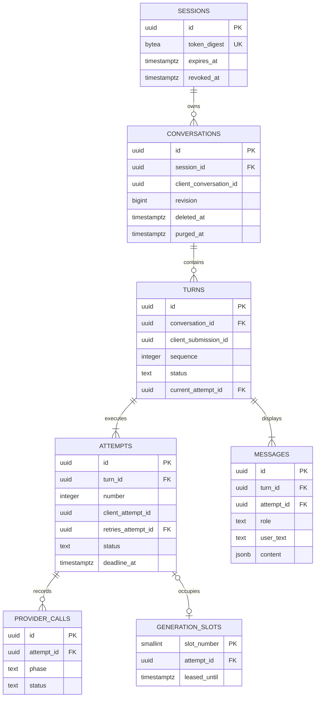

# Gusto NutriBite: Data Model

Status: Draft for review. These tables, constraints, and migrations are proposed. No database has been created or migrated.

Last updated: 11 October 2026.

## 1. Purpose and source documents

This document defines how the application stores sessions, conversations, messages, execution attempts, and usage. It owns database fields, relationships, integrity rules, query patterns, and migration design. Public payloads remain defined by the [API contract](api-contract.md); request execution remains defined by the [architecture](architecture.md).

The design supports the [product requirements](product-spec.md), especially persistent ordered conversations, isolated visitors, strict response validation, explicit retry, and repeatable evaluation. It also follows the [efficiency guide](token-optimization-and-efficiency.md): preserve failures and count known work without claiming unknown usage is zero.

Use PostgreSQL and Drizzle as proposed in architecture. Final version choices and operating limits still need review. Use separate databases for local development, automated tests, previews, and production. All project-owned configuration, migrations, and controlled artifacts belong within this project; no other project's database or runtime data is reused.

## 2. Storage decisions

| Decision | Proposed design | Reason |
| --- | --- | --- |
| Unit of conversation | A turn is one accepted question, with one or more attempts and at most one assistant message. | Retry preserves the visible question and earlier failures. |
| Message format | User text in a text column; accepted assistant content in JSONB. | Preserve the original question and the structured answer/claims contract. |
| Operation receipts | Creation key on the conversation, submission key on the turn, retry key on the attempt. | These existing rows provide durable replay protection without a generic response-cache table. |
| State | Store turn and attempt status; derive active turn, retry eligibility, and history counts. | A partial unique index can enforce one running turn. Avoid extra mutable copies of the transcript. |
| Ownership | Conversations belong to sessions; descendants inherit ownership through joins. | No browser-supplied owner IDs and no unscoped resource lookup. |
| Conversation revision | One stored counter per conversation, updated with visible state transitions. | Clients can reject stale responses from overlapping reads. |
| Accepted content | Immutable after completion except under the approved deletion process. | Earlier answers and evaluation evidence must not silently change. |
| Invalid content | No failed model candidate in the normal message table. | Invalid output cannot appear as a successful answer or enter later context. |
| Evaluation | Controlled files outside visitor tables, using a dedicated evaluation environment. | No evaluator dashboard or general visitor-transcript export is required. |
| Rate and capacity state | Small PostgreSQL quota and generation-slot tables. | Correctness must survive restarts and additional app instances. |

JSONB stores parsed JSON; it does not preserve original whitespace, key order, or duplicate keys. Validate before conversion. It is suitable for accepted structured content, not a substitute for raw provider evidence when a controlled evaluation explicitly needs that evidence.

### Common conventions

- Use `uuid` primary keys, created before related inserts so circular relationships can be written in one transaction. IDs carry no authorization meaning.
- Use `timestamptz` for instants. Generate lifecycle times from the database and serialize them using the [API time format](api-contract.md#2-http-conventions).
- Use `text` with check constraints for closed state values rather than PostgreSQL enums initially. This keeps reviewed state migrations straightforward.
- Use `integer` for small counts and sequences, and `bigint` for revisions and token counts. Enforce nonnegative values and the API's safe-integer ceiling before serializing numbers.
- Use `bytea` for digests and random binary material; check their byte lengths explicitly. Never store authentication cookies, credentials, or provider authorization headers.
- All columns below are required unless marked nullable. `PK` means primary key, `FK` means foreign key, and `UQ` means unique constraint.
- Reuse the API's Unicode and field-size rules. Reject U+0000 (NUL) in strings before storage; PostgreSQL text/JSONB cannot represent it. Preserve other valid input rather than silently rewriting it to satisfy storage.

## 3. Entity relationships



The diagram omits most columns and the standalone quota table. Each surviving turn has exactly one user message, zero or one assistant message, and at least one attempt. The current-attempt relationship is a second link from the turn to one of its own attempts; the database constraints below enforce that scope.

No claims table is needed for Milestone 1. Claims remain ordered inside the accepted content JSON. No citation, ingestion, embedding, vector, user-profile, or meal-plan tables are created in this milestone.

## 4. Session and conversation tables

### `sessions`

| Column | PostgreSQL type | Rules and purpose |
| --- | --- | --- |
| `id` | `uuid` | PK; internal ownership identity, not returned as a session credential. |
| `token_digest` | `bytea` | UQ; exactly 32 bytes. SHA-256 digest of a cryptographically random session token under the proposed session design. |
| `csrf_nonce` | `bytea` | Exactly 32 random bytes for session-bound CSRF token derivation. |
| `csrf_key_version` | `text` | Bounded key identifier, not a secret key. |
| `created_at` | `timestamptz` | Database creation time. |
| `expires_at` | `timestamptz` | Absolute access expiry; must be later than `created_at`. |
| `revoked_at` | `timestamptz`, nullable | Explicit revocation. A non-null value makes the session unusable immediately. |

Generate the proposed session token from at least 32 random bytes. Store only its digest and send the token in the protected cookie. This use of SHA-256 is for a high-entropy random bearer token, not for hashing a human password.

For repeated session reads, derive the proposed public CSRF token using the [versioned HMAC construction](safety-and-security.md#csrf-construction-and-rotation). The raw CSRF key remains outside the database. Review and test its verification and rotation behavior before implementation; this table supplies the needed storage without exposing the session credential.

A live-session predicate requires `revoked_at IS NULL` and `expires_at > clock_timestamp()`. Reading a session does not extend it. Database time and cookie expiry both apply; cookie presence alone does not establish access. The seven-day value remains an [architecture proposal](architecture.md#initial-configuration-proposals), not a retention period.

Indexes: unique token digest; an expiry index for cleanup. Do not add last-seen tracking or device fingerprints unless a concrete requirement and privacy decision justify them.

### `conversations`

| Column | PostgreSQL type | Rules and purpose |
| --- | --- | --- |
| `id` | `uuid` | PK. |
| `session_id` | `uuid` | FK to `sessions.id`; immutable owner. |
| `client_conversation_id` | `uuid` | Required client creation-operation key. |
| `revision` | `bigint` | Starts at `0`; nonnegative and within the API safe-integer range. |
| `created_at` | `timestamptz` | Creation time. |
| `updated_at` | `timestamptz` | Last visible conversation-state mutation; starts equal to `created_at`. |
| `deleted_at` | `timestamptz`, nullable | Logical deletion marker; excludes the conversation from every public query. |
| `purged_at` | `timestamptz`, nullable | Set only after child content/usage records have been purged. Requires `deleted_at`. |

Enforce UQ `(session_id, client_conversation_id)`. A matching creation replay resolves this row and returns its current snapshot. It never resets `revision` or removes turns.

A logically deleted conversation leaves a small **tombstone**: an identity row that prevents reuse of its creation key while the session remains live. A replay against the tombstone returns unavailable rather than creating a new conversation. A tombstone is still retained data; its lifetime and removal must be covered by the privacy policy.

Do not store `turn_count` or `active_turn_id` as extra columns. Derive them from the turn rows in the same read snapshot. For the proposed bounded history, these queries are small. Index `(session_id, created_at)` for scoped maintenance and deleted rows by `deleted_at` for purge selection.

## 5. Turns, attempts, and messages

### `turns`

| Column | PostgreSQL type | Rules and purpose |
| --- | --- | --- |
| `id` | `uuid` | PK. |
| `conversation_id` | `uuid` | FK to `conversations.id`. |
| `client_submission_id` | `uuid` | Required submission-operation key. |
| `sequence` | `integer` | Positive position within this conversation; starts at `1`. |
| `normalized_question` | `text` | The accepted normalized question; nonempty and within the accepted input limit. |
| `question_digest` | `bytea` | Exactly 32 bytes: SHA-256 of UTF-8 normalized question text. |
| `normalization_version` | `text` | Version of the [API normalization rule](api-contract.md#question-normalization). |
| `status` | `text` | `running`, `completed`, or `failed`. |
| `current_attempt_id` | `uuid` | Required reference to an attempt belonging to this turn. |
| `created_at` | `timestamptz` | Acceptance time, shared with the first user message and first attempt start. |
| `updated_at` | `timestamptz` | Last turn-state transition. |

Enforce UQ `(conversation_id, client_submission_id)` and UQ `(conversation_id, sequence)`. Add a partial unique index on `conversation_id` where status is `running`.

Allocate sequence as `max(sequence) + 1`, or `1` for an empty conversation, while holding its conversation lock. Do not use a PostgreSQL sequence for this user-visible ordering: rolled-back acceptance must not consume a position. Do not delete individual turns from an accessible conversation or renumber prior turns.

On a replay, normalize using the recorded rule version, compare the digest, and confirm exact normalized text equality. Do not let a normalization change reinterpret an existing operation ID. The stored original user message remains the first accepted text, even when a replay differs only in ignored surrounding whitespace.

Question digests are private metadata, not anonymized analytics. Short or predictable questions can be guessed from an unkeyed digest; never publish them or send them to general logs.

### `attempts`

| Column | PostgreSQL type | Rules and purpose |
| --- | --- | --- |
| `id` | `uuid` | PK. |
| `turn_id` | `uuid` | FK to `turns.id`. |
| `number` | `integer` | Positive attempt number within the turn. |
| `client_attempt_id` | `uuid`, nullable | Null only for attempt `1`; required for every explicit retry. |
| `retries_attempt_id` | `uuid`, nullable | Null for attempt `1`; otherwise the stored `failed_attempt_id` from the retry request. Must belong to this turn. |
| `status` | `text` | `running`, `completed`, or `failed`. |
| `started_at` | `timestamptz` | Acceptance time. |
| `deadline_at` | `timestamptz` | Absolute completion deadline; later than start. |
| `finished_at` | `timestamptz`, nullable | Required for a terminal state; null while running. |
| `failure_code` | `text`, nullable | A code from [accepted-attempt failures](api-contract.md#accepted-attempt-failures); present only when failed. |
| `failure_message` | `text`, nullable | Reviewed safe message, within API limits; present only when failed. |
| `context_revision` | `bigint` | Conversation revision observed immediately before accepting this attempt. |
| `context_through_sequence` | `integer` | Current turn's sequence; bounds context reconstruction. |
| `context_digest` | `bytea` | Exactly 32 bytes for the canonical context actually selected for this attempt. |
| `milestone` | `smallint` | Server-selected `1` or `2`; not writable through a public payload. |
| `run_manifest` | `jsonb` | Allowlisted version/configuration snapshot described below. |

Enforce UQ `(turn_id, number)`, UQ `(turn_id, client_attempt_id)`, and UQ `(turn_id, id)` for scoped references. A partial unique index on `turn_id` where status is `running` prevents two active attempts. Another partial unique index on `turn_id` where status is `completed` prevents two completed attempts.

The first-attempt check is explicit: number `1` requires both retry fields to be null; number greater than `1` requires both to be non-null. A retry must reference the immediately previous, failed attempt and use the next consecutive number. The transaction and deferred integrity checks enforce this across rows.

Terminal attempt outcomes do not change. When retry starts, the earlier failed attempt remains failed and the turn points to the new running attempt. Provider usage can be supplemented later without changing that terminal outcome. A completed turn cannot be retried.

Do not store `unknown` as a turn/attempt status. It is an inability to establish durable state. The separate provider-call record may use an unknown outcome because external processing can outlive the local request.

### Attempt configuration and context

`run_manifest` is a strict internal object, with a proposed maximum serialized size of 32 KiB. Store references and effective settings, not prompt text, secrets, or another transcript:

| Entry | Purpose |
| --- | --- |
| Application commit/build ID | Identify the implementation used; mark local uncommitted state explicitly. |
| Prompt version/hash per phase | Identify input classification, answer, and output-review instructions. |
| Content-schema and safety-policy versions | Explain acceptance and refusal behavior. |
| Context-builder and normalization versions | Reconstruct how messages were selected and normalized. |
| Effective limits | Record the deadline, context/output bounds, attempt cap, and other execution settings used. |
| Provider/model/settings per phase | Preserve requested settings; represent unsupported or unknown settings as null rather than inventing defaults. |
| Usage-normalization version | Explain how provider token categories map to stored metrics. |

Keep actual call-level provider/model observations in `provider_calls`. A safe configuration version is insufficient if the corresponding settings cannot later be recovered; retain the allowlisted effective snapshot as well.

Build canonical context from ordered prior turns plus the current normalized question exactly once. Include prior user questions and accepted assistant content according to architecture; no invalid assistant candidates. Earlier turns are immutable once a later turn is accepted, so the bounded sequence plus versioned builder can reconstruct context without storing a second full transcript. Include prior failure/refusal state in the canonical representation when it affects the prompt.

Compute the candidate context and its digest before acceptance, then verify the conversation revision under lock. If it changed, rebuild before accepting. Do not run tokenization or other expensive work while holding locks. Reconstruction must match the saved digest before any call; a mismatch ends the attempt as a failure rather than silently using different context. Deletion ends the ability to reconstruct; it is not a reason to retain an extra private copy.

### `messages`

| Column | PostgreSQL type | Rules and purpose |
| --- | --- | --- |
| `id` | `uuid` | PK; stable visible message identity. |
| `turn_id` | `uuid` | FK to `turns.id`. |
| `role` | `text` | `user` or `assistant` only. |
| `attempt_id` | `uuid`, nullable | Null for the user message; required for the assistant message and scoped to the same turn. |
| `user_text` | `text`, nullable | Original accepted user text; required only for role `user`. |
| `content` | `jsonb`, nullable | Exact accepted `AnswerContent`; required only for role `assistant`. |
| `response_kind` | `text`, nullable | `answer`, `refusal`, or `clarification` for assistant messages only. |
| `content_schema_version` | `text`, nullable | Required for assistant content; null for user messages. |
| `created_at` | `timestamptz` | User acceptance time or assistant completion time. |

Enforce UQ `(turn_id, role)`. Check the role-specific nullability as a complete expression, so a row cannot mix user text and assistant content. A user row must not carry attempt, response-kind, or content fields. An assistant row must not carry user text.

Store the original user string without trimming it; its normalized form is on the turn. Apply the API body bound as a defensive storage byte bound to user text. Do not replace the original on a replay.

Before inserting assistant content, validate the complete [answer/citation schema](api-contract.md#answer-content-and-citation-schema), including nested keys and limits. Add a database JSON validation function/check for the stable structural rules and a deferred relationship check for milestone source policy. In Milestone 1 every claim source must be JSON null, not a missing field, SQL null, an empty string, or an empty object.

Do not assume `jsonb_typeof` checks alone validate the schema. The database checks must cover required/extra keys, field types, bounds, and source shape. App-side semantic safety and future evidence checks remain necessary; the database cannot prove an answer true or safe. Schema versions identify immutable validator definitions rather than silently changing the meaning of an old function.

## 6. Provider usage and operational state

### `provider_calls`

| Column | PostgreSQL type | Rules and purpose |
| --- | --- | --- |
| `id` | `uuid` | PK; local call identity, generated before the external request. |
| `attempt_id` | `uuid` | FK to `attempts.id`. |
| `phase` | `text` | `input_safety`, `answer`, or `output_safety` in Milestone 1. |
| `call_number` | `integer` | Positive ordinal within the phase. Initially `1`; extra calls require a reviewed policy change. |
| `provider` | `text` | Bounded provider identifier. |
| `requested_model` | `text` | Bounded configured model identifier. |
| `reported_model` | `text`, nullable | Provider-reported identifier when available. |
| `request_settings` | `jsonb` | Strict allowlisted effective call settings, excluding messages and credentials; proposed maximum 8 KiB. |
| `provider_request_id` | `text`, nullable | Bounded external request ID; private operational metadata. |
| `status` | `text` | `started`, `succeeded`, `failed`, or `unknown`; describes the external call, not answer acceptance. |
| `started_at` | `timestamptz` | Local dispatch-intent time. |
| `ended_at` | `timestamptz`, nullable | End of local observation, including a timeout; not a claim about remote finish time. |
| `duration_ms` | `bigint`, nullable | Nonnegative locally measured duration. |
| `finish_code` | `text`, nullable | Sanitized provider finish category. |
| `error_code` | `text`, nullable | Sanitized adapter/network/provider error category; no raw exception text. |
| `validation_code` | `text`, nullable | Sanitized adapter/response-check outcome; no candidate text or free-form rationale. |
| `input_tokens` | `bigint`, nullable | Known input usage under the adapter's documented definition. |
| `output_tokens` | `bigint`, nullable | Known output usage under that definition. |
| `cached_input_tokens` | `bigint`, nullable | Known cached input subset, when reported. |
| `reasoning_tokens` | `bigint`, nullable | Known reasoning subset, when reported. |
| `cost_amount` | `numeric(20,8)`, nullable | Nonnegative reported cost or explicitly labeled estimate. |
| `cost_currency` | `char(3)`, nullable | Currency code; required if an amount is present. |
| `cost_kind` | `text`, nullable | `reported` or `estimated`; required if an amount is present. |
| `pricing_reference` | `text`, nullable | Dated pricing-source reference; required for an estimate. |
| `usage_updated_at` | `timestamptz`, nullable | Last recorded usage update. |

Enforce UQ `(attempt_id, phase, call_number)`. Index `attempt_id` for attempt reports and `started_at` for time-bounded operations reporting. Avoid indexes on message text or JSON content without a demonstrated need.

Persist the call intent before dispatch. If that write cannot be confirmed, do not send the external request. This bounds unrecorded work but does not prove that a committed intent was sent: a crash between commit and dispatch leaves uncertainty. Reconciliation marks unresolved call intents unknown; it does not resubmit them.

A call may succeed externally and still produce a failed attempt because schema or safety validation rejected it. Preserve its known usage. A timeout may leave the provider processing remotely; mark outcome/usage unknown where appropriate. Late metadata may update an existing call row after attempt failure, but cannot insert an assistant message or recreate purged rows.

All token and cost values default to SQL null. Use zero only for an explicitly known zero. A code-handled refusal can have no provider-call rows and known zero calls; an interrupted attempt with incomplete call records cannot be reported as proven zero usage. Never add cached or reasoning subsets to totals that already include them. Do not store a second mutable attempt-total column; aggregate call rows and report known totals together with unknown/incomplete counts.

### `quota_buckets`

This table supports atomic limits across app restarts/instances. Detailed thresholds and network-identity rules belong in the safety and operations documents.

| Column | PostgreSQL type | Rules and purpose |
| --- | --- | --- |
| `rule_key` | `text` | Bounded configured rule, such as generation/session or read/session. |
| `subject_digest` | `bytea` | Exactly 32 bytes; a keyed digest of the session/network subject, never a raw IP address. |
| `key_version` | `text` | Identifies the digest key without storing it. |
| `window_start` | `timestamptz` | Database-aligned start of the configured window. |
| `used_count` | `integer` | Nonnegative counted operations. |
| `expires_at` | `timestamptz` | Cleanup time after the window and required replay/clock margin have passed. |

Use composite PK `(rule_key, subject_digest, key_version, window_start)` and an expiry index. For a new generation attempt, check and increment all applicable buckets in the same acceptance transaction; roll back them all if acceptance fails. Replays do not consume another generation quota. General HTTP-abuse limits may count unsuccessful/replayed requests separately, as the API allows.

The [abuse-prevention proposal](safety-and-security.md#9-abuse-prevention-and-spending-controls) uses fixed UTC windows initially and requires boundary-burst checks. Key rotation must not reset an active window's protection. Retain a key/version for at least its bucket's active period, then remove expired bucket identifiers under the proposed retention schedule. A later rolling-window design would require a matching storage change.

### `generation_slots`

| Column | PostgreSQL type | Rules and purpose |
| --- | --- | --- |
| `slot_number` | `smallint` | PK; one configured row per simultaneous application attempt. |
| `attempt_id` | `uuid`, nullable | UQ when present; FK to `attempts.id`. |
| `leased_until` | `timestamptz`, nullable | Required with an attempt ID; null for a free slot. Matches that attempt's deadline. |

Populate the configured capacity during controlled setup, initially four slots under the architecture proposal. Do not let requests insert extra capacity. Claim a free or expired slot with a locked, conditional update and store its attempt ID/deadline in the same transaction as acceptance. Make the attempt FK `DEFERRABLE INITIALLY DEFERRED` so the reservation and new attempt can be inserted together. Releasing a slot requires a confirmed terminal outcome or an expired lease, and must match the attempt ID; an old handler cannot release a slot that has been reassigned. A lost browser connection or unknown commit is not sufficient evidence to release it early.

An expired lease may be reused because the old attempt can no longer pass its time fence. Reconcile that old attempt separately using the normal lock order; do not lock its conversation while already holding a slot lock. A slot bounds accepted application work, not the number of remote requests a provider may still be processing after timeouts.

## 7. Database integrity rules

Use three layers: row checks for local values, keys/indexes for uniqueness and relationships, and reviewed transaction code plus deferred constraint triggers for invariants spanning rows. A deferred trigger runs at transaction end so related inserts can be temporarily incomplete inside a transaction.

### Key constraints

These SQL fragments illustrate required constraints; they are not a complete migration and have not been executed.

```sql
CREATE UNIQUE INDEX turns_one_running_per_conversation
    ON turns (conversation_id) WHERE status = 'running';

CREATE UNIQUE INDEX attempts_one_running_per_turn
    ON attempts (turn_id) WHERE status = 'running';

CREATE UNIQUE INDEX attempts_one_completed_per_turn
    ON attempts (turn_id) WHERE status = 'completed';

ALTER TABLE attempts
    ADD CONSTRAINT attempts_turn_id_id_unique UNIQUE (turn_id, id);

ALTER TABLE turns
    ADD CONSTRAINT turns_current_attempt_same_turn
    FOREIGN KEY (id, current_attempt_id)
    REFERENCES attempts (turn_id, id)
    DEFERRABLE INITIALLY DEFERRED;

ALTER TABLE attempts
    ADD CONSTRAINT attempts_retry_same_turn
    FOREIGN KEY (turn_id, retries_attempt_id)
    REFERENCES attempts (turn_id, id)
    DEFERRABLE INITIALLY DEFERRED;

ALTER TABLE messages
    ADD CONSTRAINT messages_attempt_same_turn
    FOREIGN KEY (turn_id, attempt_id)
    REFERENCES attempts (turn_id, id)
    DEFERRABLE INITIALLY DEFERRED;
```

Nullable composite references are intentionally optional for a first attempt/user message; the row-level checks make them mandatory where needed. UQ `(turn_id, number)` identifies the first attempt for submission replay. UQ `(turn_id, client_attempt_id)` identifies a retry receipt and allows the single null key on attempt `1`.

### Enforcement matrix

| Invariant | Enforcement |
| --- | --- |
| A conversation belongs to one session | FK, immutable owner field, and scoped repository queries. A FK alone is not authorization. |
| A submission/retry ID cannot create duplicate work | Unique keys plus locked receipt lookup before accepting new work. |
| One running turn per conversation | Partial unique index. |
| One running and at most one completed attempt per turn | Partial unique indexes plus terminal-state transition rules. |
| Current attempt belongs to its turn and is the latest number | Composite FK plus deferred cross-row check. |
| Turn status matches current attempt | Deferred cross-row check on affected turn/attempt changes. |
| Exactly one user message per surviving turn | Unique role key plus deferred existence check at acceptance/commit. |
| Only a completed turn has an assistant message | Deferred check tying role, attempt ID, completed state, and response kind together. |
| Retry refers to the immediately previous failed attempt | Same-turn FK plus deferred number/status check and latest-turn check under lock. |
| Running/terminal times and failures agree | Row checks: running has no finish/failure; completed has finish without failure; failed has finish and a known safe failure code/message. |
| Message and accepted-question content does not change | Update rejection for immutable fields; deletion only through reviewed maintenance. |
| Milestone 1 cannot store cited assistant content | Versioned JSON structural validation plus same-attempt milestone check. |
| An occupied slot references its attempt and deadline | Deferred attempt FK, paired-nullability check, unique attempt ID, and deferred deadline-equality check. |
| Conversation sequence is contiguous | Conversation lock, rollback-safe allocation, and deferred integrity check; no per-turn deletion from a live chat. |
| Revisions advance with visible mutations | Central mutation functions update revision once per transition; integration checks detect bypasses. |
| A late response cannot complete | Conditional attempt ID/status, live-session, undeleted-conversation, and fresh database-time checks at finalization. |

Implement deferred checks for affected parents on inserts, updates, and deletes, not only on the happy-path insert. Skip parent-existence checks only if that parent is genuinely removed in the same approved purge. Still enforce cross-row content/state integrity for a deleted conversation whose payload has not yet been purged.

Keep normal runtime writes behind the repository/turn-service layer. Give schema migration privileges to a separate role. The schema does not claim that PostgreSQL row-level security is already configured; ownership checks remain mandatory in server queries and transactions.

## 8. Transaction design and locking

Use `READ COMMITTED` for short write transactions with explicit row locks. Use an authoritative consistent snapshot for public reads as described below. No network call, model generation, or long-running context processing belongs inside a database transaction.

### Lock order

When an operation needs several records, lock in this order:

1. Session row: a shared lock for ordinary work; an exclusive update lock for revocation/purge.
2. Conversation row, then turn row, then affected attempts in ascending attempt number.
3. Quota buckets in a deterministic composite-key order.
4. Generation slot.

Scope checks precede writes. Acquire only needed locks. Maintenance may discover candidates without locks, but must recheck them under this order. A slot-only conditional release after a confirmed terminal outcome or lease expiry need not lock parents; it must never subsequently acquire parent locks. A capacity reclaimer must not reverse the order by locking a slot and then its old conversation.

Use the architecture's short statement/lock limits and bounded transaction duration. A database deadlock or serialization failure is not a reason to replay a provider call. Retry only a clearly rolled-back database-only transaction within the request budget and with the same operation IDs.

### Create a conversation

Lock/check the live session; look up `(session_id, client_conversation_id)`. Return an existing live conversation, reject a tombstone as unavailable, or insert a new empty row with revision zero. A concurrent insert is resolved through its unique key and a fresh owned lookup. An uncertain commit is resolved by replaying the same creation operation; never allocate a fresh key automatically.

### Accept an initial question

1. Validate and normalize outside the transaction. Build bounded candidate context and record the observed revision.
2. Under the session/conversation locks, recheck ownership, logical deletion, expiry, and the submission receipt. A matching receipt returns current state without reserving capacity.
3. Confirm the context revision is unchanged, no turn is running, and history limits permit the new turn. Rebuild outside the lock if context became stale.
4. Generate turn, user-message, and first-attempt IDs before inserting. Allocate the next turn sequence; lock/check quota and claim a generation slot.
5. Insert the turn, original user message, and first running attempt. Set the current-attempt pointer. Use one database acceptance time for the related creation fields and derive the deadline from it.
6. Increment conversation revision once and commit all records, quota consumption, and slot ownership together. Only a confirmed commit allows provider dispatch.

The deferred current-attempt FK permits the turn and attempt to be inserted in either required order without allowing a broken relationship at commit. Unknown commit outcome goes through status lookup. No partial accepted question or consumed attempt may be assumed from a failed HTTP response alone.

### Accept an explicit retry

Look up the same-turn retry receipt first. A match compares `retries_attempt_id`, returns that operation's attempt ID and the current snapshot, and does not call a provider again.

For a new receipt, lock the turn/current attempt; check current failure, latest accepted turn, supplied failed-attempt reference, and remaining attempts. Insert the next running attempt with new execution versions/settings and unchanged question/context boundary. Recheck/rebuild context using the recorded rule; update the turn pointer/status, claim capacity, count the new attempt, and increment conversation revision once.

Earlier failed attempts and their calls stay intact. Retry does not add a user message, change its sequence, or increase conversation turn count. It may use a changed reviewed prompt/model configuration, but the new manifest must record that difference so evaluations do not treat the runs as identical.

### Complete an answer, refusal, or clarification

Validate the candidate before opening the final transaction. Under the standard locks, require a live session, undeleted conversation, matching current attempt, running states, and `deadline_at > clock_timestamp()`. Use a fresh clock reading, not PostgreSQL transaction-start `now()`, for this decision.

Insert the accepted assistant message, mark the attempt and turn completed, set finish/update times, advance conversation revision once, and release only the matching slot in the same transaction. Return a completed API response only after commit is confirmed. A code-authored refusal/clarification follows the same persistence path, with no fabricated provider-call row.

This is a deadline check at the final state transition; no database can promise that a later network acknowledgment arrives before the deadline. Keep finalization transactions short. If reconciliation and finalization race, their locks and conditional updates allow one terminal winner. A stale candidate must not overwrite that outcome.

### Record failure or reconcile expiry

Use the same locks and current-attempt fence. If the attempt is still running, record the appropriate safe failure code, finish it, mark the turn failed, increment revision once, and release only its own slot. Do not insert an assistant message.

For deadline reconciliation, use `deadline_at <= clock_timestamp()` and the API's timeout code. Repeated reconciliation of an already terminal attempt does nothing and does not increment revision again. Scan the indexed running deadlines during startup and scheduled maintenance; status reads also reconcile relevant expired work.

If storage prevents recording failure, the client outcome remains unknown until a later authoritative read/reconciliation. If a finalization commit may already have succeeded, query the current state before trying to record failure. Never overwrite a committed answer to make a failed HTTP request appear simpler.

Revoked/expired sessions may still be reconciled by privileged maintenance; the public session gate stays closed. Cleanup never starts generation or renews a lease. An older provider callback can supplement existing usage if policy permits, but cannot complete a non-current or expired attempt.

## 9. Reads, indexes, and API mapping

Resolve session identity from the cookie digest. Scope conversation reads through the session and exclude `deleted_at IS NOT NULL`. Scope every turn, attempt, submission, message, and provider-call lookup through its parent conversation; never authorize by resource ID alone.

After any needed reconciliation, construct a conversation/status response using one SQL statement or a short `REPEATABLE READ` transaction. Hold/check the session and conversation against deletion as needed and recheck current expiry before returning data. All nested turns must share the same observed conversation revision. A series of unrelated autocommit reads is insufficient because the current attempt could change between them.

| Public field or operation | Database source |
| --- | --- |
| Session expiry | `sessions.expires_at`, with live-session predicate. |
| CSRF token | Derived from the session material and configured server key; not the bearer-token digest. |
| Conversation ID/created time/revision | Corresponding conversation columns. |
| `turn_count` and ordered `turns` | Count and ascending sequence from owned turn rows in the same snapshot. |
| `active_turn_id` | The single running turn selected by status, or null. |
| `user_message` | The unique user-role message for that turn. |
| `assistant_message` | The unique assistant-role message, only when the turn is completed. |
| `current_attempt` and `failure` | Current-attempt join; failure fields only for failed state. |
| `retry` | Derived from current status, latest sequence, and effective attempt cap as the API specifies. |
| Submission operation receipt | The turn's submission key plus attempt number `1`. |
| Retry operation receipt | Same-turn lookup by client attempt key; retain its original failed-attempt reference. |
| Submission not recorded | No matching row in an authoritative owned-conversation read; never inferred from a storage error. |

Do not serialize internal digests, manifests, nonce/key versions, provider request IDs, or usage rows into chat responses. Evaluate/export controlled metadata through private tooling only.

Required query indexes are covered by primary/unique keys plus:

| Access pattern | Additional index |
| --- | --- |
| Expiring sessions | `sessions(expires_at)` |
| Scoped conversation maintenance | `conversations(session_id, created_at)` |
| Purge candidates | Partial index on `conversations(deleted_at)` where deleted and not purged |
| Expired active attempts | Partial index on `attempts(deadline_at)` where status is running |
| Call reports for an attempt | The `(attempt_id, phase, call_number)` unique index |
| Time-bounded usage reports | `provider_calls(started_at)` |
| Old quota buckets | `quota_buckets(expires_at)` |

Do not add duplicate indexes whose leading columns are already covered. Inspect representative query plans during implementation before adding JSONB or full-text indexes. The application has no public transcript search feature.

## 10. Retention, deletion, and recovery

The [safety/privacy draft](safety-and-security.md#7-privacy-retention-and-deletion-proposals) proposes retention durations and session-wide user deletion. This section owns storage boundaries; the deletion API/UX and any required durable receipt fields still need a focused amendment before implementation.

| Data group | Storage boundary governed by the privacy policy |
| --- | --- |
| Session identity and CSRF material | Access lifetime, revocation cleanup, and abandoned bootstrap-session cleanup. |
| Conversation payload and normalized question | Visitor-history retention and deletion scope. |
| Attempts, calls, manifests, digests | Same sensitive conversation boundary unless a reviewed policy allows separate reduced metadata. |
| Conversation tombstone | Prevent creation-key reuse for the remainder of a live session; then purge when policy permits. |
| Quota subject digests | Only the enforcement window and necessary cleanup margin. |
| Backups | Independent expiry and restore rules; live deletion does not automatically erase existing backups. |
| Controlled evaluation artifacts | Preserve comparative evidence under an explicit artifact/access policy. |

Logical deletion first marks a conversation unavailable under lock. For whole-session deletion, revoke the session before processing its conversations. Every finalization checks these markers, so an in-flight answer cannot recreate deleted history. A close-tab or New chat action does not set either marker.

Use explicit, reviewed purge transactions rather than broad automatic cascades for session/conversation deletion. Release generation slots, remove provider calls and messages, remove attempts/turns with deferred cyclic references, and mark the retained conversation tombstone purged. Cross-row triggers must examine the final surviving state, not an intermediate delete order. Keep child-parent FKs and use deferred `NO ACTION` constraints where the turn/attempt cycle requires deletion together; do not disable integrity checks to purge.

The purge procedure must not leave normalized questions, digests, usage settings, or rejected-output artifacts behind after claiming that conversation content is removed. If payload deletion is batched, keep the conversation unavailable throughout; set `purged_at` only after every required child group is gone. Audit the scope with IDs/counts, not copies of private text.

A deleted conversation's creation replay returns unavailable for its existing key. Once the session is invalid, old operation keys cannot be used under it; after policy-authorized session cleanup, its identity/tombstones can also be removed. New sessions have a different ownership scope.

An authoritative restore must not silently restore access to revoked/deleted data. Define how post-backup revocations/deletions are reapplied before reopening traffic, or invalidate restored sessions and complete the deletion reconciliation first. Operators must report the backup recovery point rather than promising preservation of writes that were never in the backup.

## 11. Evaluation artifacts and Milestone 2

### Controlled evaluation storage

Use the planned `evals/questions/` and `evals/runs/` paths for controlled test definitions and artifacts, following the future `evaluation.md`. These paths are not created by this document. Do not put real visitor transcripts into Git or label arbitrary visitor traffic as synthetic.

Each run artifact needs an immutable run ID, exact question IDs/wording, repeat number, conversation conditions, application/prompt/schema/policy/model settings, request/turn/attempt references, complete accepted responses, known per-call usage, unknown outcomes, and review observations. Keep manual failure labels and counts in linked review records; a later review adds a revision rather than rewriting an earlier observation without history.

The evaluation runner uses ordinary API behavior in a dedicated evaluation database. It can privately export allowed attempt/call metadata. A fresh question repetition uses fresh operation IDs; a replay is recovery of the same sample. Snapshot needed results into controlled run artifacts so routine evaluation-database resets do not erase comparison evidence.

Invalid provider candidates are not normal messages. If evaluating them requires raw capture, design a separate restricted artifact store with explicit retention and access rules first. Preserve the observed failure code even when raw capture is disabled. Do not manufacture a valid-looking answer or an empty "successful" response for an invalid result.

### Retrieval extension

Milestone 1 stores the already defined nullable citation shape inside message JSON and enforces null sources. Milestone 2 can add internal evidence records while leaving the API unchanged.

The later evidence design should identify a retrieved passage by server source ID, originating document/version, title, approved URL/locator, passage text or durable reference, content digest, retrieval time, and owning attempt. Link accepted source objects to evidence actually retrieved for that attempt. Source URLs and titles in historical accepted messages stay immutable even if an upstream page changes later.

Do not add empty evidence/vector tables now. Add reviewed migrations when retrieval requirements are defined. Preserve `attempts.milestone` and versioned content validation so old Milestone 1 messages remain subject to their original null-source rule; enabling Milestone 2 must not rewrite their stored content or evaluation results.

## 12. Migration and build handoff

### Proposed migration sequence

| Migration | Content | Gate before proceeding |
| --- | --- | --- |
| `0001_core_conversations` | Sessions, conversations, turns, attempts, messages, base checks, unique keys, and scoped deferred FKs. | Empty-schema migration succeeds and cyclic insert/delete transactions behave as specified. |
| `0002_content_and_state_integrity` | Versioned content validators, cross-row constraint triggers, immutable-field protection, and required lookup/deadline indexes. | Valid states commit; invalid source/state/ownership relationships fail. |
| `0003_usage_and_capacity` | Provider-call ledger, quota buckets, generation slots, usage checks, and controlled capacity setup. | Atomic acceptance/capacity behavior and unknown-usage handling pass. |

Names and numbering are proposals; no migration files exist yet. All required migrations must be present before readiness permits the application to serve chat. Do not deploy an intermediate state with missing validation/ownership constraints. Prefer one fully reviewed initial schema if that makes the first build simpler; the sequence expresses dependencies, not a requirement for three deployments.

Generate/review Drizzle migrations, retain explicit SQL for constraints the ORM cannot express, and commit a migration ledger/checksum strategy. Never rely on automatic schema push or on each web replica running migrations at startup. Use a separate migration connection with appropriate privileges; the runtime connection cannot alter tables or disable triggers.

For later changes, expand the schema, deploy compatible readers/writers, backfill in bounded batches, validate constraints, and only then remove old fields. Keep validator versions that historical rows need. Do not edit applied migration files, reset production to match local code, or drop stored conversations to resolve drift.

Before a risky migration, create a backup and verify restoration into a separate database. Test the application version against both the current and intended schema during a rolling upgrade. Rollback may require a forward repair or data restoration; do not assume reversing DDL recovers removed data.

### Required data checks

These are implementation acceptance checks to carry into `testing.md`, not results claimed by this draft.

| Area | Required evidence |
| --- | --- |
| Ownership | Two sessions cannot cross-read, submit, poll, retry, or finalize against each other's conversations. |
| Initial acceptance | One transaction creates exactly one question/turn/first attempt and one revision increment, or none of them. |
| Replay | Matching operation IDs return the original receipt; changed payload/reference conflicts; no extra quota, question, or call is created. |
| Retry history | Failure then retry then completion preserves both attempts, one user message, and one assistant message. |
| Concurrent work | Competing submissions/retries cannot bypass one-running-turn, attempt-cap, quota, or slot constraints. |
| Finalization race | Deadline reconciliation, deletion/revocation, and late completion cannot produce two terminal outcomes or release a newer slot. |
| Read consistency | History and single-turn responses show one revision, ordered messages, and current eligibility without mixed snapshots. |
| Response integrity | Database and runtime validators reject malformed content and non-null Milestone 1 sources; invalid candidates never become messages. |
| Usage | Failed/rejected calls retain known usage; unknown calls remain unknown; late updates do not change turn outcome or resurrect deleted rows. |
| Purge | Removing payload also removes normalized text/digests/metadata; retained tombstones block creation-key reuse under a live session. |
| Migration/restore | Empty initialization, populated upgrade, rollback strategy, and isolated restore preserve constraints and disclose recovery limits. |

One synthetic lifecycle illustrates the expected counts: initial acceptance gives revision `1`, one turn, one user message, and one running attempt; failure gives revision `2`; retry gives revision `3` and a second attempt without another question; completion gives revision `4` and exactly one assistant message. The first attempt remains failed. This is a design example, not a recorded evaluation.

### Open decisions and next document

Review the proposed database/runtime stack, numerical limits, CSRF key construction, quota-window behavior, retention/deletion scope, and controlled evaluation-artifact storage. Resolve these with their owning documents before public release. Once code exists, link this document to the actual schema, repositories, validators, and migrations instead of maintaining a second untracked specification.

Next document: `docs/design-guide.md`. Use the draft [safety/security policy](safety-and-security.md) for notices, refusal/error presentation, and the proposed deletion flow; keep its required API/UX amendment explicit before implementation.
