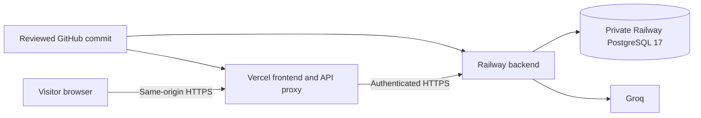

# Gusto NutriBite: Deployment and Operations

Last updated: 13 October 2026. **Status: final pre-deployment plan; local production support verified, cloud deployment not started.** Priyank Agrawal is the project creator/operator and will deploy. This document owns the execution steps and operating procedures; the [implementation plan](phase-wise-implementation-plan.md#phase-4--deploy-verify-and-close-m1) tracks milestone progress.

## Deploy with Railway and Vercel

Owner decision, 13 October 2026: use the same GitHub repository for a Railway backend/PostgreSQL and a Vercel frontend. This replaces the earlier Railway-only hosting choice. Production preparation is implemented locally; the owner will perform deployment. Cloud builds, platform configuration and public behavior remain unverified until the steps below are executed.

The browser calls `/api/v1/*` on its Vercel origin. A server-side Vercel route forwards to the configured Railway HTTPS origin with a shared secret and canonical visitor address. Railway owns database access, Groq, session/CSRF checks, quotas and cleanup. Vercel holds only its proxy secret and public origins. No CORS relaxation or browser-readable session token is needed. Preview deployments deliberately cannot access this production backend.



### Readiness and remaining decisions

| Item | Current evidence or action |
| --- | --- |
| Application preparation | Build, 77 unit checks, 55 integration tests and 40 browser tests passed in the recorded local run. See [testing](testing.md#phase-4-local-production-preparation); these are not cloud results. |
| Container and GitHub CI | Docker unavailable locally. Push the reviewed commit and confirm the full CI run, including the container build, passes. |
| Code identity | Deployment changes are currently local and uncommitted. Record the selected branch and commit before connecting releases. |
| Hosting access and cost | Operator selects the Railway/Vercel accounts and records the hosting budget, provider budget and alert settings. No paid plan or price is assumed. |
| Domains | Reserve one stable Vercel production origin and one Railway backend origin. Platform domains are sufficient; record both below. |
| Secrets and database | Configure platform-held secrets and a new dedicated PostgreSQL database using the committed templates. Never copy `.tmp/local` or its visitor data into production. |
| Model evidence | Preserve the existing M1 failure log. Record the consequential food-safety release disposition under the existing safety policy; no question-specific fixes or perfect-accuracy target are added. Human accessibility review remains separately identified as unperformed. |
| Privacy | Keep the test-project attribution and truthful Groq retention notice. A new public contact address or verified/enabled Groq Zero Data Retention is not required by this plan. |

Execute steps 1-5 with generation disabled. Step 6 verifies the deployed candidate and enables controlled live checks only after their budget and release disposition are recorded. Preparing this document does not provision services, authorize new paid evaluations or mark M1 complete.

### 1. Publish the prepared code

Review and commit the changes, push to the GitHub repository, and wait for the software CI checks. Both services must use the same reviewed commit initially. Keep `.env`, `.tmp`, database contents and evaluation response artifacts out of Git. The placeholder [backend](../.env.backend.example) and [frontend](../.env.frontend.example) files are safe to commit. No cloud deployment was performed by the local preparation task.

Repository: `https://github.com/priyank-agrawal-101/ai-nutrition-asst`. Do not push blindly from a dirty tree: review the final diff and intended files first. Use manual deployment or a verified CI gate while configuring the services; a GitHub connection alone does not ensure a hosting deployment waits for CI. Record the CI run URL and passing commit in the release record.

**Exit check:** a reviewed commit is on GitHub and its software/container checks pass. A failure is corrected and checked before advancing; it is not overridden by a green local build.

### 2. Reserve the frontend domain

Import the repository into Vercel using the Next.js framework and repository root. Select Node 24.x. The committed [Vercel configuration](../vercel.json) selects `npm ci` and `npm run build`. Record the production domain, such as `https://YOUR-FRONTEND.vercel.app`, without a trailing slash. A custom domain is optional. The first deployment may show an unavailable backend until variables are configured; that is not a completed launch.

Select the intended production branch and retain the same commit as step 1. Do not share the candidate as a working app during setup. Use platform deployment protection where available; `GENERATION_ENABLED=false` stops model generation but is not an access restriction on the site or stored-history endpoints.

**Exit check:** the Vercel project and stable production origin are known. No backend/provider/database secrets have been placed in Vercel.

### 3. Create the Railway services

Create a new Railway project for this app, add PostgreSQL 17 and connect an application service to this GitHub repository at its root. Keep PostgreSQL private. Use one backend replica and disable sleeping/serverless mode so the existing five-minute cleanup timer runs. Railway reads [railway.json](../railway.json) and the [Dockerfile](../Dockerfile): pinned Node 24.14.0/npm 11.11.0, production build, pre-deploy `npm run db:deploy`, startup `npm run start:production`, readiness `/api/v1/health/ready`. Startup binds `0.0.0.0` to Railway's `PORT`; never use `npm run dev` in Railway.

Generate a public HTTPS domain for the backend. It is the proxy destination, not the visitor-facing URL. Non-health API access requires the proxy secret, so directly visiting the Railway API without it is expected to fail.

The backend and PostgreSQL should share a region and private network. Verify the database major version is 17; do not silently accept a different template default. Stage variables in step 4 before triggering the first complete backend deployment. An automatic initial build without variables may fail; it is not grounds to loosen configuration checks.

**Exit check:** the project contains the backend and its dedicated persistent PostgreSQL service; the backend domain, private database destination, one replica and `sleepApplication=false` are recorded.

### 4. Configure backend variables

Use [.env.backend.example](../.env.backend.example) as the checklist. Set `APP_ORIGIN` to the exact Vercel production origin. Store the existing Groq key only in Railway. Keep the model and prompt bundle unchanged. Set `BUILD_ID` to the deployed Git commit (or a Railway reference to its commit variable).

Set `MIGRATION_DATABASE_URL` from the dedicated Railway PostgreSQL service's private connection URL. Set `DATABASE_URL` to the same host, port and database with username `nutribite_runtime` and a newly generated hex password. The pre-deploy script creates that restricted login if absent, applies checksum-verified migrations and grants only runtime data access. It does not reset the database or rotate an existing password. Use the same runtime password on later deploys. Do not point either URL at the local or another project's database.

Generate three independent 32-byte base64url secrets: one for `CSRF_KEYS`, one for `QUOTA_KEY`, and one for `PROXY_SHARED_SECRET`. Generate each locally with Node's `crypto.randomBytes(32).toString('base64url')`, then paste directly into platform secret settings; do not commit values or send them in chat. Set `CSRF_KEYS` as a JSON object with key `v1` and its secret, and `CSRF_ACTIVE_KEY=v1`. Generate the runtime database password with `crypto.randomBytes(32).toString('hex')`. Keep active secrets stable across deployments so sessions and quota windows survive.

Initially use `GENERATION_ENABLED=false`. Retain the current account ceilings or configure lower daily limits; this app's ledger cannot account for other applications sharing the Groq account. Configure the hosting spending limit/alerts and backup retention in the platform account before enabling ordinary public use. These account settings are not supplied by the repository.

Keep both database URLs on the same private host, port and database, without mixing a public connection URL with a private one. The migration user must be able to create the runtime role and database objects. On a later release, an incorrect runtime password must be corrected in configuration; the deployment script intentionally does not reset the role password or database.

Trigger the backend deployment after variables are saved. Its pre-deploy command applies migrations before startup. Confirm successful restricted runtime access and `/api/v1/health/ready` returning 200. Do not run migrations independently from multiple replicas or use schema push.

**Exit check:** the backend is healthy on the selected commit, migrations are applied, runtime privileges are restricted and generation remains disabled. Record actual platform backup/log-retention settings and any unresolved mismatch with the published policy.

### 5. Configure the frontend and redeploy

Set the five variables from [.env.frontend.example](../.env.frontend.example) in Vercel's **Production** environment only. `BACKEND_ORIGIN` is the exact Railway HTTPS domain and `PROXY_SHARED_SECRET` must match Railway. Do not put `GROQ_API_KEY`, database URLs, CSRF keys or quota keys in Vercel. Do not prefix the proxy secret with `NEXT_PUBLIC_`. Vercel supplies `VERCEL=1` and `VERCEL_ENV=production`; the application rejects preview use of this backend. Redeploy after setting the variables.

| Relationship | Required value |
| --- | --- |
| `APP_ORIGIN` on both platforms | Exactly the same stable Vercel HTTPS origin, with no path/trailing slash. |
| `BACKEND_ORIGIN` on Vercel | Railway backend HTTPS origin; never the Vercel origin. |
| `PROXY_SHARED_SECRET` on both platforms | Exactly the same independent secret, supplied server-side only. |
| Deployment roles | `backend` on Railway, `frontend` on Vercel; both use `APP_ENV=production`. |

Confirm Vercel exposes its system environment variables and that the deployed function supports the configured 90-second allowance. Keep any protection on the candidate compatible with operator testing; do not remove the application's Origin, CSRF or proxy checks to work around a platform configuration problem.

**Exit check:** Vercel serves the frontend from the intended commit, and its `/api/v1/health/ready` reaches the healthy Railway backend. Frontend Preview remains unable to use this production backend.

### 6. Verify before opening the app to visitors

First run the configuration, asset, session and access checks below with generation disabled. Record the results against the actual frontend/backend deployment IDs. Fix a deployment defect and repeat the affected check; do not erase stored data or alter nutrition answers to make the smoke test pass.

- Check both Railway health endpoints and the same endpoints through the Vercel origin. Readiness must verify database schema and restricted runtime access; liveness alone is insufficient.
- Open Vercel's production URL. Establish a session and inspect the host-only `__Host-nutrition_session` cookie: `Secure`, `HttpOnly`, `SameSite=Lax`, `Path=/`, no `Domain`. Confirm there are no CSP violations or missing CSS/JS assets.
- Confirm rejected foreign origins, missing/wrong CSRF, direct unauthenticated Railway requests and another session's history cannot bypass access checks. Verify Vercel's canonical visitor header cannot be spoofed through public requests. Do not log raw addresses, cookies or secrets while checking.
- Once the release disposition and a small live-call budget are recorded, set Railway `GENERATION_ENABLED=true` and redeploy. Complete a real question, a follow-up, required refusals, refresh/recovery, Sources and mobile checks. Preserve existing M1 failures; hosting does not require a model correction campaign.
- Verify the 65-second backend deadline, 70-second proxy/browser deadline and configured 90-second Vercel function allowance on the actual account. An interrupted mutation must recover through stored IDs/status, not automatic resubmission. Local injected-transport tests are not proof of platform timeouts or cookie forwarding.
- Verify five-minute cleanup, runtime-only logs, generation shutdown, managed database backups/retention and a recovery procedure. The earlier isolated archive rehearsal is supporting evidence, not a test of Railway-managed backups.
- Record frontend/backend URLs, deployed commit, health/browser results and known limits in README and the Phase 4 plan. Only then mark public delivery complete.

For the small live smoke check, plan one general cooking question and a relevant follow-up, then direct calorie-target and condition-specific diet requests. Expect two useful stored replies and two refusals with referrals. Record a call/token cap before enabling generation and charge all phases/errors against it; four questions do not mean four provider calls. Reuse the saved conversation to verify refresh/recovery without regenerating answers. Do not invoke `eval:groq` or `smoke:groq` as a substitute: those scripts create isolated local environments, not a test of the hosted URL. The full ten-question baseline remains unchanged for M2.

**Exit check:** actual public chat, required refusals, saved recovery, privacy/access boundaries and operating controls have recorded evidence. Outstanding platform or consequential safety issues stay explicit; a successful hosting build alone does not close Phase 4.

### Release record

Fill this record with non-secret identifiers and evidence after each step. Keep raw synthetic transcripts and account details private. Pending entries are not passes.

| Field | Value / evidence |
| --- | --- |
| Operator | Priyank Agrawal |
| Selected production branch and commit | Pending |
| GitHub CI run, including container build | Pending |
| Railway project/service and backend deployment ID | Pending |
| Railway backend origin | Pending |
| PostgreSQL version, migration result and runtime-grant check | Pending |
| Vercel project and frontend deployment ID | Pending |
| Vercel production origin | Pending |
| Backend `BUILD_ID` | Pending; must identify the selected commit |
| Provider/model and prompt baseline | Groq `openai/gpt-oss-120b`, `m1-prompts-v2`; verify effective deployed configuration |
| Operating spend limits, alerts, backup/log retention | Pending; private evidence reference only |
| Live smoke budget, actual usage and results | Pending |
| Health, cookies, CSRF/ownership, proxy, assets and browser checks | Pending |
| Cleanup, shutdown and recovery checks | Pending |
| Consequential findings and release disposition | See [Phase 3 review](evaluations/phase3-review.md); record operator disposition |
| Final public-delivery date and outcome | Not deployed |

### Implementation boundaries and references

[Production configuration](../src/server/config.ts) requires the backend role, an exact public HTTPS origin, Groq and an independent proxy secret. [Frontend forwarding](../src/server/frontend-proxy.ts) bounds/parses requests, rejects foreign origins, forwards only allowlisted headers, disables caching and redirects, and preserves uncertain outcomes without retrying. Railway trusts only the proxy-authenticated canonical address; quotas retain the existing keyed digest storage. Public health responses contain no visitor data. [Page CSP](../src/proxy.ts) uses a fresh script nonce; inline styles remain allowed for the current UI. Local configuration/cookies/launcher remain separate.

Vercel's [request-header documentation](https://vercel.com/docs/headers/request-headers) and Railway's [pre-deploy documentation](https://docs.railway.com/deployments/pre-deploy-command) were accessed on 13 October 2026. The implementation uses `x-vercel-forwarded-for` at Vercel and replaces all incoming private proxy headers. Actual account behavior must still be verified. No additional proxy in front of Vercel is configured by this plan. Docker is unavailable on this local machine; the actual container image build must be checked in CI/Railway. The local Next build is separate evidence.

The remaining sections contain reusable operating procedures and dated local evidence. Earlier phase limitations are historical; the production implementation and final deployment sequence above are current.

## Phase 3 recovery and release readiness

The new [restore rehearsal](../tests/recovery/restore.test.ts), invoked with `npm run test:restore`, verifies a real PostgreSQL 17 custom archive in a separate, marked test database. [Migration 0005](../migrations/0005_restore_validation.sql) corrects function resolution during restoration, preserving all existing data/validation rules. No visitor backup or shared database was used for this test.

For an operator restore, keep the public app and generation stopped. Use matching PostgreSQL 17 `pg_dump --format=custom --no-owner --no-acl` and `pg_restore --exit-on-error --no-owner --no-acl` against explicitly selected, separate project databases. Supply credentials through protected environment/password files, never command arguments or logs. Latest-schema archives contain the corrected function configuration. Older archives need staged pre-data restoration and the reviewed function-search-path correction before data/post-data restoration; that older-archive procedure is not yet separately verified. Apply the migration manifest before app startup, reapply runtime grants, and verify checksums/readiness.

If post-backup revocations cannot be reconstructed, revoke **all restored sessions before allowing access**, then run the existing maintenance routine until all visitor payload/session tables are empty and generation slots released. Verify the archive's recovery point and record expected history loss. Do not purge the source database, remove `.tmp/local`, or use this disaster-recovery procedure for an ordinary restart. The rehearsal proves the conservative policy; managed backup scheduling, encryption, retention and restoration time still need hosting evidence.

Groq's [Your Data in GroqCloud](https://console.groq.com/docs/your-data) page was accessed on 13 October 2026. It says inference content is not retained by default, but reliability/abuse exceptions may retain inputs/outputs for up to 30 days; organization admins can enable Zero Data Retention. Usage metadata is retained separately. **This is a public policy check, not verification that this account has ZDR enabled.** The app uses ordinary chat completions, not batch/fine-tuning features. Confirm the organization's Data Controls before public claims; keep provider-held retention distinct from the app's seven-day access and cleanup policy.

Local limits remain 30 calls/minute, 1,000/day, 8,000 tokens/minute and 200,000/day; evaluation allocation must leave 50,000 tokens for chat. The owner approved 120 calls/120,000 additional tokens for the Phase 3 work. The primary continuation used 26/33,873 and its separately labeled diagnostic run used 10/13,108: **36 calls / 46,981 tokens total**, with no automatic retries. Unknown usage stays conservatively charged. Export/import evaluation charges into the local ledger exactly once before restarting the visitor app; an isolated database is not a separate provider allowance.

Owner clarification, 13 October: use **"An experimental project created by Priyank Agrawal."** A dedicated public support contact and enabling/verifying Groq ZDR are not requirements of the original assignment; the owner chose not to add them for this test project. Record Priyank Agrawal as project creator/operator without inventing an email/contact route. Groq account retention stays unknown, with the existing honest notice. Railway retention/backup configuration, spend/alert delivery and hosting timeouts remain unverified. Production now requires explicit validated configuration, rather than being unconditionally disabled. [The review disposition](evaluations/phase3-review.md) distinguishes required exclusions, consequential factual findings and additional review. No Railway service, production secret or public deployment has been created by this work.

This document owns environment setup, release procedures, maintenance, and recovery. Follow the [implementation plan](phase-wise-implementation-plan.md); [architecture](architecture.md#12-deployment-and-operations), [safety/security](safety-and-security.md), and [data model](data-model.md) remain authoritative for behavior and constraints. Add exact commands and evidence here as implementation makes them real.

## 1. Environments and configuration

Use the Vercel frontend and one Railway Node backend with PostgreSQL described above. Keep Railway database connectivity private. No separate staging service, queue, Redis or monitoring platform is required for M1. Local, test and production databases remain separate.

| Environment | Boundary |
| --- | --- |
| Local development | Project-owned database and process; scripted provider first. Deliberate real-provider work uses separate credentials and a recorded budget. |
| Tests / PR CI | Disposable PostgreSQL and synthetic data; `TEST_DATABASE_URL` only, never fallback to a development/production connection. Follow [harness isolation](testing.md#3-harness-and-environment-isolation). No live provider/deployment secrets. |
| Controlled evaluation | Ordinary app pipeline with the verified provider, explicit spend limit, reviewer, and restricted synthetic artifacts. Separate from visitor traffic and normal CI. |
| Production | Dedicated database, restricted runtime identity, real provider only, and server-held secrets. A production build used by the isolated test harness is not a production deployment. |

Pinned versions and runnable commands are in [package.json](../package.json), [.node-version](../.node-version) and [Dockerfile](../Dockerfile). Use the role-specific templates above for public deployment and [.env.example](../.env.example) for local configuration. Do not publish real values.

Required configuration covers database connections, allowed origin/trusted proxy, independent security keys and versions, provider endpoint/model/settings, generation enablement, and effective limits. Keep migration credentials separate from the runtime role. Use host secret settings in production and ignored local environment files; never browser-exposed prefixes. Missing or invalid required configuration must fail startup/readiness. Build and routine health checks make no model calls or migrations.

Existing provider compatibility and model evidence are recorded in testing/evaluation. Before public calls, verify the deployed configuration, account capacity and bounded smoke allowance. Before ordinary public use, record actual hosting retention, timeouts, connection limits, shutdown and spend/alert settings. Keep the owner's operator/contact and Groq retention decisions above; do not introduce new administrative requirements.

## 2. Commands and release procedure

The commands are implemented. Their checks and applicability stay in [testing](testing.md#6-command-and-ci-contract).

| Command | Where and when |
| --- | --- |
| `npm ci`, `npm run check`, `npm run test:integration`, `npm run build`, `npm run test:browser-matrix` | Local/CI verification with the scripted provider and disposable test database. Stop the local app before a local build. |
| `npm run test:restore` | Isolated archive rehearsal; requires PostgreSQL 17 client tools. |
| `npm run db:deploy` | Railway pre-deploy step with explicit migration/runtime URLs; provisions the restricted role and applies migrations. |
| `npm run start:production` | Railway only; binds to `0.0.0.0:$PORT`. |
| `npm run dev` | Local saved app and project-owned PostgreSQL only. |
| `npm run maintenance` | Operator invocation with runtime configuration and TypeScript tooling available; the production container already runs the maintenance loop automatically. |

Steps 1-6 above are the first-release procedure. For subsequent releases:

1. Identify the commit, schema, prompt/policy versions, model/settings, and environment. Confirm Phase 3 software/evaluation evidence and [pre-deployment release gates](safety-and-security.md#release-review). Ordinary CI must not publish an unchecked change automatically.
2. Inspect migration SQL and compatibility with the running app. Before a risky change, create a backup and prove restoration into a separate database. Initial setup tests an empty schema; do not claim a nonexistent prior-version upgrade.
3. Produce the reproducible build. Run reviewed migrations once as a controlled release step with the migration identity, then start the compatible app. Do not use schema push, per-replica startup migrations, or edit applied migrations.
4. Verify configuration, HTTPS/cookies, exact Origin/CSRF behavior, security headers, private DB access, and proxy timeouts. Test both health paths below and the maintenance controls.
5. Run a deliberate, budgeted provider smoke test and an external-browser stored exchange, required refusal, refresh/recovery, and empty sources-panel check. Health polling alone does not verify the provider or chat.
6. Record the public URL, deployed commit/configuration, date, evidence links, operator, and disposition here; update README and the plan. Only then mark M1 deployed and verified.

| Health path | Expected behavior |
| --- | --- |
| `/api/v1/health/live` | Process response only; no database/model call. |
| `/api/v1/health/ready` | Required configuration, database, and schema compatible: 200; otherwise safe 503. No paid call or secret details. |

For a release rollback, stop new generation, identify the last verified compatible app/schema pair, and redeploy it only if compatibility holds. Otherwise use a reviewed forward repair or controlled restore. Recheck health, persistence, and affected flows. Never reset the database or erase conversations as a deployment shortcut.

To stop generation on Railway, set `GENERATION_ENABLED=false` and redeploy/restart the backend; verify the new deployment is active. This is not instantaneous while the old process drains. `npm run generation:off` controls only the local marker and does not disable Railway. Keep safe history/status reads and cleanup available. Roll back frontend/backend to a known compatible pair without changing stable secrets; a code rollback does not reverse database migrations. Preserve failure evidence and use the restore procedure only when a database restore is actually required.

## 3. Maintenance, retention, and cost

Initial implementation default: one process-owned maintenance loop at startup and every five minutes, with bounded batches and no overlapping passes. Reuse the same reviewed routine for operator recovery. Reconcile expired attempts/slots and clean expired/revoked sessions and quota rows using database time and the [scoped transaction rules](data-model.md#10-retention-cleanup-and-recovery). No public maintenance endpoint or job service is needed. Verify continuous process availability and restart behavior on the chosen hosting plan; change scheduling if it cannot meet the policy.

The [retention schedule](safety-and-security.md#retention-schedule) owns durations: immediate access cutoff at expiry/revocation, payload purge within 24 hours, quota cleanup within one hour of window end, seven-day logs/backups, and thirty-day operator audit. Verify hosting/provider retention separately; backups may retain copies for up to eight days after access cutoff. New chat is not deletion; manual deletion remains deferred.

Record maintenance success time, counts, duration, oldest pending cutoff, and safe error codes. Configure operator alerts for stale/failed maintenance, impending retention breaches, storage/readiness failures, repeated safety/schema rejection, and spend thresholds. Record actual alert settings and delivery verification before public use. Log only [allowlisted metadata](safety-and-security.md#8-logging-evaluation-evidence-and-operator-access), including in hosting logs; never transcripts, credentials, or raw provider exceptions.

Use the existing quotas plus verified provider spending controls where available. Local token estimates are not a guaranteed spending cap. When cost, safety, or provider health requires shutdown, disable new attempts and new provider dispatches while preserving safe authorized history/status and cleanup. Already dispatched remote work may still cost money. Never skip a required review to finish an in-flight turn; reconcile interrupted work without automatic regeneration.

## 4. Recovery and incidents

- **Restart/outage:** preserve PostgreSQL state; drain bounded in-flight work where possible. Startup/status reconciliation resolves deadlines. Verify saved history and duplicate protection using synthetic tests.
- **Backup restore:** keep public access disabled, restore into a separate project-owned database, and check schema/constraints and synthetic ownership/history. If later revocations cannot be reconstructed, invalidate all restored sessions and purge retained visitor payload before reopening. Record recovery point and history loss; do not build a deletion-ledger service or silently revive revoked access.
- **Safety, privacy, or secret incident:** contain the affected capability, preserve safe evidence, assess impact, revoke/rotate affected access, apply a general fix, and pass relevant regression before reopening. Do not export visitor transcripts into issues or logs. Record operator, time, reason, action, and outcome under the audit policy.

## 5. Evidence still to add

Current evidence and remaining work:

- [x] Phase 1: pinned versions, environment names/loader, isolated DB/roles, start/migration/maintenance implementation, and passing restart/cleanup tests. See [evidence](testing.md#phase-1-implementation-evidence).
- [x] Phases 2–3: provider compatibility, bounded evaluation captures, failure records, local shutdown and isolated restoration evidence. Human review and account-level retention are not implied complete; see the owning records.
- [x] Phase 4 preparation: production roles/proxy/cookies/quotas/startup, deployment files and local software/browser verification.
- [ ] Before public access: actual Railway/Vercel settings, spend/alerts, backup retention/recovery evidence and the recorded release disposition.
- [ ] Phase 4: deployed identity/URL, external verification, and release/rollback record. Use concise dated entries here; link detailed test/evaluation evidence instead of copying it.

## Phase 1 local operation

The [local launcher](../scripts/local.mjs) is `npm run dev`, after `npm ci` and `npm run build`. It creates only project-owned resources under `.tmp/local`, selects unused loopback ports, saves the origin/security configuration for restart, and uses PostgreSQL **17.9** packaged native binaries. This is a dedicated PostgreSQL cluster, not SQLite or a database from another project. The same PostgreSQL major is pinned in [CI](../.github/workflows/ci.yml). Local runtime data and credentials are ignored by Git; preserve the directory between launches.

Use Node 24.14.0 and npm 11.11.0. During this Windows implementation, a project-local runtime was installed in `.tmp/runtime/` because the host has Node 26. With that existing runtime, PowerShell can select it for one terminal:

```powershell
$env:PATH = (Join-Path (Get-Location) '.tmp/runtime/node_modules/node/bin') + ';' + $env:PATH
& .tmp/runtime/node_modules/node/bin/node.exe .tmp/runtime/node_modules/npm/bin/npm-cli.js run dev
```

On a fresh machine, install/select the pinned LTS runtime normally; `.tmp/runtime` is not committed. The npm commands themselves work in PowerShell, Git Bash, and Linux. The launcher serves the production build and reports the chosen URL. It refuses occupied stored ports rather than stopping another listener. Ctrl+C stops its child application and then its cluster, preserving local data. It opens no visible helper windows.

For separately provisioned dedicated PostgreSQL, [`.env.example`](../.env.example) names the inputs validated by [config.ts](../src/server/config.ts). Supply them in the process environment, or with Node's `--env-file` option; operator scripts do not implicitly load `.env`. `npm run db:migrate` requires `MIGRATION_DATABASE_URL`; it never falls back to `DATABASE_URL`. `npm run maintenance` uses the runtime configuration and the same reviewed purge/reconciliation routine. It has no HTTP endpoint. The local launcher generates its own ignored configuration, so it needs no manual secret entry.

Maintenance starts with the Node server and repeats every five minutes without overlapping passes, with 100-session/100-conversation batches. Status reads reconcile relevant expired attempts independently. Safe events include counts, duration and oldest cutoff; production alert delivery and seven-day platform-log/backup enforcement remain unverified. The generation flag is read at bootstrap; changing it requires restarting the app with the new configuration. History/replay/cleanup remain available when new generation is disabled.

Historical Phase 1 supported loopback only. The local profile still groups loopback traffic and ignores forwarded addresses; current production uses authenticated proxy identity, HTTPS cookies and CSP. No Railway resource or paid provider was provisioned by Phase 1. Cloud operating verification remains in the final plan above.

## Phase 2 Groq local operation

Use Node 24 and npm 11. Install with npm ci, build with npm run build, then start with npm run dev. The launcher retains the existing .tmp/local database, cookie keys and origin. It applies additive migrations with the separate owner identity and grants only runtime operations; it never resets stored chats.

The ignored project .env supplies PROVIDER_MODE=groq, GROQ_API_KEY and GENERATION_ENABLED=true. A minimal file has been prepared locally; the owner's key is never committed. The server pins openai/gpt-oss-120b. Choose PROVIDER_MODE=scripted for offline demos; its visible label and data notice remain explicit. The launcher imports only the named provider/operating settings from .env, never another project's database URL. .env.example documents names/placeholders. Rebuild after source changes; this launcher serves the compiled app.

Use npm run generation:off to create the project's local shutdown marker; new attempts and every later provider phase stop without restarting the app. Use npm run generation:on to remove that marker. GENERATION_ENABLED=false still takes precedence until a restart with a changed setting. Status/history reads remain available. A request already dispatched may incur usage; shutdown cannot safely undo it. This is a local operator action, not an unauthenticated web control.

The user's Groq limits are 30 requests/minute, 1,000/day, 8,000 total tokens/minute and 200,000/day. All local app processes sharing this database share durable rolling limits. GROQ_DAILY_CALL_LIMIT and GROQ_DAILY_TOKEN_LIMIT may lower daily caps. Other software sharing the same Groq account is outside this ledger; keep spare capacity and avoid concurrent external use. Provider 429/errors are never retried automatically. Larger conversations can run out of capacity mid-pipeline; they fail safely and preserve history. Do not skip review or raise account limits to force a demo pass.

The rate-limit fix checks first-phase availability before accepting new work and calculates when enough minute/day reservations expire. Mid-pipeline limits remain explicit stored failures. Groq HTTP 429 uses a valid `Retry-After` (bounded to 24 hours), or a 60-second fallback, and persists an account cooldown shared across conversations and restarts. Unknown usage remains reserved. Apply additive migration 0003 through the local launcher before serving the new build; existing rows are preserved. A cooldown is an earliest retry estimate, not reserved capacity. Requests larger than the configured token ceiling receive a distinct capacity error rather than an endless wait.

The deliberate npm run smoke:groq entry point creates an isolated database/cluster and a private .tmp/live/<run-id> evidence directory. It reads the project key, writes its manifest before dispatch, caps the run at 20 calls/40,000 tokens, and paces groups by 62 seconds. It uses the same Groq adapter, account reservation module and ordinary built Next.js API. Normal check/integration/browser tests use a scripted provider and an explicit environment allowlist. Build/test processes blank GROQ_API_KEY and suppress Next's dotenv processing; Next may report discovered .env filenames, but those values are not imported into test configuration.

Keep synthetic evidence private and preserve failures. No raw provider errors, returned reasoning, rejected candidate text, credentials or visitor data belong in Git or ordinary logs. The local smoke checks are not the fixed-question evaluation or public-hosted verification. Later Phase 3/4 work completed the recorded browser matrix, isolated archive rehearsal and production implementation; human accessibility review and actual cloud operating evidence remain distinct.

## Temporary local diagnostics

The owner authorized local capture on 11 October 2026 to understand rejected responses. Start the upgraded local app so migration 0004 is applied. Operator commands, run from this project:

| Command | Effect |
| --- | --- |
| `npm run diagnostics:on` | Enable capture for the next 24 hours; does not call Groq. Reload the chat to update its privacy notice. |
| `npm run diagnostics:off` | Stop capture immediately. Existing records keep their expiry. |
| `npm run diagnostics:status` | Remove expired records, then show capture expiry, record count and next record expiry without printing content. Requires the local app/database to be running. |
| `npm run diagnostics:purge` | Remove only diagnostic records immediately. Does not delete chats or disable future capture; use `diagnostics:off` first to stop collecting. |

The ignored `.tmp/local/diagnostics.enabled.json` is an expiring operator switch, not a credential or a public setting. Ordinary test mode ignores it. Nothing turns capture on automatically when a request fails. Records live in a separate local database table, never in the transcript or future model context. Inspect them using the [project's SQLTools walkthrough](project-documentation.md#inspect-rejected-model-responses).

The collector retains returned input/output verdicts and answer content for failed attempts, plus model-driven refusals/clarifications. An input refusal has no generated answer. Successful answers are already stored in messages and are not copied. Capture is best effort: a crash, timeout before content arrives, disabled/expired switch, lost session, or failed diagnostics write can leave no record. Replays do not regenerate or backfill diagnostics. The old discarded protein answer cannot be recovered.

Records expire after at most 24 hours or earlier session expiry. Physical deletion occurs on the next five-minute maintenance pass, new capture, status/purge command or startup; while stopped, cleanup waits for startup. The newest 100 records are kept. The local owner has database access, so expired rows should not be treated as readable evidence awaiting indefinite review. Do not include diagnostic content in backups, Git, public issues or test artifacts. Production configuration explicitly disables this local-only capture facility; do not copy its marker or data to Railway.

## Deliberate classifier regression

`npm run eval:groq` is an operator-only live evaluation, not a normal test or CI command. It runs the [frozen baseline and policy extensions](evaluation.md#classifier-v2-regression) using an isolated owned PostgreSQL database, the built app and its ordinary API. Read that run's budget and evidence policy first. Do not run it concurrently with local chat or another client using the same account.

Before dispatch, stop this project's idle visitor app, preserve its data, and build the intended prompt version. The global local-generation shutdown marker also affects the isolated app, so clear that marker only after the visitor app is stopped. Record a fresh account-usage snapshot and the previous input prompt in private `.tmp` files. The usage snapshot shape is `{at, local: {calls, charged_tokens}, old: [{run, budget: [{calls, charged_tokens}]}]}`; include all other recent runs without double-counting any usage already imported into the local ledger. The baseline-prompt file contains `{input_safety: "<previous assembled system prompt>"}`. Never put credentials or visitor text in either file.

Set `LIVE_MAX_CALLS`, `LIVE_MAX_TOKENS`, `LIVE_PRIOR_USAGE_FILE` and `LIVE_BASELINE_PROMPTS_FILE` for that invocation, then run `npm run eval:groq`. The script rejects absent/out-of-range caps, files outside this project's `.tmp`, usage snapshots older than an hour, and allocations exceeding the supplied remaining 200,000-token daily budget. These checks cannot discover usage by unrelated applications. Per-call app reservations and upstream 429 remain authoritative. A run can stop before its planned slots are complete; report those slots as unrun, never passed.

Retain `.tmp/live/<run-id>/` results and rejected synthetic diagnostics privately. Inspect both accepted messages and classification/reviewer decisions. Restore the visitor app only after accounting for evaluation usage in its quota ledger; an isolated test database is not a separate Groq allowance. Conservative aggregate accounting may hold usage until 24 hours after a run finished. Reuse the original origin/database and check both health endpoints. No visitor data is migrated to the evaluation database.

After the owner encountered a long daily-budget wait, the regression runner now requires every new allocation to leave **50,000 tokens** of the configured 200,000-token daily allowance for interactive chat. Its check includes already-used tokens and the entire proposed test allocation, and the reserve is recorded in the manifest. Split larger evaluations across available budget windows. This safeguards future runs; it does not refund tokens already used, and a second key for the same account does not reset this app's shared usage ledger. No quota rows are deleted to make chat appear available.

The UI no longer displays a separate countdown in raw seconds. The normal concise usage-limit status remains, with Send/Retry disabled until the known wait expires. Draft editing and history access stay available; expiry never submits automatically.

## Local rebuild and missing styles

Stop this project's local launcher before running `npm run build`; then restart with `npm run dev` and refresh the browser at its saved origin. Keep `.tmp/local/`. The build preflight refuses to overwrite the active local app's files. When operating a background launcher, verify project ownership and wait for active model work before stopping it; never stop unrelated Node/PostgreSQL processes.

A healthy API does not prove that the page assets load. After a rebuild/restart, check the actual page's linked CSS and JavaScript as well as both health endpoints. [P2-008](failure-log.md#p2-008-running-server-and-rebuilt-assets-13-october-2026) records the missing-style incident and recovery.
