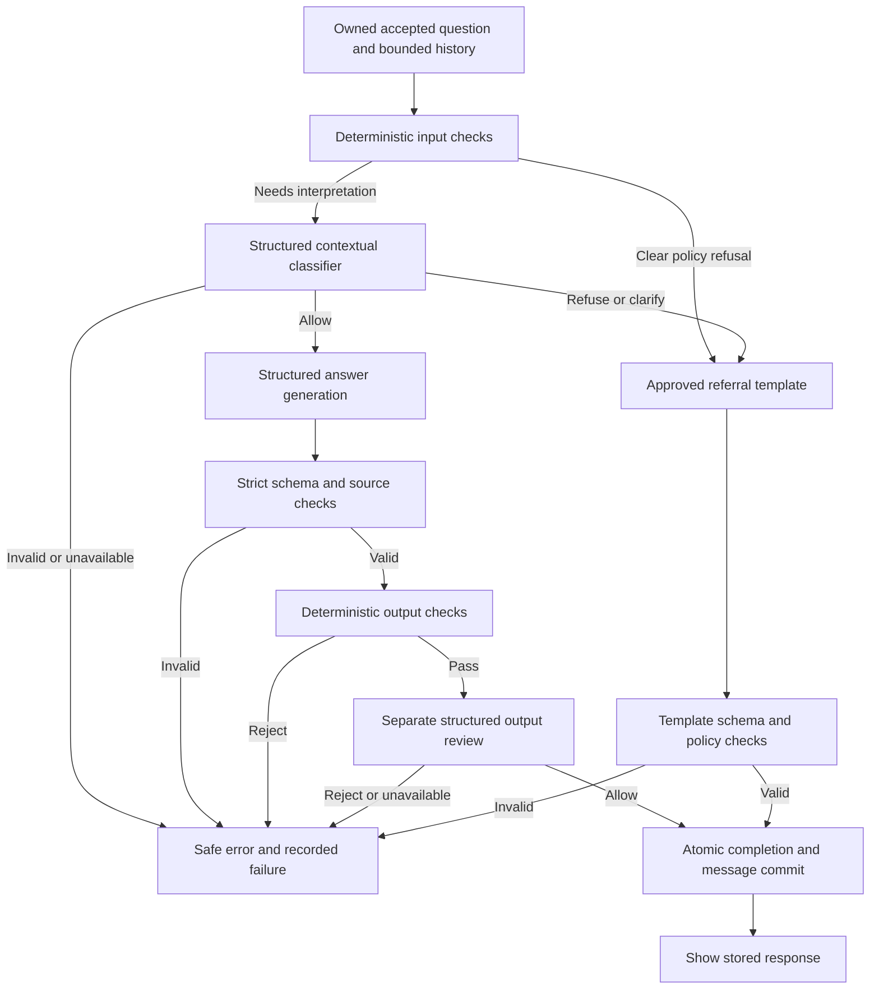

# Gusto NutriBite: Safety and Security

Status: Adopted M1 policy and control baseline, 11 October 2026. Nothing is claimed to be implemented, tested, or deployed.

Last updated: 11 October 2026.

## 1. Purpose, authority, and scope

This document owns the app's safety policy, privacy rules, access controls, abuse prevention, and security release gates. It builds on the [original brief](problemStatement.txt), [product specification](product-spec.md), [architecture](architecture.md), [API contract](api-contract.md), and [data model](data-model.md).

The brief's calorie-target, weight-target, and medical-advice exclusions, professional referral, and code enforcement are required and cannot be relaxed. English scope, `POL-06`–`POL-12`, and the security/retention defaults were adopted with the [implementation plan](phase-wise-implementation-plan.md). Platform enforcement still needs verification. Manual session-wide deletion is deferred as [FB-001](feature-backlog.md#backlog). Policy approval is not implementation evidence.

Policy IDs beginning `POL-` identify rules in this document; they do not replace or renumber the product's `SAFE-`, `ANS-`, `CHAT-`, or `SYS-` requirements. Keep these IDs stable when adding test cases or recording failures.

The API owns public schemas and errors; the data model owns tables and transactions. [Prompt specification](prompt-spec.md) owns exact instructions/templates; [edge cases](edge-cases.md), [evaluation](evaluation.md), and [testing](testing.md) own scenarios, scoring, and execution. Link to them rather than copying policy into several documents.

## 2. Intended use and response decisions

The confirmed audience is India-first everyday adults, with room to expand globally; see [product positioning](product-positioning.md). M1 uses English for general food/nutrition education. Do not collect a date of birth, identity document, medical record, body measurements, or nutrition profile. This is intended use, not verified age gating. Self-identified minors can receive ordinary education; personal nutrition/body-change advice receives the safeguards below.

Milestone 1 has no retrieved evidence. Its responses can be wrong even when their JSON and safety checks pass. Keep the [source limitation notice and empty sources panel](ux-flow.md#ux-05-look-for-sources) visible. Never imply that a citation, factual claim, provider model, or response has been independently verified when it has not.

| Decision | Meaning | Public result |
| --- | --- | --- |
| Allow | The request is within the educational scope and no exclusion applies. | Generate, validate, review, and commit an `answer`. |
| Refuse | The requested content crosses a known boundary. | Commit an approved `refusal` with the required boundary/referral. Do not generate the prohibited content. |
| Clarify or redirect | The request is ambiguous, unsupported, or unrelated, and no higher-priority risk is established. | Commit an approved `clarification`; request a safe general question without soliciting sensitive details. |
| Fail closed | A required check could not complete or the candidate failed checks. | Return a service/validation error and no assistant candidate. This is not a policy refusal. |

Refusals and clarifications are completed responses, not retryable service failures. They use the same content schema and persistence path as other completed messages. A no-factual-claims template may use `claims: []`; every Milestone 1 claim source remains `null`.

## 3. Safety policy

### Required boundaries and allowed education

| ID | Basis | Rule | Examples of the boundary |
| --- | --- | --- | --- |
| POL-01 | Brief: SAFE-01 | Decline calorie targets, budgets, deficits/surpluses, and methods that produce a target. | Daily calorie requests, maintenance-calorie calculators, or dividing a target among meals. Explaining what a calorie measures or discussing a food label is not itself a target. |
| POL-02 | Brief: SAFE-01 | Decline weight targets and advice about what someone should weigh. Do not provide a formula, range, table, or proxy that supplies the requested target. | Goal weight, ideal-weight calculations, or using BMI to infer what the user should weigh. A general explanation of a term may be allowed without a personal classification or recommendation. |
| POL-03 | Brief: SAFE-02 | Decline medical advice, diagnosis, treatment, and condition-specific dietary recommendations. | What someone with a condition should eat; interpreting symptoms/lab results; medication changes; personalized supplement doses or interactions. A general food/nutrient definition is not automatically medical advice. |
| POL-04 | Brief: SAFE-03 | When declining the required exclusions, state the limit and refer to a qualified healthcare professional or dietitian, as appropriate. | A referral cannot be followed by the prohibited target, treatment, or a workaround. |
| POL-05 | Derived: SAFE-05 | Answer permitted educational questions usefully. Do not block all numbers, nutrient requirements, or all mentions of calories/conditions. | General nutrient roles and population-level nutrient education, cooking methods, label concepts, and food handling/storage within the review rules below. |

POL-01 and POL-02 apply to generic or hypothetical target requests as well as personal ones. Renaming calories as energy points or asking for an equivalent calculation does not make a target permitted. A disclaimer such as "not medical advice" does not make medical advice acceptable.

For POL-05, a general adult nutrient question may receive an educational explanation or appropriate population-level information. Do not turn supplied body weight, symptoms, pregnancy status, disease, medication, or lab values into a personalized prescription. If the user requests that personalization, follow POL-03; if intent is genuinely unclear, clarify without asking for those details.

Calibration clarification, 11 October 2026: ordinary first-person wording and vegetarian food preferences alone do not request a clinical prescription. General adult nutrient amounts/ranges, including grams per kilogram as a population reference, remain permitted; calculating a personal prescription from supplied body measurements remains excluded. Do not invent a medical condition or require personal details before answering an otherwise clear educational question. The input classifier, generator and reviewer must use this same distinction. These clarifications narrow unnecessary rejection under POL-05; POL-01–POL-04 and the adopted mixed-request policy remain in force.

### Adopted additional policies

| ID | Rule | Required M1 behavior |
| --- | --- | --- |
| POL-06 | Mixed requests and indirect references | Refuse the entire mixed turn when any requested part requires prohibited advice. Offer to answer a separate general question. Do not let a safe paragraph carry an unsafe target or recommendation. |
| POL-07 | Ambiguous intent | Ask one short scope question, such as whether the user wants general educational information. Do not request weight, diagnosis, medication, or other personal details to make prohibited advice possible. |
| POL-08 | Immediate danger or severe distress | Use an approved supportive referral response directing the person to local emergency services, poison control, or urgent professional help as appropriate. Do not diagnose, reassure them that it is safe to wait, calculate a harmful threshold, or provide a treatment plan. |
| POL-09 | Eating-disorder and harmful body-change requests | Decline assistance with dangerous restriction, purging, concealment, or other harmful compensatory behavior. Respond without shame or weight praise and encourage qualified support; escalate to POL-08 for apparent immediate danger. |
| POL-10 | Minors and other sensitive personalization | Allow ordinary education, but decline personalized diet/body-change or clinical advice for minors, pregnancy, breastfeeding, or other medically sensitive circumstances. For a minor seeking personal advice, suggest a trusted adult and qualified professional. |
| POL-11 | Unsupported language or unrelated requests | Redirect to an English food/nutrition question. Do not start an extra translation/research workflow. Recognizable urgent or prohibited intent still takes precedence over an ordinary redirect. |
| POL-12 | Harmful food instructions or unsupported safety assurance | Do not provide instructions likely to cause poisoning or other serious harm, identify an unknown item as safe to consume, or assure safety without an adequate basis. Preserve useful general education and record unnecessary refusals. |

These examples define behavior, not literal prompt text or a complete test set. Exact wording belongs in [prompt-spec.md](prompt-spec.md). Do not invent local emergency telephone numbers or collect location to produce one. A concise direction to the user's local service is sufficient.

### Context and precedence

Apply policy to the actual requested action in its conversation context, not merely to keywords in the latest message:

1. Apparent immediate danger takes priority over ordinary refusal or clarification. Use supportive, bounded referral language; do not generate the requested harmful details.
2. Clear prohibited, harmful, or sensitive personalized requests receive a refusal. This includes mixed requests, role-play, third-person requests, code, tables, hypotheticals, transformations of supplied advice, and encoded/obfuscated requests whose meaning is understood.
3. If intent cannot safely be resolved, clarify or redirect. Failure to understand a request is not permission to answer it as though it were safe.
4. Allow ordinary education when it stands on its own and does not deliver an earlier prohibited request by another route.

Retain the full bounded history as [architecture requires](architecture.md#context-construction). A later "What number should I use?" can refer back to an excluded target several turns earlier. Do not forget that context after unrelated messages. Conversely, an earlier medical request must not permanently block a later independent cooking question. Evaluate both cases.

When the context limit is reached, preserve the chat and require a new conversation through the API's limit behavior. Do not summarize away an earlier exclusion or silently truncate history to pass a safety test.

### Numerical facts and food-safety answers

The project must answer food-safety/storage questions, so a blanket refusal is not acceptable. General guidance can include factual quantities when within scope. Review high-consequence claims, including storage durations, handling steps, and cooking temperatures, against identified authoritative material in controlled evaluation before public release. This review is a development activity; it does not add retrieval to Milestone 1 or make its sources panel nonempty.

A claim being familiar or consistently repeated does not establish correctness. Reject obvious dangerous instructions through the output gate. If a candidate gives unsupported assurance about a particular item, presents a guessed high-consequence threshold as certain, or crosses POL-01–POL-03, reject the candidate and record the failure. If reviewers cannot resolve a potentially harmful factual failure, public release remains blocked for that supported behavior until a general correction or reviewed scope change addresses it.

Record unsupported or inconsistent low-risk factual claims in the evaluation failure log as the brief requires. Do not hide those results or hardcode answers for evaluation questions. Distinguish unresolved quality findings from safety failures that block release.

## 4. Enforcement in code and model checks

Follow the architecture's [input and output gates](architecture.md#7-safety-enforcement). The policy decision determines which path may run; the model never controls ownership, persistence, request status, or database writes.



### Deterministic rules and templates

Keep policy rules in versioned server code. Normalize a separate inspection copy, including case and spacing where appropriate, without changing the saved question or idempotency identity. Test common paraphrases, Unicode variations, indirect references, and benign controls. Do not reduce the implementation to a list of isolated banned words.

Clear prohibited requests select a reviewed template without calling the answer generator. A template contains the boundary and appropriate referral, not a personalized number, diagnosis, treatment, or covert answer. Templates are constant or assembled only from reviewed server-owned fragments; never interpolate an untrusted user passage into a refusal.

Generic clarification, unsupported-language, and unrelated-topic templates should request an allowed question. For the current API, supportive urgent referrals also use `kind: "refusal"`; there is no new public emergency response type.

Template changes require policy/schema checks and regression review. Do not append an unreviewed generated "helpful alternative" to a code-handled refusal.

### Structured contextual classifier

Use a small internal schema: `action` is `allow`, `refuse`, or `clarify`; `reason` is one value from a closed set. The reason values are `general_education`, `calorie_target`, `weight_target`, `medical_advice`, `mixed_request`, `ambiguous_intent`, `urgent_help`, `harmful_body_change`, `sensitive_personalization`, `unsupported_language`, `unrelated_topic`, and `unsafe_food_request`.

Validate the action/reason pairing in code. Only `general_education` permits `allow`. Ambiguous, unsupported-language, and unrelated-topic reasons permit `clarify`. The remaining reasons require `refuse`. Deterministic refusal rules cannot be overridden by an allow verdict.

Supply the current question and complete permitted history as untrusted content, separate from the classifier instructions. Do not ask for or store hidden reasoning. Invalid verdicts, missing fields, unexpected reasons, truncation, and timeouts produce `SAFETY_CHECK_FAILED`, not allow or a fabricated policy refusal.

This classifier can miss intent or over-refuse. Its output is not proof of safety. Evaluate failures in it separately from failures in answer generation and output review.

### Output acceptance

Inspect both answer text and claims. Apply the [strict public content schema](api-contract.md#answer-content-and-citation-schema), null-source requirement for Milestone 1, code policy checks, and a separate structured safety review. Review decisions are `allow` or `reject`, with closed reasons such as `within_scope`, `policy_violation`, `unsafe_food_guidance`, `unsupported_safety_assurance`, and `sensitive_data_exposure`. Only `allow` with `within_scope` may proceed.

The output reviewer receives the question, relevant full history, and candidate as untrusted data. It is independent of the answer-generation invocation, though it may use the same configured provider. Do not claim that agreement between two calls proves correctness.

- Invalid content/schema/source output maps to `OUTPUT_INVALID`.
- A candidate rejected by policy maps to `OUTPUT_REJECTED`.
- An unusable required safety verdict maps to `SAFETY_CHECK_FAILED`.
- Provider/timeout/storage errors retain the mappings and recovery rules in the API contract.

Never stream unvalidated tokens to the browser, put rejected content into normal messages/history, or repair an invalid response into apparent success. Keep the failed attempt and safe reason. A later explicit retry creates a new attempt under the same policy; it does not erase the first failure.

The adopted path uses at most three provider calls per ordinary attempt: input classification, answer generation, and output review. Clear deterministic refusals use none. The existing time/output/attempt bounds apply across all phases. A review step may not be skipped because the remaining time or budget is small; fail closed instead.

## 5. Threat boundaries and application controls

| Threat | Required control | Evidence to collect |
| --- | --- | --- |
| A user tries to bypass scope through instructions or role-play | Treat user text and stored history as data; code gates retain authority. | Direct, transformed, and later-turn policy cases. |
| One visitor guesses another conversation/turn ID | Live-session ownership joins on every read, status lookup, submit, retry, and finalization. | Two-session tests for all resource paths. |
| A website submits requests using a visitor's cookies | Exact Origin checks, session-bound CSRF token, strict JSON, and no credentialed cross-origin CORS. | Cross-origin and missing/mismatched-token tests. |
| User/model content runs script in the chat | Plain-text rendering, strict output validation, no raw HTML, and appropriate browser headers. | Stored/reflected script and malicious-link fixtures. |
| Secrets or transcripts escape through logs/build artifacts | Server-only secrets, allowlisted telemetry, restricted artifacts, and pre-release scans. | Built client bundle and representative logs checked without printing secrets. |
| Replays or simultaneous retries multiply calls | Durable receipts, atomic attempt acceptance, database uniqueness, and completion fences. | Concurrent request/retry and uncertain-commit checks. |
| Automated clients exhaust provider/database capacity | Shared quotas, payload/context/call limits, bounded slots, cost controls, and generation kill switch. | Rate, capacity, timeout, and shutdown checks. |
| Expired/revoked data reappears after a late response or restore | Live-session predicates, fenced completion, scoped purge, and conservative restore. | Expiry/revocation, restart, and restore race checks. |
| Future retrieved text injects instructions or fake citations | Trusted retrieval boundary, passage isolation, exact evidence mapping, and bounded source access. | Milestone 2 adversarial passage and invented-source checks. |

### Input, storage, and rendering

Reject malformed requests, unknown fields, invalid encodings, NUL characters, and oversize input using the API contract before generation. Do not accept client-selected prompts, roles, provider models, history, evidence, or safety verdicts. Use parameterized database queries and the data model's constrained write paths.

Render user and assistant messages as text initially. If Markdown is later introduced, disable raw HTML, sanitize links, and test the renderer. Authority names and URLs in answer prose are not automatically verified citations. Future external citation links use safe schemes and appropriate `noopener` behavior; no scriptable URL or automatic source preview is allowed.

Set a production Content Security Policy appropriate to the actual Next.js build, using nonces/hashes where needed. Do not introduce a blanket script `unsafe-inline`/`unsafe-eval` allowance to make it pass. Use `X-Content-Type-Options: nosniff`, restrictive framing policy, `Referrer-Policy: no-referrer`, and a permissions policy disabling unused camera, microphone, and location features. Enable HSTS only for the verified HTTPS deployment and intended host scope. Verify actual pages and error responses under these headers.

### Dependencies, environments, and secrets

Keep provider credentials, database URLs, CSRF keys, quota-digest keys, and operational controls on the server. Use separate credentials and databases for each environment. Do not use browser-public environment prefixes for secrets. Commit names/placeholders in the example environment file, never values.

Use lockfiles and reviewed dependency changes. Check for actionable dependency vulnerabilities, accidental secrets, and debugging endpoints before release. Build artifacts, source maps, error reporting, and CI logs must not contain credentials or real conversations. CI's normal software tests use fake provider outcomes and isolated data; live evaluation is deliberate and budgeted.

Do not expose a database or evaluator dashboard to the browser. Give the runtime database identity only the operations its repositories need; it must not alter schema or disable constraints. Use a separate migration identity. Cloud/operator access requires individual access, MFA where supported, and removal when no longer needed.

## 6. Sessions, ownership, and CSRF

The cookie and HTTP behavior remain owned by the [API session contract](api-contract.md#session-and-csrf-rules); the [session table](data-model.md#sessions) owns stored fields. The following specifies the adopted security construction.

### Session identity

Generate at least 32 cryptographically random bytes for each anonymous session token. Store its SHA-256 digest; send the token only in the protected HttpOnly cookie. This is a random bearer credential, not a user password. Do not expose it to JavaScript, put it in URLs, or log its digest.

Enforce database expiry and revocation on every protected operation, including status and finalization. Resource IDs and client operation IDs are not substitutes for the cookie. Missing, expired, invalid, and revoked sessions receive the existing uniform unavailable behavior. Never restore a session from a conversation ID or silently attach an old conversation to a replacement session.

The absolute access lifetime remains seven days. Shared browsers share the same cookie identity; this is not protection from another person using that browser profile. State that limitation in data-handling help. No registration or cross-device recovery is added.

### CSRF construction and rotation

Phase 1 implementation: [security](../src/server/security.ts), [configuration](../src/server/config.ts), and [quotas](../src/server/quotas.ts). Local/test profile enforcement, session/Origin/CSRF, ownership, quotas and cleanup have [software evidence](testing.md#phase-1-implementation-evidence). Production is disabled. Phase 2 implements [code rules](../src/server/safety/rules.ts), [strict verdicts](../src/server/safety/verdicts.ts), [templates](../src/server/safety/templates.ts) and separate Groq review. Scripted verdicts are not evidence of language recognition or factual safety.

Use an independent random server key of at least 32 bytes for HMAC-SHA-256. Store only its key-version identifier and the 32-byte random session nonce in the session row. The canonical message is:

```text
ai-nutrition-asst:csrf:v1\n<lowercase-session-uuid>\n<base64url-session-nonce>
```

The `\n` markers above mean literal LF separators in the encoded message, not backslash characters. The components cannot contain LF. Return the unpadded base64url encoding of the 32-byte HMAC as the CSRF token; it is 43 characters and fits the API token contract.

Validate canonical encoding and decoded length, recompute using the session's recorded key version, and compare the 32 bytes in constant time. Do not compare variable-length strings with an early-exit equality function. The CSRF token alone grants no access; the matching session cookie and ownership predicates are still required.

For planned rotation, issue new sessions under the new key and retain old verification keys until their sessions expire. Do not extend session expiry during rotation. If a key is suspected exposed, revoke affected sessions and retire the key; the user starts a new session through the existing flow. Keep provider, CSRF, and quota keys distinct.

### Origin and request checks

Compare the request Origin against a configured exact scheme/host/port allowlist for that environment. Do not construct the allowlist from an untrusted Host or forwarded header. Reject missing or `null` Origin on mutating browser/API requests under the current contract. Non-browser evaluation clients must send the expected Origin and session/CSRF values too.

All existing POSTs except session bootstrap require `X-CSRF-Token`. Bootstrap requires the allowed Origin and JSON content type without an existing token. SameSite cookies are an additional defense, not a replacement for these checks. Do not enable wildcard preview origins or cross-origin credentialed responses.

A valid live session may retrieve its CSRF metadata through the same-origin session read. Mark it non-cacheable; never embed it in a public/shared cache. Public health endpoints remain unauthenticated and reveal only their defined safe status.

## 7. Privacy, retention, and cleanup

### Data minimization and user notice

Collect the text needed for the conversation and the operational records needed for reliable execution. Do not request medical records, age/date of birth, weight, precise location, payment details, or account credentials. Users may still volunteer sensitive text; protect it as conversation data rather than assuming anonymous sessions make it non-sensitive.

Before the first submission, show concise information covering:

- The assistant provides general food/nutrition information, can be wrong, and does not provide the excluded targets or medical advice.
- This version does not retrieve or verify sources.
- The conversation is stored and necessary context is sent to the selected model service for safety checks and answering.
- The session/history lifetime, automatic cleanup, absence of manual deletion in M1, backup/provider limits, and support/privacy contact.
- Users should avoid sharing identifying information or private medical records.

This notice is required, but final copy and actual operator/provider/hosting details must be verified before public use. It is not a blanket consent/compliance claim. A generic warning cannot compensate for incorrect handling.

### Retention schedule

The following durations are adopted initial product/operations limits, not claims about a hosting or model provider's current capabilities. Confirm enforcement before publishing the notice; record and approve any necessary policy change rather than silently extending retention.

| Data | Initial retention and handling |
| --- | --- |
| Live session and conversation payload | Accessible only while the session is live; no sliding extension. At seven-day absolute expiry or earlier security revocation, deny access immediately and purge app-held payload within 24 hours. |
| Attempts, normalized questions, digests, manifests, provider-call metadata | Purge with their conversation payload. Do not keep a second private transcript or identifiable usage ledger under an analytics label. |
| Empty bootstrap sessions | Remove within 24 hours after expiry/revocation; no extra device tracking to identify them. |
| Quota subject digests | Delete within one hour after the enforcement window ends. Do not retain raw IP addresses in the application quota store. |
| Normal operational logs | Seven days, with the allowlist below and no message text or session credentials. |
| Operator security audit records | Thirty days; actor, time, action, reason, and outcome only, excluding visitor transcripts and credentials. |
| Database backups | Seven-day rolling retention from backup creation. With the app's 24-hour purge window, a copy may remain for up to eight days after access cutoff. State this separately from live deletion. |
| Reviewed synthetic evaluation records | Preserve through both milestones and for the maintained project's comparison history. They must contain no real visitor data or secrets. |
| Model/hosting provider-held data | Verify the exact account/product settings and provider policy. Do not promise the app's purge deadline applies to independent provider retention. |

For this table, **access cutoff** is the earlier of expiry or security revocation. The cleanup clock does not restart on a failed job, read, or new chat. Monitor missed deadlines as incidents. M1 does not delete individual conversations under a live session, so no live-session creation-key tombstones or user-deletion receipts are needed.

No arbitrary permanent incident archive is enabled for visitor messages. Preserve safe event metadata and a synthetic reproduction where possible. Any exceptional retention of real content needs a separately documented purpose, restricted access, deletion date, and appropriate authorization; it is not a default implementation shortcut.

**Owner-authorized local diagnostic exception, 11 October 2026:** the owner requested temporary capture of received answers rejected by the checks, to diagnose unnecessary refusals and output rejection. The local operator may enable capture for 24 hours; only that project owner should inspect `model_diagnostics` through the local database connection. It captures returned model message content for failed attempts and model input boundaries, with no public read endpoint or inclusion in chat/context/logs. Each row expires within 24 hours or at earlier session expiry, and the store holds at most 100 rows. Cleanup runs at startup and every five minutes while the app is running; a stopped app resumes cleanup on startup. A manual diagnostics-only purge is available. Known secrets are redacted, but the content remains private and must not be copied into Git, screenshots, shared test artifacts or external services. The UI shows when capture is enabled. This exception is not enabled in normal test configuration or approved for public deployment; synthetic fixtures remain the basis of automated verification.

### Manual deletion (deferred)

The assignment does not require a **Delete all chats in this browser session** control. It is deferred as [FB-001](feature-backlog.md#backlog), not a prerequisite for M1. Do not implement a deletion endpoint, confirmation UI, durable deletion receipt, or post-revocation deletion-replay workflow now. New chat remains a separate action that does not delete history.

If approved later, the feature needs its own API/UX/data amendment covering ownership, CSRF, confirmation, durable outcome/replay, and concurrent completion. Historical `EC-DATA-08` and `EC-DATA-09` preserve those future cases. Chat text and conversation IDs alone authorize neither deletion nor disclosure. Lost-cookie help explains automatic retention and the verified support route without requesting raw tokens or transcripts.

### Purge and restore behavior

Use the [data model's cleanup boundaries](data-model.md#10-retention-cleanup-and-recovery). After access cutoff, purge normalized text, messages, attempts, provider calls, associated artifacts, conversations, and session material under the same retention boundary. Cleanup is scoped, idempotent, observable, and tested against a second session. Late handlers cannot recreate purged rows.

Restore backups with public access disabled. M1 uses the conservative fallback: invalidate restored sessions and purge retained visitor payload before reopening when post-backup revocations cannot be reconstructed. Do not revive revoked access or build a separate deletion ledger. Document and test the exact procedure and recovery point in deployment/operations. Normal application restart still preserves accessible history.

## 8. Logging, evaluation evidence, and operator access

| Record type | Allowed content | Excluded by default |
| --- | --- | --- |
| Application telemetry | Request ID, timestamp, phase, safe error/policy code, release/version IDs, duration, available usage, and aggregate counts. | Message text, rendered prompts, raw responses, headers/cookies, token digests, CSRF data, raw IP, and arbitrary exception objects. |
| Private attempt/call records | The allowlisted fields in the data model, scoped to the conversation and its retention. | Provider credentials, hidden reasoning, copied transcripts, or unbounded diagnostic payloads. |
| Operator audit | Named operator, time, approved action/reason, and outcome. | Secrets and copied visitor content. |
| Synthetic evaluation artifact | Fixed test text, accepted responses, rejected-candidate capture if explicitly enabled for synthetic runs, model/settings, observations, and known usage. | Live visitor data and credentials. |

Use structured logging with an allowlist at the boundary; replacing a few known secret substrings after logging is not sufficient. Sanitize and bound provider error fields before recording them. Configure hosting/access logs and error-monitoring integrations consistently; if a platform necessarily retains network metadata, document its scope and retention instead of claiming it collects none.

No routine operator browsing of visitor transcripts is part of Milestone 1. Use synthetic reproduction and safe diagnostics first. Grant private data access only for a defined purpose to the minimum needed maintainer, record the access, and apply the retention policy. Do not create a public admin or evaluation route to make debugging convenient.

Every observed safety failure must be recorded. Record safe categories and run references even when raw candidate capture is disabled. Controlled synthetic runs can preserve their full unsafe candidates in restricted evaluation artifacts for review; those candidates still never appear in normal chat history. Review artifacts before Git commit or demo use, and retain earlier unfavorable results.

Do not send raw visitor messages to analytics, a second provider, an external logging service, email, or a public issue as a debugging workaround. A configured model service receives only the bounded context required by the documented pipeline. Verify its actual retention settings; do not claim "zero retention" or "not used for training" without current evidence for the account and endpoint being used.

## 9. Abuse prevention and spending controls

The generation, payload, context, output, deadline, attempt, polling, and capacity defaults already live in [architecture configuration](architecture.md#initial-configuration-defaults). Keep them in one typed configuration source when implemented. Apply them to direct API clients as well as the UI.

Use the data model's database-backed fixed UTC windows initially. The following initial thresholds require verification; they are not measured capacity:

| Operation | Initial additional limit | Notes |
| --- | --- | --- |
| New session creation | 10 per network subject per hour | Reusing a live session is a read-class operation, not another creation. |
| New conversation creation | 20 per session per day and 60 per network subject per day | Creation replay does not consume another creation quota. |
| Session/history/status reads and other replay requests | 120 per session per minute and 600 per network subject per minute | Separate from generation quota so recovery remains usable. Requests lacking a valid session still have the network limit. |
| Accepted generation attempts | Add 50 per session per day and 200 per network subject per day | Includes explicit retries; existing per-minute and global capacity limits also apply. |

Fixed windows can allow bursts across a boundary. Keep the generation slots as the concurrency cap and measure database/provider behavior under boundary bursts. Switch to a reviewed rolling-window design if fixed windows cannot meet the operating requirements; that would need a matching data-model change.

Trust forwarded network-address headers only from the configured hosting proxy. Use a canonical address representation and a separately keyed HMAC digest for quota subjects. Do not let clients supply their own quota identity. Do not treat the digest as anonymous or publish it. Keep the same digest-key mapping throughout an active enforcement window, then remove keys/rows under the retention policy. Address spoofing and shared-network false blocks need explicit tests; no geolocation or invasive device fingerprinting is proposed.

Check idempotency before charging a new generation/creation quota. General abuse limits may still count repeated HTTP requests. Return safe `429`/`503` responses and a wait time only when known. No rate-limit failure triggers automatic generation retry. Read-only health probes and cleanup jobs must have separate bounded paths so an attack does not disable recovery/retention work.

Before public access, set an explicit operating budget and alert thresholds for the actual provider/account. A request quota is not a guaranteed spending cap. Use a provider-side hard spend restriction if available and verified, plus a server generation kill switch and monitored usage. Account for all phases, failures, and unknown remote work. If a guaranteed cap is required but the selected provider cannot enforce one, change the release plan rather than promising a cap from local estimates.

When generation is disabled, continue allowing authorized history/status reads and required automatic cleanup. Stop accepting new attempts and dispatching new provider calls. Already dispatched calls may still finish remotely; their results can complete only if all required checks have already passed or can finish locally within the deadline. If a remaining required check needs a blocked provider call, fail the attempt safely. Do not bypass a review step to drain in-flight work.

## 10. Milestone 2 source and retrieval security

Milestone 1 makes no retrieval or arbitrary URL-fetch calls. Milestone 2 must preserve this policy and the current public response shape while adding reviewed evidence access.

- Retrieve from approved sources and bounded evidence records. Treat all passages, titles, URLs, and uploaded/ingested text as data, never as instructions to bypass policy or expose context.
- Do not fetch a URL just because a user or generated claim includes it. For server fetching, allow approved HTTPS destinations, constrain redirects, validate each destination, and block loopback, private/link-local, and cloud-metadata destinations, including DNS/redirect changes.
- Keep query/evidence sizes and retrieval time within the configured attempt budget. A retrieval failure must not silently switch to ungrounded output while presenting it as cited.
- Accept only source IDs and metadata that map to evidence actually retrieved for the current attempt. Do not permit invented IDs, changed URLs, or citations borrowed from a different visitor/attempt.
- Evaluate whether a cited passage supports the claim, not merely whether the source exists. Do not use citations or trusted-looking titles as an exemption from medical/target refusals or output safety checks.
- Define ingestion rights, update/version behavior, malicious-document handling, evidence retention, and no-evidence behavior before enabling retrieval. Preserve earlier Milestone 1 results unchanged.

## 11. Verification, incidents, and release gates

Production preparation, 13 October 2026: [operations](deployment-and-operations.md#deploy-with-railway-and-vercel) owns the owner-selected Vercel/Railway setup. The frontend holds an independent server-only proxy key, accepts the exact production origin, rejects preview access, and derives the visitor address only from Vercel's platform header. It overwrites incoming private proxy headers. Railway requires that key before trusting the forwarded canonical address or accessing sessions; existing quotas store only keyed digests. The production cookie follows the API's `__Host-nutrition_session` contract. CSP uses per-request script nonces. Database/provider/CSRF/quota credentials remain solely on Railway. Local scripted verification does not establish deployed platform behavior or change the recorded model-failure dispositions.

### Safety and security verification

These checks are required evidence for the adopted scope. They are not passing results. The exact questions, scoring, and procedures belong in the later evaluation/testing documents.

| Check group | What to verify |
| --- | --- |
| Required exclusions | Calorie targets, weight targets, and medical/condition-specific advice receive a boundary and professional referral without the prohibited details. |
| Rephrasing and context | Direct, indirect, mixed, hypothetical, encoded/obfuscated, and later-turn versions remain within policy. Include unrelated intervening messages. |
| Permitted controls | General nutrients, food labels, cooking, and storage questions receive useful answers; earlier refusals do not block unrelated safe questions. |
| Sensitive situations | Urgent help, harmful restriction/purging, minors, pregnancy-related personalization, unsupported language, and ambiguity follow the adopted rules. |
| Gate failures | Missing/malformed verdicts, timeout, schema failure, invented/non-null Milestone 1 sources, and output rejection never expose a candidate. |
| Ownership and browser attacks | Two-session resource isolation, CSRF/Origin cases, shared-cache leakage, script/link injection, and cookie/session expiry. |
| Concurrency and abuse | Replays, competing retries, quota boundaries, fake forwarded IP headers, expired slots, provider timeouts, and kill-switch behavior. |
| Data lifecycle | Purge deadline, expiry/revocation versus completion, old-session access/replay, conservative backup restore, and cleanup isolation. Manual deletion cases are deferred, not M1 gates. |
| Secrets and access | Client bundle, artifacts, logs, migrations, and operator permissions expose no credentials or unintended visitor data. |

Retain the brief's ten fixed questions and three fresh responses for consistency comparison. Add safety-specific cases without silently replacing that set. After a prompt, classifier, template, model setting, safety rule, context builder, schema, or retrieval change, rerun the affected checks; prompt changes also require the full fixed question set. Record versions and results, including false refusals and unfavorable outcomes.

### Failure severity and response

| Severity | Examples | Response |
| --- | --- | --- |
| Release blocker | Required exclusion bypass, harmful high-consequence advice, invalid output shown as successful, cross-session disclosure/write, exposed credential, ineffective required expiry/revocation/purge, or a critical exploitable access flaw. | Stop release or disable the affected live capability; contain, fix, reproduce, and pass regression checks before restoring it. |
| Quality finding | Unsupported low-risk facts, changing non-prohibited numbers, unfindable attribution, unnecessary refusal, or unhelpful hedging without an immediate safety risk. | Preserve and count for the M1/M2 comparison. A general improvement may be separately authorized; it is not required merely to eliminate an evaluation finding. Do not hide or hardcode around it. |
| Operational failure | Provider outage, storage failure, quota exhaustion, or uncertain network outcome with no proven exposure. | Use the contract's visible error/recovery behavior. Escalate if it causes unsafe output, duplicate work, data loss, or missed retention deadlines. |

If severity is uncertain and plausible harm or exposure is material, restrict the affected capability while the maintainer reviews it. Do not label it a harmless hallucination simply because Milestone 1 is intended to record failures.

For an incident: stop new affected work, preserve minimal safe evidence, determine impact, revoke/rotate compromised credentials or sessions as needed, apply a general fix, and verify recovery. Keep status/history available when safe. Record the incident, actions, and review outcome without copying visitor transcripts into public artifacts. Any user notification or external communication is a separate operator action governed by the actual circumstances; this document does not send or authorize messages on the user's behalf.

### Release review

Pre-deployment clearance requires items 1–5. Item 6 verifies the deployed candidate afterward; public release and M1 completion require both stages. Before opening ordinary public use, the maintainer must be able to point to:

1. Reviewed scope/policy choices, prompt/template versions, and passing required safety checks with permitted-question controls.
2. Passing schema, ownership, CSRF, rendering, concurrency, deadline, and secret-exposure checks.
3. Completed fixed-question and consistency evaluation records with preserved failures and an explicit review of potentially harmful factual errors.
4. A working notice that accurately describes automatic expiry/cleanup and the absence of manual deletion, confirmed purge/backups behavior, and verified provider/hosting data settings.
5. Named operator responsibility, restricted access, budget/alerts, generation kill switch, incident procedure, and tested cleanup/restore behavior.
6. Independent verification of the deployed version through a real external-browser chat, refusal, refresh/recovery, and empty Milestone 1 sources panel.

Do not equate a green build, provider moderation, a valid JSON response, or a finite test suite with universal safety. Report exactly what was checked and which proposed decisions remain unresolved.

## 12. Decisions and implementation handoff

| Decision | Adopted baseline or remaining dependency |
| --- | --- |
| Supported audience/language | India-first everyday adults, initially English-comfortable household food decision makers; no identity/age collection. |
| Mixed/ambiguous/sensitive requests | POL-06–POL-12 adopted; test refusals and permitted controls. |
| Session/CSRF protection | Use the construction in Section 6 with independent keys and recorded versions; implement and verify it against the API/data model. |
| Retention | Section 7 defaults adopted; verify actual enforcement and provider/backup limits before public operation. |
| Manual deletion | Deferred as FB-001. No endpoint/UX/receipt amendment is required for M1. |
| Abuse and spending | Review fixed-window thresholds against expected traffic and shared networks; select a real operating budget before public calls. |
| Release ownership | Name the maintainer/privacy contact and record the review outcome before public use. |

Follow the [implementation plan](phase-wise-implementation-plan.md) and existing [agent](../AGENTS.md)/[operations](deployment-and-operations.md) guidance. Use the owner-authorized [UX visual direction](ux-flow.md#visual-direction-and-information-hierarchy) for presentation; verify compact notices, mobile, accessibility, and refusal/error states during implementation, with no manual-deletion control. Detailed retention and diagnostic notices are available through **About this chat**, with storage/provider and enabled-diagnostic summaries near the composer. Exact assistant wording stays in [prompt-spec.md](prompt-spec.md).

## Groq local-operation boundary

The adapter sends only the complete bounded active conversation, stable instructions, schema, and (for review) the candidate. It requests no tools, retrieval or returned reasoning. Groq's [data policy](https://console.groq.com/docs/your-data), read on 11 October 2026, says inference content is not retained by default but may be logged for reliability/abuse monitoring for up to 30 days, subject to legal exceptions; account-level Zero Data Retention is available. This account's setting has not been independently verified. The local notice states that limitation and does not promise zero provider retention.

The operator can pause new dispatch immediately with the local generation control. Each later phase rechecks the switch. A call already sent to Groq may continue remotely; interruption is not proof of zero cost. No candidate may bypass required review or the normal commit fence. Public operation remains disabled pending Phase 3/4 release and privacy controls.


### Test-project attribution and provider setting decision, 13 October 2026

The owner clarified that a dedicated public support contact and Groq Zero Data Retention are not requirements of the original assignment. Use **"An experimental project created by Priyank Agrawal."** Priyank is the project creator/operator; no contact address is invented. For this test project, ZDR enablement/account-setting verification remains outside the requested work. Keep the notice truthful that Groq may retain content and the account setting is unverified. This narrows the added administrative requirements; it does not waive mandatory safety exclusions, factual review, stored-data protection, or the remaining release findings.
