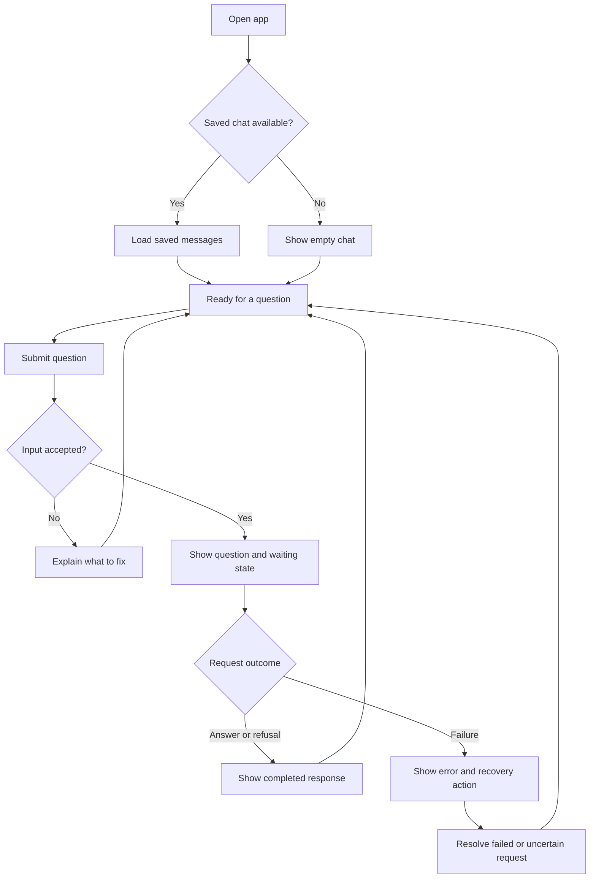

# Gusto NutriBite: UX Flows

Status: Phase 2 local flows implemented, 11 October 2026. Chromium keyboard/responsive checks passed; actual screen-reader review remains pending.

The owner requested a new visual direction on 11 October 2026, replacing the Wise styling and reducing the prominence of notices. The [local chat](../src/app/page.tsx) now centres the conversation and composer. Sources sits beside the conversation on desktop and below it on narrow screens. Answer limitations, retention and diagnostic details remain available through **About this chat**. It explicitly labels scripted mode, preserves one question per turn, restores through reads and exposes explicit retry/check-again actions. See [browser evidence](testing.md); automated checks are not a completed screen-reader or release browser-matrix review.

Based on [problemStatement.md](problemStatement.md) and [product-spec.md](product-spec.md). Follow the [README writing rules](../README.md#writing-rules).

This document covers user actions, visible states, and recovery. [Product positioning](product-positioning.md) owns brand voice. Use **Gusto NutriBite — Your personal AI nutrition companion** with clear, friendly, non-judgemental copy. The existing [Wise reference](design-references/wise/DESIGN.md) and [preview](design-references/wise/preview.html) remain preserved historical assets; the owner-authorized design below now guides presentation. API and architecture own server behavior.

## Visual direction and information hierarchy

The food-table illustration provides the distinctive entry moment; the active transcript stays quiet. The design uses self-hosted Outfit for rounded headings and readable body text, with Trebuchet MS/sans-serif fallbacks. Tokens live in [shared CSS](../src/app/globals.css): plum `#3b244d`, muted plum `#6e6078`, pale lilac `#f6f3fa`, lilac `#e6ddf3`, mint `#d7eee3` and apricot `#f6b66e`. White is the reading surface. No remote font request or animation dependency is needed; the font's OFL license is included in `public/fonts/`.

```text
Brand + tagline                         About this chat   New chat
+--------------------------------------------------+  | Sources
| Empty: invitation + plate and starter questions   |  | No sources available
| Active: questions, answers and recovery actions  |  | in this version.
| Question composer                          Send  |
| Small storage/provider and limitation footer    |
+--------------------------------------------------+
Narrow screens: Sources follows the conversation.
```

Copy and messages are left aligned; the wide-screen footer is centred. At narrow widths the starters form a swipeable card slider, the illustration shrinks (hidden below 360px) and the composer stays full width. On 13 October 2026 the owner restored the assignment's adjacent Sources panel. Keep it subtle: a 180px column, a light divider, muted readable text and one short empty-state message. Below 1100px, use a compact row directly after the conversation with a top divider, within the available screen height. Do not repeat the privacy paragraphs there. This is a chat interface, not a nutrition dashboard; there are no invented health metrics, source cards or history controls.

- Topic buttons change starter questions locally. Choosing a question fills and focuses the composer, without sending a request. Existing drafts disable starter selection so they cannot be overwritten.
- The plate enters once when the empty state mounts, then tilts up to eight degrees in response to mouse position and returns to rest on pointer exit. Topic changes reveal the new question group; starter cards lift on hover and compress on press. Choosing a starter briefly highlights the composer without sending. Opening the information panel has a short slide. Reduced-motion preference disables decorative transforms, transitions and the composer pulse. Touch users retain normal scrolling and get press/selection feedback; no pointer tracking runs for touch. The owner requested gentle ongoing motion on 13 October: the plate now drifts subtly, with slow mint/lilac background shapes outside the reading surface. Message arrivals have a short entrance, Send has press feedback and a three-dot indicator accompanies actual waiting. Decorative layers cannot intercept input or enlarge the page; animations pause in hidden tabs. Reduced-motion preference disables these effects. No simulated source search or extra model call is introduced.
- **About this chat** opens a native modal panel with answer limitations, data handling and enabled diagnostic details. Escape/Close dismiss it and return focus; the background is inert while open. The same control remains available on mobile and in error states.
- The storage/provider summary and source limitation remain small, readable text beside the composer. Enabled private diagnostics have a short indicator pointing to the information panel. No repeated full privacy paragraphs in the conversation.
- Completed answers supply the visible confirmation. “Response ready” and the duplicate saved-but-failed summary remain polite screen-reader announcements, without visible banners. Specific failure messages and recovery controls stay visible beside the affected request. Unknown/loading/waiting states remain visible.

The chat recovery, new-chat, limits, notice, and accessibility behavior is adopted in the [product specification](product-spec.md). Button labels and message examples below guide UI implementation; exact assistant templates remain in [prompt-spec.md](prompt-spec.md).

## Viewport and scrolling

Owner-approved layout, 13 October 2026: the app frame uses the available viewport height. Header, composer, Send and Sources stay visible during normal use; long history and expanded claims scroll within Messages. Remove fixed transcript minimum heights and extra wide-screen vertical padding. The welcome fits standard desktop and mobile sizes, retaining its illustration, topic controls and all three starters. On mobile, one spacious suggestion card is shown with a glimpse of the next, native horizontal swipe, previous/next controls and a position indicator. Topic changes return to the first card; navigation never fills or submits a question. Desktop retains the three-card row. Short mobile screens use a shorter introductory sentence; the composer omits desktop keyboard hints while keeping the question count.

The input grows from two to four lines and then scrolls internally. Enter/Shift+Enter and IME behavior remain unchanged. New replies follow the bottom only when the reader is already there. Essential notices, errors and recovery actions remain visible; detailed explanations stay in About this chat.

Use dynamic viewport height and the visual viewport during mobile keyboard changes. Below 500 CSS pixels of visible height, permit page scrolling with a bounded message area so enlarged/short-window content remains reachable. Keep the focused composer in view as its draft grows. Pinch zoom retains normal browser behavior. Dialogs scroll independently. Never hide overflow to conceal inaccessible controls.

[Viewport verification](testing.md#viewport-fitting-layout-verification) owns tested sizes, scenarios and browser/device limitations.

## Main flow



Saved-chat recovery and input limits implement accepted `CHAT-04` and `CHAT-06`. Load failures are covered in UX-07; the diagram shows the usual opening path.

## Screen areas

| Area | User sees or does |
| --- | --- |
| Product identity | Shows **Gusto NutriBite** and **Your personal AI nutrition companion** on the entry/chat screen. Verify responsive behavior. |
| Conversation | Reads messages in order, with user and assistant clearly identified. Request errors appear beside the affected question. |
| Question input | Types a question and uses **Send**. Input errors appear beside the field. |
| Sources | Always visible beside the conversation on desktop, or below it on narrow screens. Follow UX-05 for its content. |
| New chat | Starts a separate conversation under `CHAT-04`. |
| Answer notice | Explains the limitation in `ANS-06`. Text: "Answers may be inaccurate. This version does not check sources." |

## UX-01: Open the app

References: [Conversation](product-spec.md#conversation) (`CHAT-01`, `CHAT-04`), [Answers and sources](product-spec.md#answers-and-sources) (`ANS-05`, `ANS-06`).

1. Open the public app URL. These flows use the adopted anonymous scope without registration.
2. If the browser has an active conversation, show a loading state and follow UX-07. Otherwise, show an empty message list.
   When the tab reference is missing, first use the live session's `latest_conversation_id` to restore its most recent saved conversation. Create an empty conversation only when no saved one exists. A read failure stays an error with **Check again**, never a reason to silently create an empty chat.
3. Show the input, starter questions and **About this chat** control. The empty Sources panel remains visible in the main layout.
4. Enable submission when the conversation is ready.

Do not treat a failed history load as an empty conversation.

## UX-02: Ask a question

References: [Conversation](product-spec.md#conversation) (`CHAT-01`, `CHAT-05`–`CHAT-07`), [Answers and sources](product-spec.md#answers-and-sources) (`ANS-01`–`ANS-03`, `ANS-07`).

1. The user types and selects **Send**. With `CHAT-06`, empty or oversized input stays in the field with an explanation; no request is sent for generation.
2. Once submitted, show the question once and a waiting message: "Preparing an answer…" Disable **Send** and **New chat** while the request is active. Keep the question recoverable if it fails.
3. On success, replace the waiting message with the completed answer. Show readable answer text and an expandable **Claims (count)** list beneath it. Each entry displays the stored claim text and source value (`null` in M1). For an empty array, show “No factual claims were included in this response.” This renders the validated, committed object; it does not derive claims from the answer or generate new content.
4. Re-enable the controls for the next question. For a refusal, use UX-04; for an error, use UX-08.

Do not display partial generated text before response checks pass. Show success only after the app confirms completion, including required storage. The exact server sequence belongs in architecture.

## UX-03: Ask a follow-up

References: [Conversation](product-spec.md#conversation) (`CHAT-02`), [Safety](product-spec.md#safety) (`SAFE-01`–`SAFE-05`).

1. After a completed response, the user asks another question in the same chat.
2. Follow UX-02 while using the active conversation to understand references such as "What about freezing it?"
3. If the follow-up crosses a safety limit, use UX-04, including when the relevant earlier message was several turns ago.

A refusal does not end the conversation. The user can continue with a permitted question.

## UX-04: Receive a refusal

References: [Safety](product-spec.md#safety) (`SAFE-01`–`SAFE-04`).

1. The user submits a question covered by the safety rules.
2. Show the completed refusal as an assistant message, with the boundary and professional referral required by the product spec.
3. Return to the ready state. Keep the input available for a different question.

A refusal is a completed response, not a service error. Do not show **Retry** beside it. Exact refusal wording and mixed-request handling belong in `prompt-spec.md` and `safety-and-security.md`.

## UX-05: Look for sources

References: [Answers and sources](product-spec.md#answers-and-sources) (`ANS-02`, `ANS-05`, `ANS-06`), [Milestone 2](product-spec.md#deployment-and-milestone-2) (`NEXT-01`).

The Sources panel sits beside the conversation at widths of 1100px and above, and directly below it at narrower widths. It is always visible, with no entries in every Milestone 1 state: empty chat, waiting, answer, refusal, and error. Text: "No sources available in this version." It uses a small heading and muted text, with no card background, badge or additional action. This restores the assignment's adjacent layout; the source contract is unchanged.

Do not show a source-search animation or turn an authority mentioned in an answer into a citation link. Milestone 2 will populate this same panel; citation interactions will be specified then.

## UX-06: Start a new chat

References: [Conversation](product-spec.md#conversation) (`CHAT-04`).

1. When no request is active, the user selects **New chat**.
2. If the input contains an unsent draft, ask whether to discard it. **Keep editing** returns to the draft; **Discard and start** continues.
3. Once the new conversation is ready, show an empty message list and input. If creation fails, keep the current conversation and show an error.
4. New questions use the new conversation only.

Starting a new chat does not delete the old one. Access expires after seven days from session creation; automatic cleanup follows the [retention policy](safety-and-security.md#retention-schedule). There is no history browser or manual deletion control in M1; [FB-001](feature-backlog.md#backlog) records the deferred deletion idea.

## UX-07: Refresh or return

References: [Conversation](product-spec.md#conversation) (`CHAT-03`, `CHAT-04`, `CHAT-07`), [Backend and usability](product-spec.md#backend-and-usability) (`SYS-02`).

| Situation | Visible behavior and next step |
| --- | --- |
| Active session and saved messages | Show "Loading conversation…", then restore messages in order and enable the input. |
| Tab reference missing, corrupt or browser storage unavailable | Restore the same anonymous session's most recently updated non-empty saved conversation through session metadata and an authorized read. Do not automatically submit or retry. A missing/expired session cookie cannot recover another session's messages. |
| Refresh while an answer was pending | Check the existing request before allowing another attempt. Restore a completed response once, resume waiting if still active, or show its failure. Never resend automatically on page load. |
| Outcome cannot yet be confirmed | Explain that the previous request's status is unknown. Offer **Check again** to refresh its status, not generate another answer. |
| History service unavailable | Show "Couldn't load this conversation." Offer **Try loading again**. Keep any visible messages; do not present the failure as a new chat. |
| Session expired or chat unavailable to this visitor | Show "This conversation is unavailable. Start a new chat to continue." Do not expose another visitor's messages. |

Do not promise recovery of unsent text after a reload. Session access is seven days absolute. Follow the [API recovery sequence](api-contract.md#9-client-recovery-sequence) for pending requests; status checks never start generation.

An existing tab reference wins over the fallback, so an explicit **New chat** remains empty across refresh. An empty chat with older saved content offers **Resume last saved chat**, using reads only; it is disabled while a draft exists. This also recovers from empty chats created by the earlier startup behavior. It exposes one recovery action, not a history browser or manual deletion facility.

## UX-08: Recover from an error

References: [Conversation](product-spec.md#conversation) (`CHAT-05`–`CHAT-07`), [Answers and sources](product-spec.md#answers-and-sources) (`ANS-03`), [Backend and usability](product-spec.md#backend-and-usability) (`SYS-04`).

| Situation | Message example | Recovery |
| --- | --- | --- |
| Empty input | "Enter a question." | Keep focus in the input. |
| Input exceeds the chosen limit | "Shorten your question to [configured limit]." | Keep the text editable and show the actual limit and unit. |
| Conversation reaches its turn/context limit | "This chat has reached its limit. Start a new chat to continue." | Preserve history, reject the new question before generation, and offer New chat. Do not drop older context. |
| Connection lost or request timed out | "We couldn't confirm whether your answer completed." | Check the existing request first. If it completed, show it once; if it failed, offer **Retry**. Use **Check again** if still unknown. |
| Model service failed | "Couldn't complete the answer. Try again." | Offer **Retry** after failure is confirmed. |
| Answer failed response checks | "Couldn't complete the answer. Try again." | Hide invalid output and offer **Retry**. |
| Question or answer could not be saved | "Couldn't save this exchange. Your answer hasn't completed." | Keep the question visible. Confirm stored state before retrying; do not show an unsaved answer as successful. |
| A configured usage limit is reached | "Please wait before trying again." | Show a wait time only if the service provides one. Do not retry automatically. |

**Retry** reuses the failed question and conversation. Keep one visible question with its request status, rather than adding a duplicate. Disable retry while an attempt is active. An edited question is a new submission; only allow it after the previous request is resolved.

Architecture and the API contract must support these recovery outcomes without duplicate accepted turns. Error messages must not expose provider credentials, raw responses, or stack traces.

## Keyboard, mobile, and reading behavior

References: [Backend and usability](product-spec.md#backend-and-usability) (`SYS-03`).

- Let users reach the input and actions by keyboard, with visible focus. **Enter** sends; **Shift+Enter** adds a line. Do not send while a text-composition input is active.
- Announce loading, completion, and errors to screen readers. Do not move focus away while the user is typing or reading.
- Keep new messages in view when the user is already at the bottom. Do not force-scroll someone reading earlier messages.
- Keep Sources visible directly below the conversation on mobile. Record supported widths during UI verification.

## Implementation handoff

| Decision | Owning document |
| --- | --- |
| Implement accepted recovery, limits, source notice, and accessibility behavior | Product spec and this document |
| Materialize seven-day access, status lookup, and explicit retry | Architecture and API contract |
| Implement the adopted mixed, ambiguous, unrelated, urgent, and sensitive rules | Safety and security; prompt spec owns templates |
| Final copy, mobile placement, and accessibility | Positioning for voice; visual direction above for presentation; prompt specification for assistant wording |

Use the [efficiency guide](token-optimization-and-efficiency.md) when setting limits and retries. The inline claims disclosure exposes the response contract without adding an evaluation dashboard; evaluator procedures belong in `evaluation.md`. The owner requested visibility of the PRD's answer/claims/source structure on 13 October 2026. Collapsing the disclosure does not remove claims from the stored or API response.

Follow the [implementation plan](phase-wise-implementation-plan.md); no duplicate design-guide task is required. Record remaining presentation choices here or in testing/code as appropriate. Show a truthful storage/provider notice before collecting messages, without a manual-deletion promise.

## Phase 2 interaction evidence

Status recovery announces "Response ready" only when the submitted/retried turn is completed with a saved assistant message. A failed result announces that the question is saved but no answer is ready, with the specific safe failure shown beside the question. Historical failure codes remain unchanged.

For a known quota wait, use the existing concise failure/status message; do not show a separate seconds-countdown banner. Disable Send/Retry while keeping the draft editable. Expiry enables an explicit action; it never sends automatically. A pre-acceptance rejection preserves the pending operation ID for an unchanged request and consumes no turn/attempt. A stored quota failure retains its retry timestamp across refresh. History/status checks remain available during the wait. See the [API retry-time contract](api-contract.md#8-errors-and-recovery-instructions).

The earlier Wise-based layout passed Chromium checks at 320, 390, 768 and 1280px, including wrapped input and refusal text. Those historical results remain in testing; the owner-authorized redesign uses the same widths. The 13 October follow-up restores Sources to the main layout. Original reference assets are preserved.

Enter sends, Shift+Enter inserts a line, and active IME composition never submits. A native modal supplies Keep editing / Discard and start with focus containment. New-chat failure preserves the current conversation and draft while the creation receipt is recovered. Message scrolling follows the latest exchange only when already near the bottom; a separate live status region avoids announcing the whole transcript on every poll. The visible data notice identifies local storage and Groq transmission before input, with details of seven-day access, background cleanup, shared-browser access and provider retention.

Automated keyboard/ARIA checks and visual inspection do not establish actual assistive-technology behaviour. A human screen-reader pass remains required before marking Phase 2 fully complete. The broader release browser matrix remains Phase 3.
