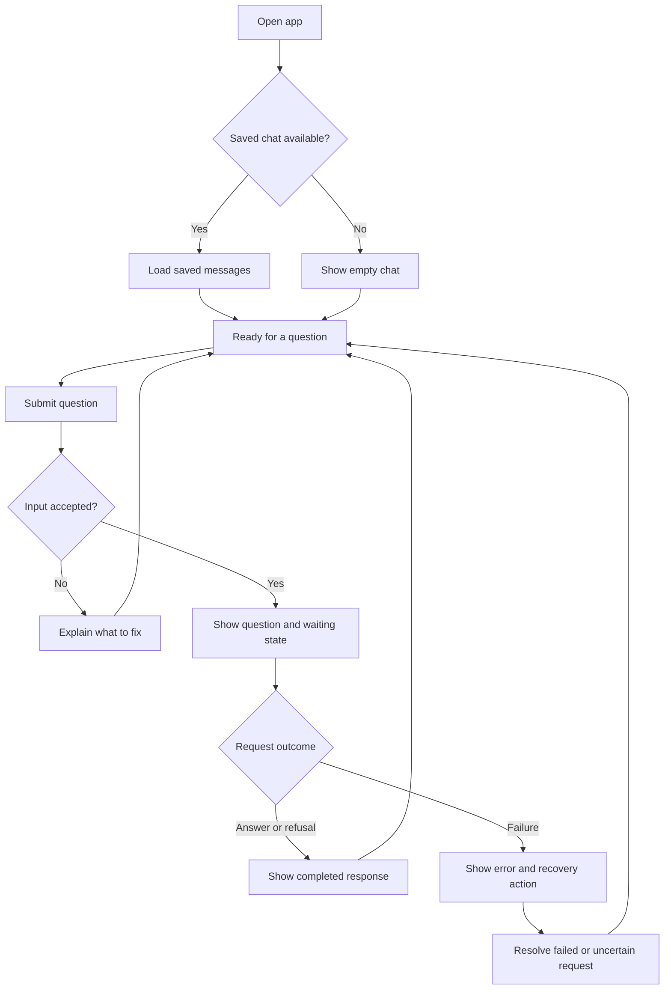

# Gusto NutriBite: UX Flows

Status: Phase 1 minimal local flow implemented, 11 October 2026; complete M1 design and accessibility acceptance remain Phase 2 work.

The [local chat](../src/app/page.tsx) uses the existing Wise palette, rounded white surfaces, and system-font fallback through [shared tokens](../src/app/globals.css) and [CSS Modules](../src/app/chat.module.css). It explicitly labels scripted mode, preserves one question per turn, restores through reads, exposes explicit retry/check-again actions, and keeps Sources empty. The initial desktop layout is two columns; it stacks below 700px. See [browser evidence](testing.md#phase-1-implementation-evidence); this is not a claim of completed screen-reader or release browser-matrix review.

Based on [problemStatement.md](problemStatement.md) and [product-spec.md](product-spec.md). Follow the [README writing rules](../README.md#writing-rules).

This document covers user actions, visible states, and recovery. [Product positioning](product-positioning.md) owns brand voice. Use **Gusto NutriBite — Your personal AI nutrition companion** with clear, friendly, non-judgemental copy. The existing [Wise reference](design-references/wise/DESIGN.md) and [preview](design-references/wise/preview.html) guide layout/styling; API and architecture own server behavior.

The chat recovery, new-chat, limits, notice, and accessibility behavior is adopted in the [product specification](product-spec.md). Button labels and message examples below guide UI implementation; exact assistant templates remain in [prompt-spec.md](prompt-spec.md).

## Main flow

Saved-chat recovery and input limits implement accepted `CHAT-04` and `CHAT-06`. Load failures are covered in UX-07; the diagram shows the usual opening path.

## Screen areas

| Area | User sees or does |
| --- | --- |
| Product identity | Shows **Gusto NutriBite** and **Your personal AI nutrition companion** on the entry/chat screen. Adapt placement from the existing reference/preview and verify responsive behavior. |
| Conversation | Reads messages in order, with user and assistant clearly identified. Request errors appear beside the affected question. |
| Question input | Types a question and uses **Send**. Input errors appear beside the field. |
| Sources | Sees the panel throughout the conversation. Follow UX-05 for its content. |
| New chat | Starts a separate conversation under `CHAT-04`. |
| Answer notice | Explains the limitation in `ANS-06`. Text: "Answers may be inaccurate. This version does not check sources." |

## UX-01: Open the app

References: [Conversation](product-spec.md#conversation) (`CHAT-01`, `CHAT-04`), [Answers and sources](product-spec.md#answers-and-sources) (`ANS-05`, `ANS-06`).

1. Open the public app URL. These flows use the adopted anonymous scope without registration.
2. If the browser has an active conversation, show a loading state and follow UX-07. Otherwise, show an empty message list.
3. Show the input and sources panel. Suggested empty-chat text: "Ask a question about food, nutrition, or food safety."
4. Enable submission when the conversation is ready.

Do not treat a failed history load as an empty conversation.

## UX-02: Ask a question

References: [Conversation](product-spec.md#conversation) (`CHAT-01`, `CHAT-05`–`CHAT-07`), [Answers and sources](product-spec.md#answers-and-sources) (`ANS-01`–`ANS-03`, `ANS-07`).

1. The user types and selects **Send**. With `CHAT-06`, empty or oversized input stays in the field with an explanation; no request is sent for generation.
2. Once submitted, show the question once and a waiting message: "Preparing an answer…" Disable **Send** and **New chat** while the request is active. Keep the question recoverable if it fails.
3. On success, replace the waiting message with the completed answer. Show readable answer text, not raw response data.
4. Re-enable the controls for the next question. For a refusal, use UX-04; for an error, use UX-08.

Do not display partial generated text before response checks pass. Show success only after the app confirms completion, including required storage. The exact server sequence belongs in architecture.

## UX-03: Ask a follow-up

References: [Conversation](product-spec.md#conversation) (`CHAT-02`), [Safety](product-spec.md#safety) (`SAFE-01`–`SAFE-05`).

1. After a completed response, the user asks another question in the same chat.
2. Follow UX-02 while using the active conversation to understand references such as "What about freezing it?"
3. If the follow-up crosses a safety limit, use UX-04, including when the relevant earlier message was several turns ago.

A refusal does not end the conversation. The user can continue with a permitted question.

## UX-04: Receive a refusal

References: [Safety](product-spec.md#safety) (`SAFE-01`–`SAFE-04`).

1. The user submits a question covered by the safety rules.
2. Show the completed refusal as an assistant message, with the boundary and professional referral required by the product spec.
3. Return to the ready state. Keep the input available for a different question.

A refusal is a completed response, not a service error. Do not show **Retry** beside it. Exact refusal wording and mixed-request handling belong in `prompt-spec.md` and `safety-and-security.md`.

## UX-05: Look for sources

References: [Answers and sources](product-spec.md#answers-and-sources) (`ANS-02`, `ANS-05`, `ANS-06`), [Milestone 2](product-spec.md#deployment-and-milestone-2) (`NEXT-01`).

The sources panel has no entries in every Milestone 1 state: empty chat, waiting, answer, refusal, and error. Suggested text: "No sources available in this version."

Do not show a source-search animation or turn an authority mentioned in an answer into a citation link. Milestone 2 will populate this same panel; citation interactions will be specified then.

## UX-06: Start a new chat

References: [Conversation](product-spec.md#conversation) (`CHAT-04`).

1. When no request is active, the user selects **New chat**.
2. If the input contains an unsent draft, ask whether to discard it. **Keep editing** returns to the draft; **Discard and start** continues.
3. Once the new conversation is ready, show an empty message list and input. If creation fails, keep the current conversation and show an error.
4. New questions use the new conversation only.

Starting a new chat does not delete the old one. Access expires after seven days from session creation; automatic cleanup follows the [retention policy](safety-and-security.md#retention-schedule). There is no history browser or manual deletion control in M1; [FB-001](feature-backlog.md#backlog) records the deferred deletion idea.

## UX-07: Refresh or return

References: [Conversation](product-spec.md#conversation) (`CHAT-03`, `CHAT-04`, `CHAT-07`), [Backend and usability](product-spec.md#backend-and-usability) (`SYS-02`).

| Situation | Visible behavior and next step |
| --- | --- |
| Active session and saved messages | Show "Loading conversation…", then restore messages in order and enable the input. |
| Refresh while an answer was pending | Check the existing request before allowing another attempt. Restore a completed response once, resume waiting if still active, or show its failure. Never resend automatically on page load. |
| Outcome cannot yet be confirmed | Explain that the previous request's status is unknown. Offer **Check again** to refresh its status, not generate another answer. |
| History service unavailable | Show "Couldn't load this conversation." Offer **Try loading again**. Keep any visible messages; do not present the failure as a new chat. |
| Session expired or chat unavailable to this visitor | Show "This conversation is unavailable. Start a new chat to continue." Do not expose another visitor's messages. |

Do not promise recovery of unsent text after a reload. Session access is seven days absolute. Follow the [API recovery sequence](api-contract.md#9-client-recovery-sequence) for pending requests; status checks never start generation.

## UX-08: Recover from an error

References: [Conversation](product-spec.md#conversation) (`CHAT-05`–`CHAT-07`), [Answers and sources](product-spec.md#answers-and-sources) (`ANS-03`), [Backend and usability](product-spec.md#backend-and-usability) (`SYS-04`).

| Situation | Message example | Recovery |
| --- | --- | --- |
| Empty input | "Enter a question." | Keep focus in the input. |
| Input exceeds the chosen limit | "Shorten your question to [configured limit]." | Keep the text editable and show the actual limit and unit. |
| Conversation reaches its turn/context limit | "This chat has reached its limit. Start a new chat to continue." | Preserve history, reject the new question before generation, and offer New chat. Do not drop older context. |
| Connection lost or request timed out | "We couldn't confirm whether your answer completed." | Check the existing request first. If it completed, show it once; if it failed, offer **Retry**. Use **Check again** if still unknown. |
| Model service failed | "Couldn't complete the answer. Try again." | Offer **Retry** after failure is confirmed. |
| Answer failed response checks | "Couldn't complete the answer. Try again." | Hide invalid output and offer **Retry**. |
| Question or answer could not be saved | "Couldn't save this exchange. Your answer hasn't completed." | Keep the question visible. Confirm stored state before retrying; do not show an unsaved answer as successful. |
| A configured usage limit is reached | "Please wait before trying again." | Show a wait time only if the service provides one. Do not retry automatically. |

**Retry** reuses the failed question and conversation. Keep one visible question with its request status, rather than adding a duplicate. Disable retry while an attempt is active. An edited question is a new submission; only allow it after the previous request is resolved.

Architecture and the API contract must support these recovery outcomes without duplicate accepted turns. Error messages must not expose provider credentials, raw responses, or stack traces.

## Keyboard, mobile, and reading behavior

References: [Backend and usability](product-spec.md#backend-and-usability) (`SYS-03`).

- Let users reach the input and actions by keyboard, with visible focus. **Enter** sends; **Shift+Enter** adds a line. Do not send while a text-composition input is active.
- Announce loading, completion, and errors to screen readers. Do not move focus away while the user is typing or reading.
- Keep new messages in view when the user is already at the bottom. Do not force-scroll someone reading earlier messages.
- Keep sources reachable on mobile. Adapt the reference layout and record final placement/supported widths during UI implementation.

## Implementation handoff

| Decision | Owning document |
| --- | --- |
| Implement accepted recovery, limits, source notice, and accessibility behavior | Product spec and this document |
| Materialize seven-day access, status lookup, and explicit retry | Architecture and API contract |
| Implement the adopted mixed, ambiguous, unrelated, urgent, and sensitive rules | Safety and security; prompt spec owns templates |
| Final copy, mobile placement, and accessibility | Positioning for voice; existing design references plus implementation choices for presentation; prompt specification for assistant wording |

Use the [efficiency guide](token-optimization-and-efficiency.md) when setting limits and retries. These flows add no evaluation dashboard or claims-inspection screen; evaluator procedures belong in `evaluation.md`.

Follow the [implementation plan](phase-wise-implementation-plan.md) and existing design references; no duplicate design-guide task is required. Record remaining presentation choices here or in testing/code as appropriate. Show a truthful storage/provider notice before collecting messages, without a manual-deletion promise.
